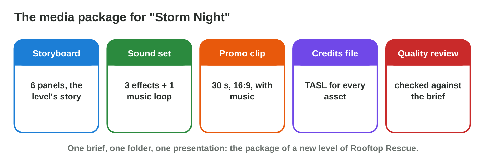
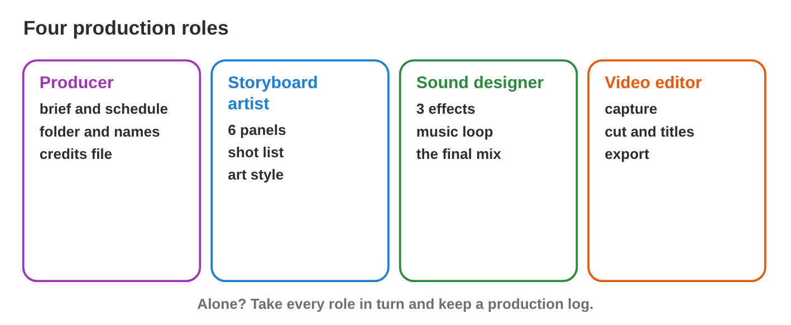
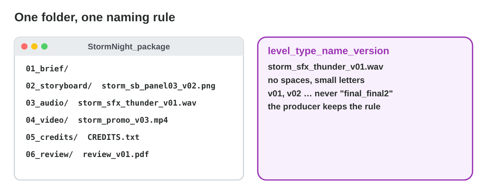

This page is the interactive version of the lesson notes (PDF). Each section
has a short summary, a picture, a **Do it** task and one set of questions.
The full explanations, examples and the team activity with its individual
alternative are in the notes.

## Key terms



## 27.1 The brief and the package

- A **production brief:** what, for whom, format and length, deadline.
- The package: **storyboard** (6 panels), **sound set** (3 effects + loop),
  **promo** (30 s, 16:9), **credits file**, **quality review**.

{width=94%}

::: {.callout-warning title="Watch out!"}
Read the brief before you produce anything.
:::

::: {.callout-note title="Do it · Read the brief"}
Write the brief of your package in five lines: what, for whom, mood,
formats, deadline.
:::

::: {.callout-tip title="Try it 1 · The brief"}
Choose the part of the package.

::: {.match extra="a game engine|a printer"}
6 panels with a shot list
:   the storyboard

3 effects and a music loop
:   the sound set

30 s, 16:9, with music
:   the promo clip

TASL for every asset
:   the credits file
:::
:::

## 27.2 Roles, schedule and handoffs

- **Producer**, **storyboard artist**, **sound designer**, **video
  editor**.
- A **schedule** in slots; a **handoff** passes finished work on.
- Storyboard before capture; music before cut; credits before export.

{width=94%}

{width=94%}



::: {.callout-warning title="Watch out!"}
Tasks that need another task's result wait for the handoff.
:::

::: {.callout-note title="Do it · Plan the sessions"}
Remove all conflicts in **Production Planner**; write your own schedule.
:::

::: {.callout-tip title="Try it 2 · Handoffs"}
Use Production Planner. Choose what must come first.

::: {.match extra="the quality review|nothing"}
before the gameplay capture
:   the storyboard and shot list

before the cut
:   the capture and the music loop

before the export
:   the credits file

after everything
:   the quality review
:::
:::

## 27.3 Files, names and the production log

- One folder with numbered subfolders.
- **Naming convention:** `level_type_name_version`, no spaces.
- **One owner per file;** a dated **production log**.

{width=94%}

::: {.callout-warning title="Watch out!"}
Nothing only on one laptop: everything in the shared folder.
:::

::: {.callout-note title="Do it · Folder and log"}
Create the folder structure; write three lines of your production log.
:::

::: {.callout-tip title="Try it 3 · Files"}
Choose the right answer.

::: {.match extra="final_final2.wav|Storm Thunder NEW.wav"}
a good name for version 2 of a rain sound
:   storm_sfx_rain_v02.wav

who saves the promo edit
:   the video editor only

what a log line has
:   date, who, what, decision

where every asset belongs
:   in the shared folder
:::
:::

## 27.4 Checking the package against the brief

- For each item: **brief value**, **measured value**, **pass/fail**.
- Fix the fails; check again.



::: {.callout-warning title="Watch out!"}
Length, shape and peaks are numbers: measure them.
:::

::: {.callout-note title="Do it · Check version 1"}
Mark and fix version 1 in **Package Checker**; write the check table of
your package.
:::

::: {.callout-tip title="Try it 4 · Version 1"}
Use Package Checker. Choose the fix.

::: {.match extra="make it louder|add more shots"}
41 s instead of 30 s
:   cut the slow intro shot

9:16 instead of 16:9
:   export with the 16:9 preset

a peak at 0 dB
:   lower the master and export again

two sounds missing in the credits
:   add their TASL lines
:::
:::

## Game challenge: Workshop Day {.challenge}

Work alone. Use every section of today.

Six problems: a **late storyboard**, files called **"final"**, **two
editors** in one project, a **clicking loop**, a promo in **9:16**, and a
student **alone**.



::: {.callout-tip title="Try it 5 · The problems"}
Choose what to do.

::: {.match extra="skip the storyboard|delete all files"}
the storyboard is late for the capture
:   finish the storyboard and shot list first

"final.wav" and "final2.wav"
:   use the naming rule with versions

the loop clicks
:   cut at a loop point with tiny fades

a student works alone
:   take each role in turn, keep a log
:::
:::

## Summary {.summary}

- One brief, one media package: storyboard, sound set, promo, credits,
  review.
- Roles and a schedule with handoffs.
- One folder, one naming rule, one owner per file, a production log.
- Check every item against the brief before you present.
