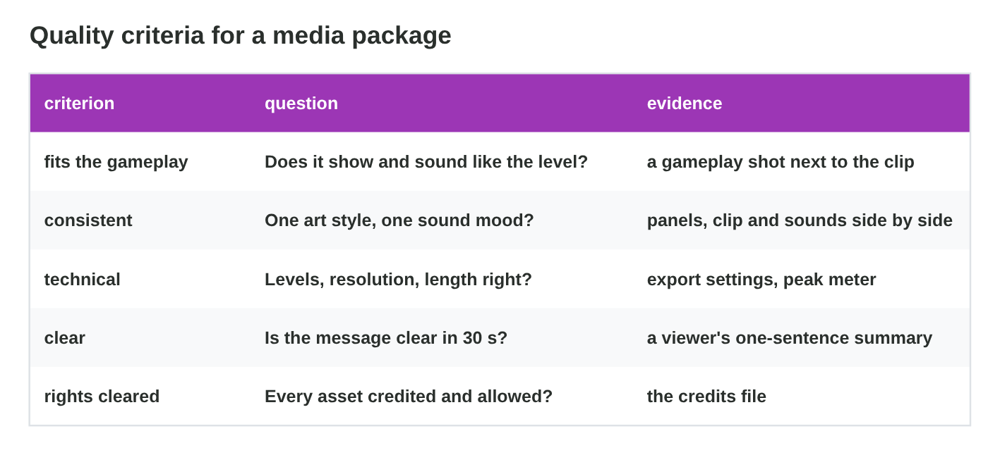
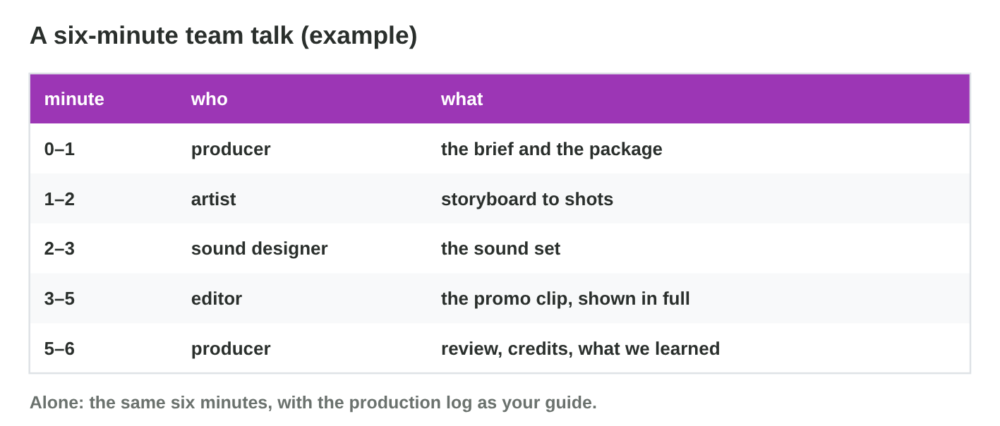
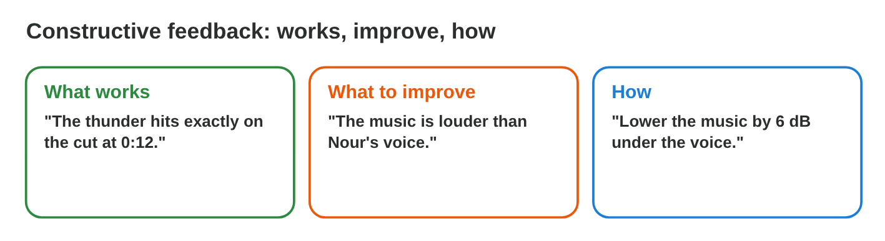
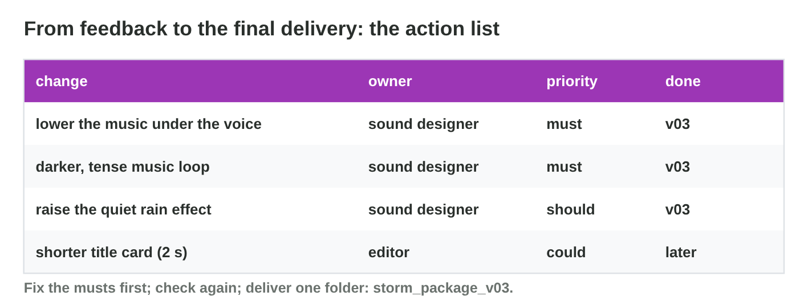

This page is the interactive version of the lesson notes (PDF). Each section
is one step of the seminar. It ends with a **Do it** task and one set of
questions. The full explanations, examples and the team activity with its
individual alternative are in the notes.

## Key terms



## 28.1 Step 1: review with quality criteria

- Five **criteria:** fits the gameplay, consistent, technical, clear,
  rights cleared.
- Each one needs **evidence**; score 1 (weak) to 4 (excellent), up to 20.

{width=94%}



::: {.callout-warning title="Watch out!"}
Score the evidence, not the effort.
:::

::: {.callout-note title="Do it · Review your package"}
Score Team Blue in **Package Review**; then score your own package with
one piece of evidence per criterion.
:::

::: {.callout-tip title="Try it 1 · Criteria"}
Use Package Review. Choose the criterion.

::: {.match extra="the brief|the deadline"}
the music mood does not match the panels
:   consistent

peaks at −1.5 dB, 1920 × 1080
:   technical

a viewer's one-sentence summary
:   clear

the credits file with TASL
:   rights cleared
:::
:::

## 28.2 Step 2: plan a six-minute talk

- Brief first, parts in the order of the handoffs, review last.
- In a team, each member presents their own role.
- The promo clip is **shown in full**: at least 1 min.

{width=94%}



::: {.callout-warning title="Watch out!"}
Don't rush the clip at the end: the package is the star.
:::

::: {.callout-note title="Do it · Plan your talk"}
Make a six-minute plan in **Package Talk Planner**, for a team and alone;
write your own plan: minute, who, what.
:::

::: {.callout-tip title="Try it 2 · The talk"}
Use Package Talk Planner. Choose the answer.

::: {.match extra="10 minutes|the last 10 seconds"}
the total time of the talk
:   6 minutes

the least time for the promo clip
:   1 minute

who presents the sound set in a team
:   the sound designer

what guides a student who presents alone
:   the production log
:::
:::

## 28.3 Step 3: present and give feedback

- **Constructive feedback:** what works, what to improve, how.
- About the package, not the person; with a place and a fix.

{width=94%}

::: {.callout-warning title="Watch out!"}
"Nice!" and "Too long." give the team nothing to do.
:::

::: {.callout-note title="Do it · Write feedback"}
Write one piece of three-part feedback for every other team.
:::

::: {.callout-tip title="Try it 3 · Feedback"}
Choose the part of constructive feedback.

::: {.match extra="I don't like it.|Why didn't you read the brief?"}
"The thunder hits exactly on the cut at 0:12."
:   what works

"The music is louder than Nour's voice line."
:   what to improve

"Lower the music by 6 dB under the voice."
:   how
:::
:::

## 28.4 Step 4: act on feedback and deliver

- An **action list:** change, owner, priority (must, should, could).
- Fix the musts, check again, deliver one **final folder**.

{width=94%}

::: {.callout-warning title="Watch out!"}
Don't try to fix everything: musts first, then deliver on time.
:::

::: {.callout-note title="Do it · Your action list"}
Write your action list, fix the musts and deliver the final folder.
:::

::: {.callout-tip title="Try it 4 · Priorities"}
Choose the priority.

::: {.match extra="never|skip"}
a font without a licence
:   must

the quiet rain effect
:   should

a shorter title card
:   could
:::
:::

## Game challenge: Feedback Desk {.challenge}

Work alone. Use every section of today.

Six situations: **music over a voice**, **matching panels**, a clip that is
**too long**, a **font without a licence**, "**was it good?**", and a
student who worked **alone**.



::: {.callout-tip title="Try it 5 · Feedback Desk"}
Choose the most constructive feedback.

::: {.match extra="Too long.|Nice."}
the clip is 45 s; the brief says 30 s
:   Cut the 15 s intro and start on the lightning shot.

the panels match the clip
:   Panels 2–5 match the shots exactly.

the font has no licence
:   Add the font's licence file and its TASL line.
:::
:::

## Summary {.summary}

- Review the package with five criteria and evidence.
- Plan six minutes; show the promo clip in full.
- Constructive feedback: what works, what to improve, how.
- An action list with priorities leads to the final delivery.
