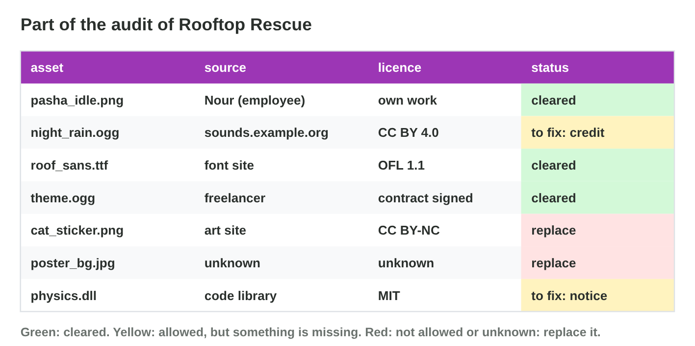

::: {.lead}
In Lecture 13 you learned where assets come from, how to read and save a
licence, how to write TASL credits, and how to check every asset before the
release. Today you run the licence audit of one game. There are no new
ideas: two short problems. Do each one alone. The results of the
activities are at the end of this worksheet. This worksheet explains the
basics; it is not legal advice.
:::

## Recall

- Every asset needs a **proof**: the saved licence page, the receipt, or
  the signed contract.
- A **TASL** credit names the **t**itle, the **a**uthor, the **s**ource and
  the **l**icence, in the credits screen and the credits file.
- The rights check gives each asset a status: **cleared**, **to fix** or
  **replace**.

::: {.callout-tip title="Try it 1 · Recall"}
Choose the right answer.

::: {.match extra="a screenshot of a search|the file size"}
What do the letters TASL stand for?
:   title, author, source, licence

A sound has an unknown source. Which status does it get?
:   replace

Which proof do you keep for music by a freelancer?
:   the signed contract
:::
:::

## Activity 1 · Audit the assets

Before the release of *Rooftop Rescue*, Salma runs a **licence audit**:
one row for each asset, with its source, its exact licence and its proof,
and then a status. **Cleared:** allowed and credited. **To fix:** allowed,
but a credit or a contract is missing. **Replace:** not allowed, or
unknown.

{width=94%}



::: {.callout-note title="Activity 1 · Eight assets · 18 min"}
1. In **Audit Board**, give each of the eight assets a status and press
   check.
2. For each asset that is not cleared, write its fix.

*Your product:* eight statuses and four fixes.

::: {.check}
Cleared: pasha_idle.png (work for hire), roof_sans.ttf (OFL, credit
written), theme.ogg (contract signed), roof_tiles.png (CC BY-SA, credit
written). To fix: night_rain.ogg and thunder.ogg (CC BY, write the TASL
credits). Replace: cat_sticker.png (CC BY-NC in a game for sale) and
poster_bg.jpg (source unknown).
:::
:::

::: {.callout-tip title="Try it 2 · Statuses"}
Use Audit Board. Choose the status.

::: {.match extra="ignore it|delete the game"}
A CC BY sound with no credit line yet.
:   to fix

A CC BY-NC sticker in a game for sale.
:   replace

A font under the OFL, with its credit written.
:   cleared

Recoloured CC BY-SA tiles, with the credit written.
:   cleared
:::
:::

## Activity 2 · Fix, credit and report

Every finding gets its fix: write the credit, sign the contract, or
replace the asset (and check the new asset too). Then Salma updates the
**credits file** and writes a short **audit report**: the date, how many
assets are cleared, fixed and replaced, and what is still open.

{width=94%}



::: {.callout-note title="Activity 2 · Fixes and a report · 15 min"}
1. In **Audit Fixes**, choose the fix for each of the six findings.
2. Write the TASL credit for night_rain.ogg: "Night Rain" by Lina Haddad,
   sounds.example.org, CC BY 4.0.
3. Write a three-line audit report for Activity 1.

*Your product:* your score, one credit and a report of three lines.

::: {.check}
Audit Fixes: write the TASL credit; replace the sticker or buy a
commercial licence; replace the poster; find the licence page again and
save it; sign a written contract; audit the new assets of the update too.
The credit: "Night Rain" by Lina Haddad, sounds.example.org/night-rain,
CC BY 4.0. A good report: "Audit of Rooftop Rescue, 2 December. 4 cleared,
2 fixed (two credits), 2 replaced (the sticker, the poster). Open: none;
the new assets of the update will be audited too."
:::
:::

::: {.callout-tip title="Try it 3 · Fixes"}
Choose the right answer.

::: {.match extra="never|make it smaller"}
When do you repeat the audit?
:   after every update with new assets

What does a red row (replace) need?
:   a new asset, checked again

Nobody saved the licence page of a library image. What do you do?
:   find the page again and save it

Where do the credits go?
:   the credits file and the credits screen
:::
:::

## Exercises

1. Name the three statuses of an audit and what each means.
2. Why do you audit the store page and the trailer too?
3. Write a TASL credit for "Old Roofs" by Sara Nader, photos.example.org/old-roofs, CC BY 4.0.
4. What does an audit report say?

## Answers to the exercises

::: {.answers}
1. Cleared: allowed and credited. To fix: allowed, but a credit or contract is missing. Replace: not allowed, or unknown.
2. They are public, and they use assets too.
3. "Old Roofs" by Sara Nader, photos.example.org/old-roofs, CC BY 4.0.
4. The date, the numbers cleared, fixed and replaced, and what is still open.
:::
