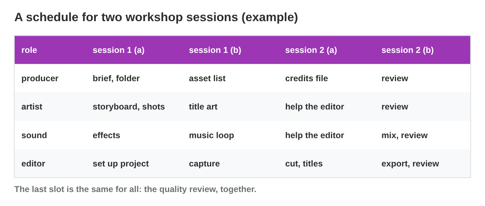

::: {.lead}
Night Owl Games plans a new level for *Rooftop Rescue*: "Storm Night". In
this level, Nour and Pasha the cat cross the roofs in a thunderstorm.
Salma, the producer, needs a **media package** in two workshop sessions: a
storyboard, a sound set, a 30-second promo clip and a credits file. In
this course you learned each part alone: storyboards (Lectures 5–6), sound
and music (Lectures 7–9), video (Lectures 10–11) and intellectual property
(Lectures 12–13). In this workshop you make **all of them for one brief**,
in a small production team or alone, role by role. Every section ends with
a short task, and the team activity describes the whole workshop.
:::

## Key terms



## 14.1 The brief and the package

Four people want to start at once. But what exactly must they make, and
for when? A production starts with a **brief** that everyone can check
(@fig-package).

::: {.callout-important title="Definition 14.1 — Production brief and media package"}
A **production brief** says what to make, for whom, in which format and
length, and by when. The **media package** of this workshop has five
parts:

- a **storyboard** of 6 panels with a shot list (C1);
- a **sound set**: 3 sound effects and 1 seamless music loop (C2);
- a **promo clip** of 30 s, 16:9, 1920 × 1080, with music (C3);
- a **credits file** with a TASL line for every asset that is not your
  own (D1);
- a **quality review** of the package (B2).
:::

{#fig-package width=94%}

::: {.callout-note title="Example 14.1 — Salma's brief"}
1. *For whom:* players of *Rooftop Rescue* on phones and PCs.
2. *Mood:* a dark blue night with rain and lightning. The music is tense,
   but not scary.
3. *Formats:* panels as PNG; sounds as 48 kHz WAV; the promo as MP4 16:9,
   with peaks at −1 dB or lower.
4. *Deadline:* the end of the second session. The teams present the
   package in Seminar 14.
:::

::: {.callout-warning title="Common mistake"}
Starting to produce before everyone reads the brief. Ten minutes on the
brief save an hour of work in the wrong format.
:::

::: {.callout-note title="Do it · Write the brief"}
Write the brief of your own package in five lines: what, for whom, mood,
formats, deadline. Use "Storm Night" or a level of your own game idea.

*Your result:* a five-line brief.

::: {.check}
A good brief looks like: "What: a storyboard, a sound set, a 30 s promo
and a credits file for Storm Night. For whom: players on phones and PCs.
Mood: dark, rainy, tense. Formats: PNG panels, 48 kHz WAV sounds, an MP4
promo in 16:9 with peaks at −1 dB or lower. Deadline: the end of session
2." Check: five lines; every format is a file type or a number; the
deadline is a time, not "soon".
:::
:::

## 14.2 Roles, schedule and handoffs

The editor wants to capture gameplay, but nobody knows which shots the
promo needs. A small team splits the work into **roles** and plans the
**handoffs** (@fig-roles, @fig-pipeline).

::: {.callout-important title="Definition 14.2 — Roles, schedule and handoffs"}
- **Producer:** the brief, the schedule, the folder, the names, the
  credits file.
- **Storyboard artist:** the panels, the shot list, the art style.
- **Sound designer:** the effects, the music loop, the final mix.
- **Video editor:** the capture, the cut, the titles, the export.

A **production schedule** puts the tasks in order, so that each task gets
its input in time. A **handoff** is the moment when finished work passes
to the next role. For example, the artist gives the shot list to the
editor before the capture.
:::

{#fig-roles width=94%}

{#fig-pipeline width=94%}

{#fig-schedule width=94%}

::: {.callout-note title="Example 14.2 — A late shot list"}
1. The editor wants to capture gameplay in the first half of session 1.
   But the storyboard is not finished.
2. Salma moves the capture to the second half. The editor sets up the
   project first.
3. The music loop must be ready before the cut, and the credits before the
   export (@fig-schedule).
:::



::: {.callout-warning title="Common mistake"}
Everyone starts "their" task at the same time. A task that needs another
task's result must wait for the handoff, or the work is done twice.
:::

::: {.callout-note title="Do it · Plan the sessions"}
1. In **Production Planner**, move the tasks until there are no conflicts.
2. Write your own schedule for the package: role, task, slot.

*Your result:* a schedule without conflicts.

::: {.check}
A plan without conflicts: 1a the storyboard and shot list, the sound
effects and the music loop; 1b the capture and the credits file; 2a the
cut and titles; 2b the mix and export, then the quality review. Check your
own schedule: every task has a role and a slot, and every task comes after
the tasks it needs.
:::
:::

## 14.3 Files, names and the production log

Is the newest music loop "final.wav" or "final2.wav"? A shared folder only
works with clear rules (@fig-naming).

::: {.callout-important title="Definition 14.3 — Working with files"}
- One shared **folder** with numbered subfolders: brief, storyboard, audio,
  video, credits, review.
- A **naming convention**: `level_type_name_version`, for example
  `storm_sfx_thunder_v02.wav`. No spaces; version numbers, never
  "final_final2".
- **One owner per file:** the editor owns the edit; the others send notes.
- A **production log**: the date, who, what was made, which decision,
  which problem was solved.
:::

{#fig-naming width=94%}

::: {.callout-note title="Example 14.3 — The lost changes"}
1. The sound designer and the editor both open the promo project and save
   their changes. The editor's cut is lost.
2. New rule: only the editor saves the edit. The sound designer exports
   `storm_music_loop_v03.wav` into `03_audio`.
3. The log says: "12:40, Yara, music loop v03, shortened to 8 bars; Tariq
   imports v03."
:::

::: {.callout-warning title="Common mistake"}
Keeping assets only on one person's laptop. If that person is absent, the
package is missing. Everything goes into the shared folder.
:::

::: {.callout-note title="Do it · Folder and log"}
Create the folder structure of @fig-naming on your computer or in the
cloud. Write the first three lines of your production log.

*Your result:* a folder and three log lines.

::: {.check}
A good folder has six numbered subfolders: 01_brief, 02_storyboard,
03_audio, 04_video, 05_credits, 06_review. A good log line has a time, a
name, a file with its version, and one decision, for example "10:15, Sara,
panels 1–6 v01, the lightning shot moves to panel 2."
:::
:::

## 14.4 The quality review: the brief and five criteria

Before the presentation, Salma asks two questions. Does the package meet
the brief? And does it work for the players? The **quality review**
answers both (@fig-criteria).

::: {.callout-important title="Definition 14.4 — Quality review"}
A quality review has two steps.

1. **The brief:** for each item, write the brief value and the measured
   value: the panel count, the clip length and shape, the loudest peak,
   the loop, the credits. Mark each item **pass** or **fail**.
2. **The quality:** score five **quality criteria** from 1 (weak) to 4
   (excellent). Each score needs **evidence**: something you can see, hear
   or measure.
   - **Fits the gameplay:** does it show and sound like the level?
   - **Consistent:** one art style and one sound mood?
   - **Technical:** are the levels, the size and the length right?
   - **Clear:** can a viewer say the message in one sentence?
   - **Rights cleared:** is every asset credited and allowed?

Fix the fails first: the owner of each file makes its fix. Then check
again.
:::

{#fig-criteria width=94%}

::: {.callout-note title="Example 14.4 — Version 1 of the package"}
1. The promo is 41 s (brief: 30 s) and 9:16 (brief: 16:9): fail, fail.
2. The loudest peak is 0 dB, so the sound clips: fail. Two sounds are
   missing in the credits: fail.
3. Fixes: the editor cuts the slow intro shot and exports with the 16:9
   preset; the sound designer lowers the master; the producer adds two
   TASL lines. Version 2 passes.
:::



::: {.callout-warning title="Common mistake"}
Watching the package once and saying "it looks fine". The length, the
shape and the peaks are numbers: measure them. And score the evidence, not
the effort: "we worked all night" is not evidence.
:::

::: {.callout-note title="Do it · Check version 1"}
1. In **Package Checker**, mark the six rows and fix version 1.
2. Score your own package (or Storm Night as you imagine it) on the five
   criteria, with one piece of evidence for each score.

*Your result:* a check table and five scores with evidence.

::: {.check}
Package Checker: the storyboard and the music loop pass; the promo length
(41 s), the shape (9:16), the peak (0 dB) and the credits (two sounds
missing) fail. Fixes: cut the slow intro shot; export with the 16:9
preset; lower the master and export again; add the two TASL lines. Your
scores are five numbers from 1 to 4, each with evidence, for example
"technical 3: peaks at −1.5 dB, but one rain sound is too quiet".
:::
:::

## Team activity: the Storm Night package

::: {.callout-note title="Team activity · The Storm Night package (two workshop sessions)"}
**Team:** three or four students.

**Roles:** producer, storyboard artist, sound designer, video editor. In a
team of three, the producer also does the credits and the review.

**Product:** one media package to the brief of section 14.1: the
storyboard, the sound set, the 30-second promo clip, the credits file and
the quality review, in one shared folder with the naming rule.

**Process:** a schedule with handoffs (section 14.2), one owner per file,
a shared production log, and a quality review at the end of session 2
(section 14.4).

**Presentation:** six minutes in Seminar 14. Every member presents the
part of their own role.

**Individual alternative.** A student who works alone makes the same
package with a smaller scope (4 panels, 2 sound effects, a 20-second
promo). The student takes every role in turn, in the order of the
handoffs, and keeps a **production log** for each role (date, task,
decision). The student presents the package alone in Seminar 14.

::: {.check}
A good package is in one folder with six numbered subfolders and named
files with versions. Its quality review shows every item of the brief as
"pass" and five scores with evidence. The production log has a line for
every handoff, and every member (or the student alone, for each role) can
say one decision and one problem that was solved.
:::
:::

## Case study: Workshop Day

During the workshop, six problems come up: a storyboard that is not ready
for the capture, files called "final" and "final2", two people who edit
the same project, a music loop that clicks, a promo exported in 9:16, and
a student who works alone. The Game challenge of the interactive lesson
uses these problems. In the mini-game below you choose what the team, or
the student, should do.



## Further reading

Chandler, *The Game Production Toolbox* (2020), the chapters on roles,
schedules and communication. Schell, *The Art of Game Design*, 3rd ed.,
the chapters on the team and on the documents of a project.

## Exercises

1. What does a production brief say?
2. Name the five parts of the media package of this workshop.
3. Name the four roles and one task of each.
4. What is a handoff? Give an example.
5. Write a file name for the second version of a rain sound effect of the
   level "storm".
6. Why does each file have only one owner?
7. What goes into a production log?
8. Which values of the promo clip can you measure in the quality review?
9. Name the five quality criteria.
10. What does a student who works alone do in this workshop?

## Answers to the exercises

::: {.answers}
1. What to make, for whom, in which format and length, and by when.
2. Storyboard, sound set, promo clip, credits file, quality review.
3. Producer (schedule), storyboard artist (panels), sound designer (music
   loop), video editor (cut).
4. The moment finished work passes to the next role; for example, the
   shot list goes to the editor before the capture.
5. `storm_sfx_rain_v02.wav`.
6. So that nobody overwrites another person's changes.
7. The date, who, what was made, which decision, which problem was solved.
8. The length, the shape (aspect ratio and size), the loudest peak.
9. Fits the gameplay, consistent, technical, clear, rights cleared.
10. Makes a smaller package, takes every role in turn, and keeps a
    production log.
:::
