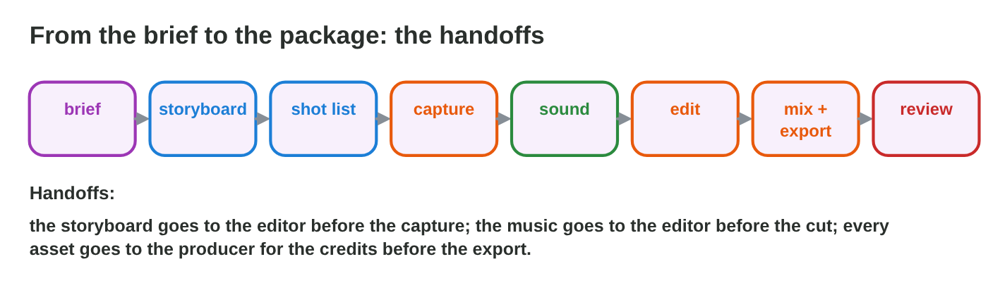
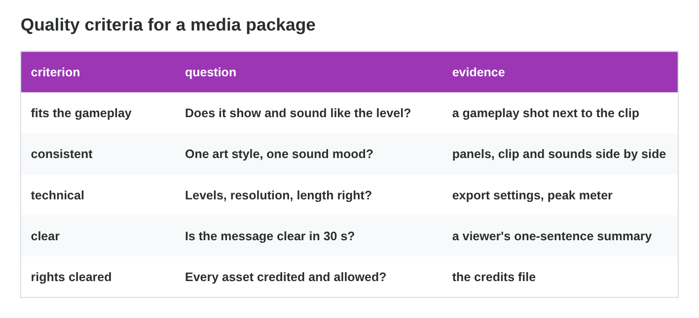

No new ideas today: two short problems that use the storyboards, the sound,
the video and the credits of Lectures 5–12 in one media package. Do each one
alone. Tap, sort or type your answer at every step: the page checks it at
once and tells you why.

## Recall

- A storyboard plans the shots before production (Lectures 5–6); a sound
  set and a mix are checked by ear and by numbers, such as peaks at −1 dB or
  lower (Lectures 7–9).
- A promo clip is cut, titled and exported for its target, for example MP4
  in 16:9 (Lectures 10–11).
- Every asset needs a licence and a TASL credit (Lecture 12).

::: {.callout-tip title="Try it 1 · Recall"}
Choose the right answer.

::: {.match extra="9:16|0 dB"}
Which shape fits a promo clip for a PC and phone video page?
:   16:9

    Why: 16:9 is the shape of most screens and video pages.

Which part of a credit names the licence?
:   the L of TASL

    Why: title, author, source, licence.

What comes before the gameplay capture?
:   the storyboard and the shot list

    Why: the storyboard plans the shots first.
:::
:::

## Activity 1 · Plan the Storm Night package

Salma, the producer of *Storm Night*, writes a **brief** (what the team
must deliver). Her message:

- We need a storyboard of 6 panels, a sound set (3 effects and a music
  loop), a promo clip of 30 s in 16:9, and a credits file.
- The players play on phones and PCs.
- The mood is dark and tense.
- The formats are PNG, 48 kHz WAV and MP4, with peaks at −1 dB or lower.
- The deadline is the end of session 2.

Four roles share the work. A **handoff** passes finished work to the next
role.

| Role | Makes |
|------------------|------------------------------------------------|
| producer | the brief, the plan, the credits file and the review |
| storyboard artist | the storyboard |
| sound designer | the sound effects, the music loop and the mix |
| video editor | the capture, the cut, the titles and the export |

Every file follows one naming rule: `level_type_name_version`. For example,
`storm_sfx_wind_v01.wav` is level storm, type sfx (a sound effect), name
wind, version 1.

{width=90%}



::: {.callout-note title="Activity 1 · Brief, plan and names · 15 min"}
1. Match each line of the brief to its words from Salma's message: what,
   for whom, mood, formats, deadline. The words: **a)** the end of session
   2 · **b)** players on phones and PCs · **c)** dark and tense · **d)**
   PNG, 48 kHz WAV and MP4 · **e)** a storyboard of 6 panels, a sound set,
   a 30 s promo and a credits file.
2. In **Production Planner**, put the eight tasks into two sessions without
   a conflict.
3. Write the names of three files with the naming rule: version 2 of a rain
   sound, version 1 of the promo clip and version 1 of the storyboard.

*Your product:* five letters, a plan without conflicts and three file names.

::: {.sort}
Step 1: which line of the brief do Salma's words fill? Sort them.

What
:   e) a storyboard of 6 panels, a sound set, a 30 s promo and a credits file

    Why: The products of the package.

For whom
:   b) players on phones and PCs

    Why: The audience of the package.

Mood
:   c) dark and tense

    Why: How the package must feel.

Formats
:   d) PNG, 48 kHz WAV and MP4

    Why: The file types to deliver.
:::

::: {.choice}
Step 1: which words are the deadline?

- [x] a) the end of session 2

  Why: The deadline says when the package is due.

- [ ] c) dark and tense

  Why: That is the mood.

- [ ] d) PNG, 48 kHz WAV and MP4

  Why: Those are the formats.
:::

::: {.choice}
Step 3: which name follows the rule `level_type_name_version` for version 2
of a rain sound?

- [x] `storm_sfx_rain_v02.wav`

  Why: The level, the type, the name and the version, in this order.

- [ ] `rain sound new.wav`

  Why: No level, no type and no version, with spaces.

- [ ] `storm_rain_v02_sfx.wav`

  Why: The four parts are in the wrong order.
:::
:::

::: {.callout-tip title="Try it 2 · The plan"}
Choose the right answer.

::: {.match extra="the brief|final_final2.wav"}
The editor wants to cut the promo on the music. What must be finished first?
:   the capture and the music loop

    Why: a handoff passes finished work to the next role.

What is a good name for version 2 of a rain sound of the level "storm"?
:   storm_sfx_rain_v02.wav

    Why: it follows level_type_name_version, without spaces.

Which task comes last of all?
:   the quality review

    Why: the team checks the finished package against the brief.
:::
:::

## Activity 2 · Check version 1

The team checks version 1 of the package in two steps:

1. Each line of the brief gets "pass" or "fail".
2. Each of the five quality criteria (in the table below) gets a score
   from 1 to 4, with evidence. 1 is poor, 4 is very good.

The owner of each file fixes the fails first.

{width=90%}



::: {.callout-note title="Activity 2 · Pass, fail and fix · 15 min"}
1. In **Package Checker**, mark each line of version 1 as pass or fail.
2. For each fail, write its fix and the role that makes it: producer,
   storyboard artist, sound designer or video editor.
3. Which evidence supports a low score on "technical"?

*Your product:* the list of fails with their fixes and roles, and one
choice.

::: {.sort}
Step 1: pass or fail? Sort the lines of version 1.

Pass
:   the storyboard: 6 panels

    Why: It meets the brief.

:   the music loop: dark and tense

    Why: It fits the mood.

Fail
:   the length: 41 s

    Why: The promo must be 30 s.

:   the shape: 9:16

    Why: The brief asks for 16:9.

:   the peak: 0 dB

    Why: It clips: the master must stay below 0 dB.

:   the credits: two sounds missing

    Why: Every asset needs its credit line.
:::

::: {.sort}
Step 2: which role makes each fix? Sort the fixes.

Video editor
:   cut the slow intro shot

    Why: The cut is the editor's work: the promo gets to 30 s.

:   export in 16:9

    Why: The export is the editor's work.

Sound designer
:   lower the master to −1 dB

    Why: The mix is the sound designer's work.

Producer
:   add two TASL lines to the credits

    Why: The producer owns the credits file.
:::

::: {.choice}
Step 3: which evidence supports a low score on "technical"?

- [x] The peak is 0 dB, and the shape is 9:16.

  Why: Two technical lines of the brief fail.

- [ ] The music loop is dark and tense.

  Why: That is about the mood, and it fits.

- [ ] The storyboard has 6 panels.

  Why: That line passes the brief.
:::
:::

::: {.callout-tip title="Try it 3 · The review"}
Choose the right answer.

::: {.match extra="make it louder|add more shots"}
The promo is 41 s, and the brief says 30 s. What is the fix?
:   cut the slow intro shot

    Why: the length is a number in the brief: it must be 30 s.

The promo is 9:16, and the brief says 16:9. What is the fix?
:   export again with the 16:9 preset

    Why: the shape comes from the export settings.

Who fixes a missing credit line?
:   the owner of the credits file

    Why: one owner per file makes its fix.
:::
:::

## Wrap-up {.summary}

- You can plan a media package with a brief, roles, handoffs and file
  names.
- You can check a package against its brief and score it with evidence.
