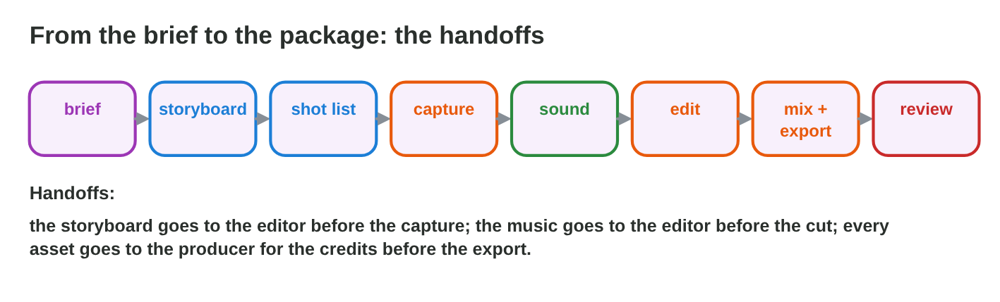

No new ideas today: two short problems that use the storyboards, the sound,
the video and the credits of Lectures 5–12 in one media package. Do each one
alone, then open "Check your result". Every question on this page has its
answer: try first, then check.

## Recall

- A storyboard plans the shots before production (Lectures 5–6); a sound
  set and a mix are checked by ear and by numbers, such as peaks at −1 dB or
  lower (Lectures 7–9).
- A promo clip is cut, titled and exported for its target, for example MP4
  in 16:9 (Lectures 10–11).
- Every asset needs a licence and a TASL credit (Lecture 12).

::: {.callout-tip title="Try it 1 · Recall"}
Choose the right answer.

::: {.match extra="9:16|0 dB"}
Which shape fits a promo clip for a PC and phone video page?
:   16:9

    Why: 16:9 is the shape of most screens and video pages.

Which part of a credit names the licence?
:   the L of TASL

    Why: title, author, source, licence.

What comes before the gameplay capture?
:   the storyboard and the shot list

    Why: the storyboard plans the shots first.
:::
:::

## Activity 1 · Plan the Storm Night package

Salma, the producer of *Storm Night*, writes a **brief**: a storyboard of 6
panels, a sound set (3 effects and a music loop), a promo clip of 30 s in
16:9, and a credits file, for players on phones and PCs; the mood is dark
and tense; the formats are PNG, 48 kHz WAV and MP4 with peaks at −1 dB or
lower; the deadline is the end of session 2. Four roles share the work:
producer, storyboard artist, sound designer and video editor. A
**handoff** passes finished work to the next role. Every file follows one
naming rule: `level_type_name_version`.

{width=90%}



::: {.callout-note title="Activity 1 · Brief, plan and names · 15 min"}
1. Write the brief in five lines: what, for whom, mood, formats, deadline.
2. In **Production Planner**, put the eight tasks into two sessions without
   a conflict.
3. Write the names of three files: version 2 of a rain sound, the promo
   clip and the storyboard.

*Your product:* a brief, a plan without conflicts and three file names.

::: {.check}
1. A good brief: "What: a storyboard, a sound set, a 30 s promo and a
   credits file for Storm Night. For whom: players on phones and PCs. Mood:
   dark, rainy, tense. Formats: PNG, 48 kHz WAV, MP4 16:9. Deadline: the end
   of session 2."
2. Session 1: storyboard, sound effects and music loop, then the capture and
   the credits file; session 2: the cut and the titles, then the mix and the
   export, and the quality review last.
3. For example `storm_sfx_rain_v02.wav`, `storm_video_promo_v01.mp4` and
   `storm_board_panels_v01.png`.
:::
:::

::: {.callout-tip title="Try it 2 · The plan"}
Choose the right answer.

::: {.match extra="the brief|final_final2.wav"}
The editor wants to cut the promo on the music. What must be finished first?
:   the capture and the music loop

    Why: a handoff passes finished work to the next role.

What is a good name for version 2 of a rain sound of the level "storm"?
:   storm_sfx_rain_v02.wav

    Why: it follows level_type_name_version, without spaces.

Which task comes last of all?
:   the quality review

    Why: the team checks the finished package against the brief.
:::
:::

## Activity 2 · Check version 1

The team checks version 1 of the package in two steps. **Step 1:** each line
of the brief is "pass" or "fail". **Step 2:** five criteria, each scored from
1 to 4 with evidence: fits the gameplay, consistent, technical, clear, and
rights cleared. The owner of each file fixes the fails first.

{width=90%}



::: {.callout-note title="Activity 2 · Pass, fail and fix · 15 min"}
1. In **Package Checker**, mark each line of version 1 as pass or fail.
2. Write the fix of each fail and who makes it.
3. Score version 1 on one criterion of your choice, with one piece of
   evidence.

*Your product:* the list of fails with their fixes, and one score with
evidence.

::: {.check}
Pass: the storyboard and the music loop. Fail: the length (41 s), the shape
(9:16), the peak (0 dB) and the credits (two sounds missing). Fixes: the
video editor cuts the slow intro shot and exports in 16:9; the sound
designer lowers the master to −1 dB; the producer adds two TASL lines. A
good score: "technical: 2 of 4, the peak is 0 dB and the shape is 9:16."
:::
:::

::: {.callout-tip title="Try it 3 · The review"}
Choose the right answer.

::: {.match extra="make it louder|add more shots"}
The promo is 41 s, and the brief says 30 s. What is the fix?
:   cut the slow intro shot

    Why: the length is a number in the brief: it must be 30 s.

The promo is 9:16, and the brief says 16:9. What is the fix?
:   export again with the 16:9 preset

    Why: the shape comes from the export settings.

Who fixes a missing credit line?
:   the owner of the credits file

    Why: one owner per file makes its fix.
:::
:::

## Wrap-up {.summary}

- You can plan a media package with a brief, roles, handoffs and file
  names.
- You can check a package against its brief and score it with evidence.
