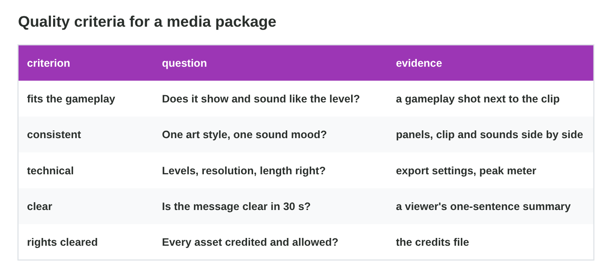
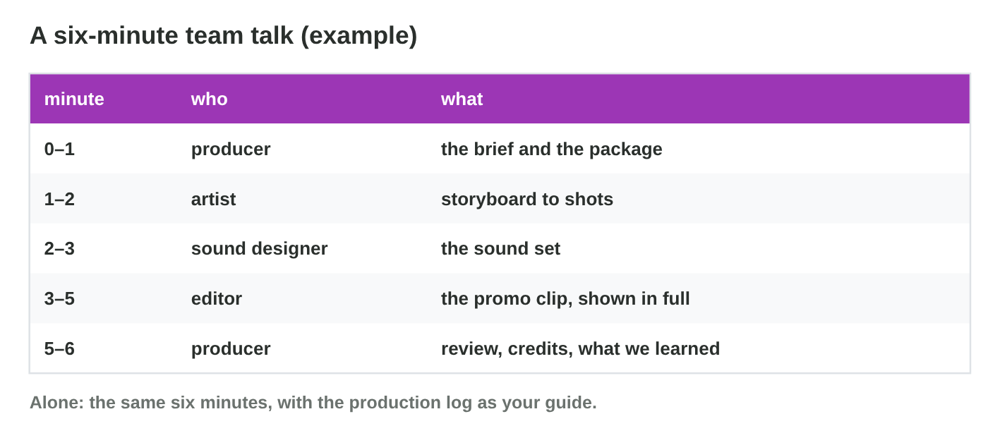

No new ideas today: two short problems on Practice 1, about the Storm Night
package. Do each one alone. Tap, sort or type your answer at every step: the
page checks it at once and tells you why.

## Recall

- A **media package** has five parts made to one brief: the storyboard,
  the sound set, the promo clip, the credits file and the quality review.
- **Roles** and **handoffs** put the work in order, and each file has
  **one owner**: the video editor owns the edit of the promo.
- The **quality review** checks the brief (pass or fail) and scores five
  criteria from 1 to 4, each with evidence: fits the gameplay, consistent,
  technical, clear, rights cleared.

::: {.callout-tip title="Try it 1 · Recall"}
Choose the right answer.

::: {.match extra="the effort|the deadline"}
Which part of the package has 6 panels and a shot list?
:   the storyboard

    Why: The storyboard plans the shots of the promo.

Who saves the edit of the promo project?
:   the video editor

    Why: Each file has one owner; the others send notes.

What does every score of the quality review need?
:   evidence

    Why: Evidence is something you can see, hear or measure.
:::
:::

## Activity 1 · Review Team Blue's package

Team Blue finished its Storm Night package: 6 panels, three sound effects
and a music loop, a 30-second promo and a credits file. Every item of the
brief passes. Before the talk, the team scores the five quality criteria,
each with its evidence.

{width=94%}



::: {.callout-note title="Activity 1 · Five scores and a fix · 15 min"}
1. In **Package Review**, read the evidence and give each criterion a
   score from 1 to 4. Then compare with the teacher.
2. Find the lowest score. Write its fix and the role that makes the fix.

*Your product:* five scores and one fix with its owner.

::: {.fill answer="17" unit="of 20" hint="Fits the gameplay 4, consistent 2, technical 3, clear 4, rights cleared 4."}
Step 1: the teacher's scores are 4, 2, 3, 4 and 4. What is the total?

Why: 4 + 2 + 3 + 4 + 4 = 17 of 20; a score one point away is fine when your evidence supports it.
:::

::: {.choice}
Step 2: which is the lowest score, and its fix?

- [x] consistent: a darker, tense music loop, made by the sound designer

  Why: The music loop is bright and happy, but the brief is tense.

- [ ] technical: lower the peak, by the video editor

  Why: Technical scores 3; the lowest is consistent (2).

- [ ] rights cleared: add credits, by the producer

  Why: Rights cleared scores 4: every credit is there.
:::
:::

::: {.callout-tip title="Try it 2 · Criteria"}
Use Package Review. Which criterion does the evidence show?

::: {.match extra="the deadline|the effort"}
The panels and the clip are dark blue, but the music loop is bright and happy.
:   consistent

    Why: Consistent means one art style and one sound mood.

30 s, 16:9, 1920 × 1080, with peaks at −1.5 dB.
:   technical

    Why: Lengths, sizes and levels are technical values.

After one view, a viewer says: "Nour and Pasha escape a storm on the roofs."
:   clear

    Why: The viewer says the message in one sentence.

The credits file lists every asset with TASL, and the font licence is saved.
:   rights cleared

    Why: Every asset is credited and allowed.
:::
:::

## Activity 2 · Plan the six-minute talk

Team Blue presents its package in six minutes:

- The talk follows the work. First the brief and the package, then the
  storyboard, the sound set and the promo clip (the order of the
  handoffs), and the review last.
- Each member presents the part of their own role.
- The promo clip (30 s) is shown in full and explained, so it needs at
  least 1 minute. The review and the credits need at least 1 minute too.

{width=94%}



::: {.callout-note title="Activity 2 · A talk plan · 15 min"}
1. In **Package Talk Planner**, make a six-minute plan with the promo clip
   shown in full. Then switch to "alone".
2. The five parts of Team Blue's talk are shuffled: a) the promo clip ·
   b) the review and the credits · c) the brief and the package · d) the
   sound set · e) the storyboard. The promo clip takes 2 minutes, and every
   other part 1 minute. Put the parts in the order of the talk, and write
   who presents each part.

*Your product:* five letters, each with its presenter.

::: {.order}
Step 2: put the five parts of the talk in order.

1. c) the brief and the package: the producer, 1 min
2. e) the storyboard: the storyboard artist, 1 min
3. d) the sound set: the sound designer, 1 min
4. a) the promo clip: the video editor, 2 min
5. b) the review and the credits: the producer, 1 min

Why: The talk follows the handoffs of the work, and the review comes last: 6 minutes in all.
:::

::: {.choice}
Step 1: a student presents alone. What changes?

- [x] The student presents every part; the parts and the times stay the same.

  Why: The production log shows each role.

- [ ] The talk gets 2 minutes shorter.

  Why: The parts and their times stay.

- [ ] The promo clip is left out.

  Why: The promo clip is always shown in full.
:::
:::

::: {.callout-tip title="Try it 3 · The talk"}
Use Package Talk Planner. Choose the answer.

::: {.match extra="10 minutes|the last 10 seconds"}
How long is the whole talk?
:   6 minutes

    Why: The plan must end at the time limit.

What is the least time for the promo clip?
:   1 minute

    Why: The 30-second clip is shown in full and explained.

Who presents the sound set in a team?
:   the sound designer

    Why: Each member presents the part of their own role.

What guides a student who presents alone?
:   the production log

    Why: The log shows the decisions of each role.
:::
:::

## Wrap-up {.summary}

- You can review a media package with the brief and five quality
  criteria, with evidence for every score.
- You can plan a six-minute talk that follows the handoffs and shows the
  promo clip in full.
