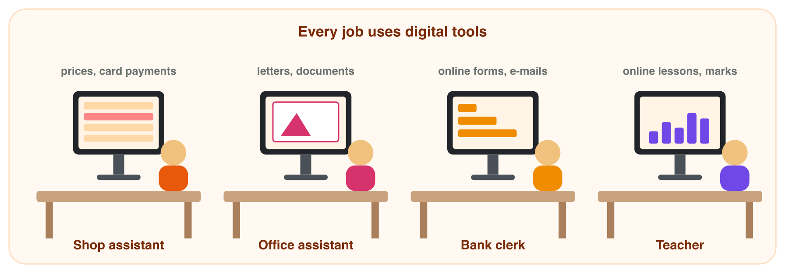
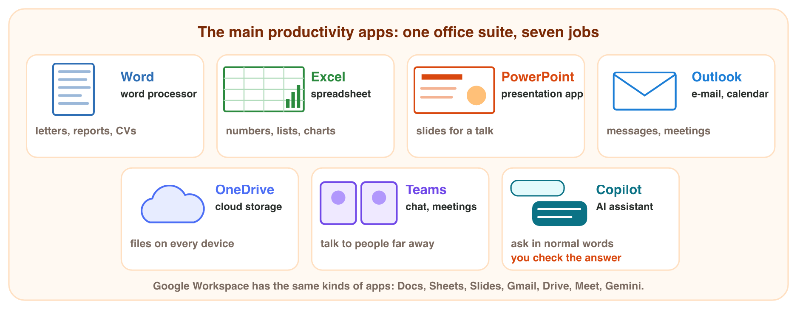
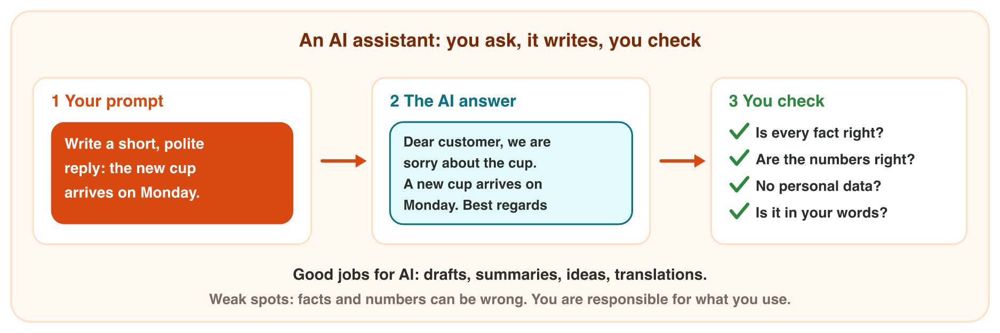

## Keywords



## Why every job needs digital skills

:::: {.columns}
::: {.column width="50%"}
- Job adverts ask for Excel, e-mail, Microsoft Office and AI tools.
- Digital skills are what you can do with a computer, a phone and apps.
- Productivity means more useful work in less time.
- The app does the simple, repeated work, and you plan and check it.
:::
::: {.column width="50%"}

:::
::::

## Live demo · Time Saver



## Try it 1 · Skills and time

a) What is the name for "more useful work in less time"?
b) The computer does the simple, repeated work. Who checks the result?
c) The total of 8 prices is 155 JD, and the price 8 becomes 18. What is the new total?

::: {.answer}
a) productivity
b) you
c) 165 JD
:::

## The main productivity apps

:::: {.columns}
::: {.column width="50%"}
- An office suite is a set of apps that work together, like Microsoft 365.
- Word is for text, Excel for numbers and PowerPoint for slides.
- Outlook is for e-mail, OneDrive for files and Teams for online meetings.
- Numbers in a Word table do not add up by themselves, so use Excel.
:::
::: {.column width="50%"}

:::
::::

## Live demo · App Launcher



## Try it 2 · Which app?

a) Which app do you use for a CV?
b) Which app do you use for a chart of the sales of each month?
c) Which app do you use to send a file and set a meeting for Tuesday?

::: {.answer}
a) Word
b) Excel
c) Outlook
:::

## AI assistants: a new kind of app

:::: {.columns}
::: {.column width="50%"}
- An AI assistant is an app that you ask in normal words, like Copilot, ChatGPT or Gemini.
- Your request is a prompt, and generative AI makes new text from it.
- AI is good for drafts, summaries, ideas and short translations.
- The AI rule: check every fact and number, and never type personal data.
:::
::: {.column width="50%"}

:::
::::

## Live demo · AI Chat



## Try it 3 · Good job for AI?

a) "Sum up this long e-mail in 3 points." Is it a good job for AI?
b) "Fill in this form. My ID number is 9981234567." What should you do?
c) Who is responsible for the text that you use from an AI?

::: {.answer}
a) Yes, but you read the answer.
b) Do not send it: it is personal data.
c) You are.
:::

## Summary

- Digital skills are what you can do with a computer, a phone and apps.
- Apps do the repeated work, so you finish more work in less time.
- Choose the app by the job: text, numbers, slides, mail, files or meetings.
- An AI assistant writes drafts, sums up and translates from your prompt.
- You check every AI answer, and you never type personal data into it.

## Your worksheet

:::: {.columns}
::: {.column width="50%"}
- Now do the three experiments of the worksheet alone.
- Part A of each experiment is in Excel, office.com, an AI assistant and Word.
- Part B is on a simulator: scan its QR code, or click its link.
- Open prices-start.xlsx, and write your result after each step.
:::
::: {.column width="50%"}

:::
::::

## Results of the worksheet

Which results do you have in your table?

::: {.reveal}
- Experiment 1: The total is 150 JD; AutoSum gives =SUM(A2:A9), and 160 after the change.
- Experiment 2: Word, Excel and PowerPoint are on the lab computers, and Excel sorts the list of visitors.
- Experiment 3: A date about Sunrise Company is invented, and 15% of 240 is 36, not 32.
:::
