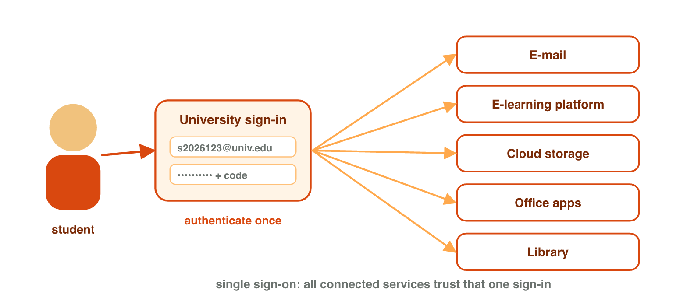
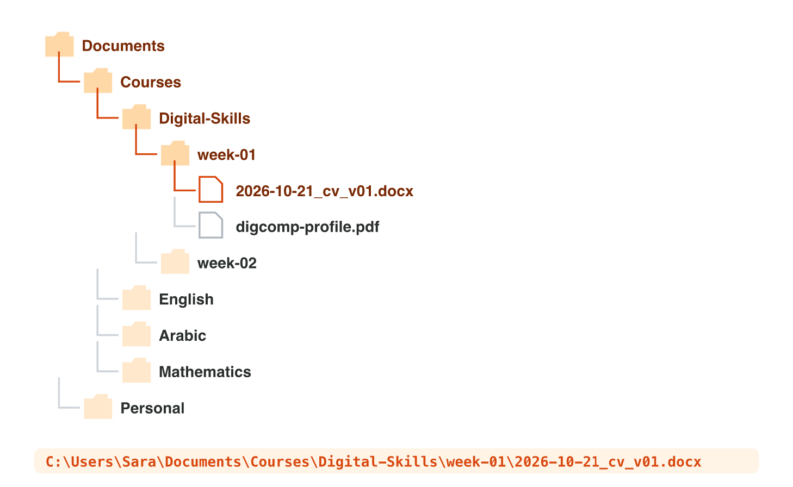
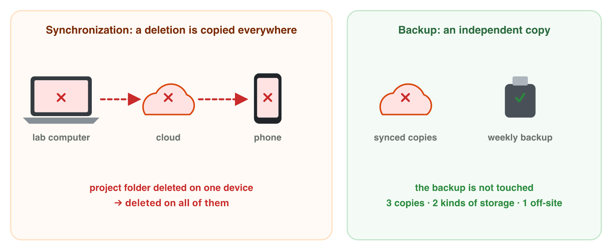

## Keywords



## One account, one sign-in

:::: {.columns}
::: {.column width="50%"}
- Your account is your user name, your password and your data.
- Authentication means that you prove that the account is yours.
- With single sign-on, one sign-in opens all university services.
- On a lab computer, lock the screen with Windows key + L, and sign out at the end.
:::
::: {.column width="50%"}

:::
::::

## Try it 1 · Accounts and sign-in

a) You sign in one time, and e-mail and OneDrive both open. What is this called?
b) What is the risk of single sign-on?
c) You finish your work on a lab computer. What do you do first?

::: {.answer}
a) single sign-on
b) A stolen password opens everything.
c) Press Sign out.
:::

## Folders, paths and extensions

:::: {.columns}
::: {.column width="50%"}
- A file is one saved piece of work, and a folder keeps files and folders.
- The path is the full address of a file, like C:\\Users\\Sara\\Documents\\cv.docx.
- Two files can have the same name, but never the same path.
- The extension shows the type: .docx is Word, .xlsx is Excel and .exe is a program.
:::
::: {.column width="50%"}

:::
::::

## Example · A better file name

Sara's English talk of 12 November 2026 is called final final.pptx. It is the third version. What is a good name?

::: {.reveal}
- Rule 1: The name says what it is: english-talk.
- Rule 2: It has no spaces, so it uses - and _.
- Rule 3: The date comes first as year-month-day: 2026-11-12.
- Rule 4: It has a version, not final: 2026-11-12_english-talk_v03.pptx.
:::

## Live demo · Folder Lab



## Try it 2 · Paths and names

a) Which app opens budget.xlsx?
b) A file is called photo.jpg.exe. What is it really?
c) Which date format sorts files by date: 26-10-2026 or 2026-10-26?

::: {.answer}
a) Excel
b) a program
c) 2026-10-26
:::

## Cloud storage, sync and backup

:::: {.columns}
::: {.column width="50%"}
- Cloud storage keeps your files on the Internet, so they open on any device.
- Sync keeps the same files on all your devices, mistakes too.
- The recycle bin of the cloud keeps deleted files for some days.
- A backup is an extra copy in a separate place, like a USB stick.
:::
::: {.column width="50%"}

:::
::::

## Live demo · Sync Lab



## Try it 3 · Sync or backup?

a) You delete a file on the lab computer. What happens on your synced phone?
b) A copy of your work on a USB stick at home. What is it?
c) Where can you find a deleted cloud file for some days?

::: {.answer}
a) It is deleted too.
b) a backup
c) the recycle bin
:::

## Summary

- Your account is your user name, your password and your data.
- Single sign-on opens all university services, so you keep your password safe.
- A path is the full address of a file, and the extension shows its type.
- A good name says what it is and has the date, a version and no spaces.
- Sync copies every change, but a backup is a separate copy.

## Your worksheet

:::: {.columns}
::: {.column width="50%"}
- Now do the three experiments of the worksheet alone.
- Part A is in office.com and OneDrive on the lab computer.
- Part B is on your phone, or on a simulator: scan its QR code or click its link.
- Write your result after each step, and sign out at the end.
:::
::: {.column width="50%"}

:::
::::

## Results of the worksheet

Which results do you have in your table?

::: {.reveal}
- Experiment 1: Outlook and OneDrive open without the password again: single sign-on.
- Experiment 2: OneDrive shows My files › Courses › Digital-Skills › unit-01, and the file has a good name.
- Experiment 3: The file comes back from the recycle bin, and after mission 4 only the backup has the photo.
:::
