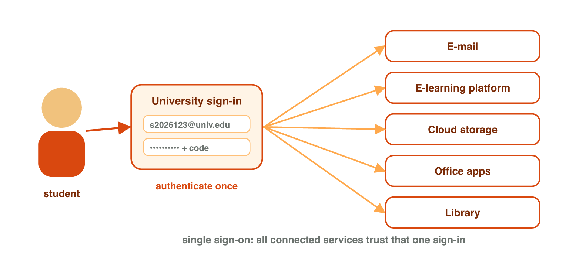
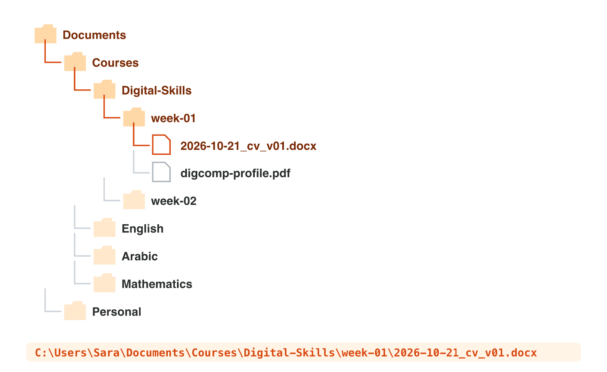
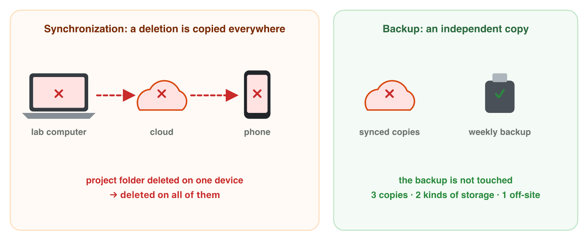

This page is the interactive version of Lecture 2. In class, the teacher
first explains the ideas with the slides. Then you do the **worksheet
(PDF)**: three experiments, each with Part A on the computer and Part B on
your phone or on a simulator of this page. Each section below explains one
idea, then shows its experiment: do each step, then tap or put in order its
result. The page checks it at once and tells you why.

## Key terms



## Before you start

- **You need:** a lab computer with a browser, your university account, and
  your phone.
- **No lab computer?** Do Part B of each experiment on your phone. Do Part A
  later on any computer, in the browser at `office.com`.
- Never type your password on a page of this course.
- What you type in the table of results stays in this browser only.

{width=100%}

## 2.1 One account, one sign-in

- Your **account**: your user name, your password and your data.
- **Authentication**: you prove that the account is yours. You type your
  password; often a code also comes to your phone.
- **Single sign-on (SSO)**: you sign in one time, and all university
  services open: e-mail, the e-learning platform, Microsoft 365, OneDrive.
- Risk: a stolen password opens everything.
- On a shared or lab computer: never save your password. When you finish,
  press **Sign out**. When you leave it for a minute, lock the screen
  (Windows key + L).

{width=84%}

::: {.callout-warning title="Watch out!"}
Closing the browser does not always sign you out. Press **Sign out** first.
:::



::: {.callout-tip title="Try it 1 · Accounts and sign-in"}
Choose the right answer.

::: {.match extra="save the password|close the browser"}
What do we call proving that an account is really yours?
:   authentication

    Why: You prove it with your password, and often a code on your phone.

You sign in one time, and e-mail and OneDrive both open. What is this called?
:   single sign-on

    Why: One sign-in opens all the university services.

What is the risk of single sign-on?
:   a stolen password opens everything

    Why: The same password opens every service.

You leave a lab computer for one minute. What do you do?
:   lock the screen

    Why: Windows key + L locks it, and your account stays safe.

You finish your work on a lab computer. What do you do first?
:   press Sign out

    Why: Closing the browser does not always sign you out.
:::
:::

## 2.2 Folders, paths and good file names

Watch the short video first (with captions; the words are also under it).



- A **file** is one saved piece of work. A **folder** keeps files and other
  folders. Folders in folders make a tree.
- The **path** is the full address of a file, for example
  `C:\Users\Sara\Documents\Courses\Digital-Skills\unit-01\cv.docx`.
  Two files can have the same name, but never the same path.
- The **extension** shows the type: `.docx` Word, `.xlsx` Excel, `.pptx`
  PowerPoint, `.jpg` a photo, `.exe` a program.
- Four rules for good file names:
  1. say what it is (`cv`, not `New Document`);
  2. no spaces: use `-` or `_`;
  3. the date as year-month-day (2026-10-26), so files sort by date;
  4. versions `v01`, `v02`, never `final`, `final2`.

{width=86%}





::: {.callout-warning title="Watch out!"}
`invoice.pdf.exe` looks like `invoice.pdf` when Windows hides extensions. It
is a program. In File Explorer, turn on **View → Show → File name
extensions**.
:::



::: {.callout-tip title="Try it 2 · Paths and names"}
Choose the right answer.

::: {.match extra="21-10-2026|final_v2_new"}
Two files are both called `cv.docx`. What is always different?
:   their paths

    Why: Two files can share a name, but never a path.

Which app opens `budget.xlsx`?
:   Excel

    Why: `.xlsx` is the extension of an Excel file.

A file is called `photo.jpg.exe`. What is it really?
:   a program

    Why: The last extension shows the type: `.exe` is a program.

Which date format sorts files by date?
:   2026-10-26

    Why: Year, then month, then day: the names sort in time order.

A better name for `final final.pptx` (an English talk, 12 November 2026, third version)?
:   2026-11-12_english-talk_v03.pptx

    Why: It has the date first, what it is, the version and no spaces.
:::
:::

## 2.3 Cloud storage, sync and backup

- **Cloud storage** (OneDrive, Google Drive) keeps your files on the
  Internet. You open them on any device after you sign in.
- **Sync** keeps the same files on all your devices. It also copies your
  mistakes: delete a file in one place, and it is gone everywhere.
- The **recycle bin** of the cloud keeps deleted files for some days.
- A **backup** is an extra copy in a separate place, for example a USB
  stick. A mistake does not reach it.

{width=90%}





::: {.callout-tip title="Try it 3 · Sync or backup?"}
Choose the right answer.

::: {.match extra="sync is a backup|on the USB stick only"}
You delete a file on the lab computer. What happens on your synced phone?
:   it is deleted too

    Why: Sync copies every change, a delete too.

A copy of your work on a USB stick at home. What is it?
:   a backup

    Why: It is an extra copy in a separate place.

Where can you find a deleted cloud file for some days?
:   the recycle bin

    Why: The cloud keeps deleted files there for some days.

Your laptop breaks. Your files are in OneDrive. Where can you open them?
:   on any device, after you sign in

    Why: Cloud storage keeps the files on the Internet.
:::
:::

## Table of results



## Summary {.summary}

- Your account is your user name, your password and your data.
- Single sign-on opens all university services, so keep your password safe.
- On a lab computer, lock the screen when you leave, and sign out at the end.
- A path is the full address of a file; the extension shows its type.
- Good names: what it is, no spaces, the date as year-month-day, a version.
- Sync copies every change; a backup is a separate copy that a mistake does not reach.
