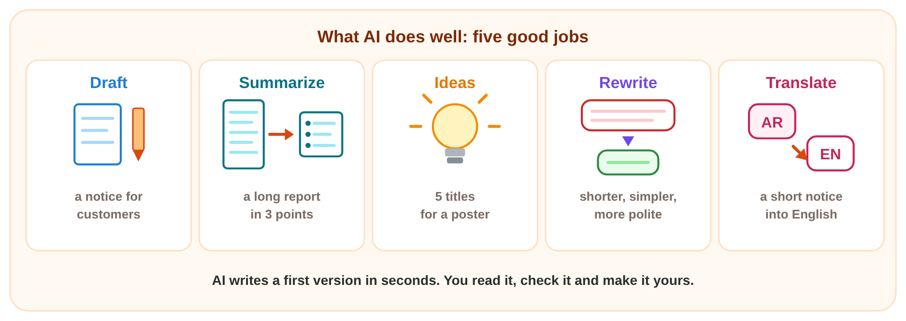
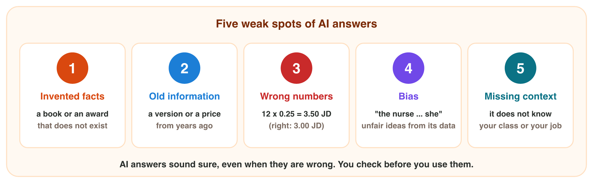
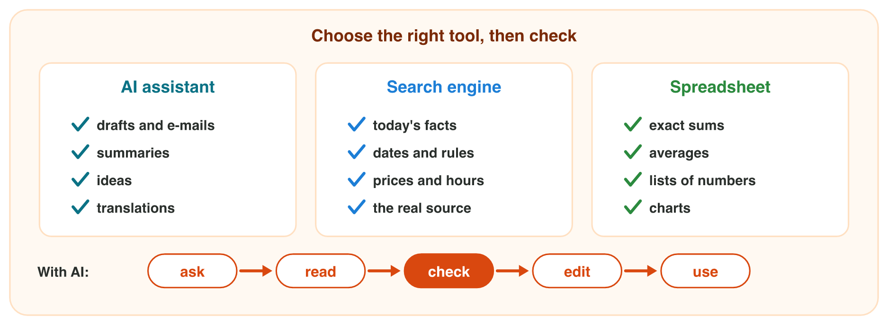

## Keywords



## What AI does well

:::: {.columns}
::: {.column width="50%"}
- An AI assistant learned from a huge amount of text: its training data.
- It writes likely words, so it is fast, but likely is not always true.
- It does five jobs well: drafts, summaries, ideas, rewrites and translations.
- You read and check every answer before you use it.
:::
::: {.column width="50%"}

:::
::::

## Try it 1 · Good jobs for AI

a) "Give me the main points of this 3-page report." Which good job is it?
b) "Make this e-mail shorter and more polite." Which good job is it?
c) You ask the same prompt the next day. What can happen?

::: {.answer}
a) a summary
b) a rewrite
c) a different answer
:::

## Five weak spots of AI answers

:::: {.columns}
::: {.column width="50%"}
- AI can invent a book, a name or a link: this is a hallucination.
- It can give old information from before its knowledge cutoff.
- It can make wrong numbers, and it can repeat unfair ideas: bias.
- It does not know your class, job or company: missing context.
:::
::: {.column width="50%"}

:::
::::

## Live demo · Weak Spots



## Try it 2 · Which weak spot?

a) The AI names a book that no library or shop has. Which weak spot is it?
b) The AI says that 12 pens at 0.25 JD cost 3.50 JD. Which weak spot is it?
c) The AI writes "We need a nurse. She must be kind." Which weak spot is it?

::: {.answer}
a) an invented fact (a hallucination)
b) a wrong number: the right price is 3.00 JD
c) bias
:::

## AI, search engine or spreadsheet?

:::: {.columns}
::: {.column width="50%"}
- Use an AI assistant for drafts, summaries, ideas and translations.
- Use a search engine for today's facts, and read the real source.
- Use a spreadsheet for exact sums and averages.
- With AI, you ask, read, check, edit and use, in this order.
:::
::: {.column width="50%"}

:::
::::

## Live demo · Right Tool



## Try it 3 · Which tool?

a) Which tool is best for the last day to apply for a scholarship?
b) Which tool is best for the average of 30 test marks?
c) You have an AI draft. Which step comes after "read"?

::: {.answer}
a) a search engine
b) a spreadsheet
c) check
:::

## Summary

- Generative AI learned from training data and writes likely words.
- AI writes drafts, summaries, ideas, rewrites and translations very fast.
- AI answers can have invented facts, old information, wrong numbers, bias or missing context.
- Use AI for drafts, a search engine for facts and a spreadsheet for numbers.
- With AI, you ask, read, check, edit and use, and you are responsible for the result.

## Your worksheet

:::: {.columns}
::: {.column width="50%"}
- Now do the three experiments of the worksheet alone.
- Part A is with an AI assistant, a calculator and a search engine.
- Part B is on your phone, or on a simulator: scan its QR code or click its link.
- Never type personal data into the AI, and write your result after each step.
:::
::: {.column width="50%"}

:::
::::

## Results of the worksheet

Which results do you have in your table?

::: {.reveal}
- Experiment 1: Five trip ideas, a summary with no added facts, and a translation with the same time and day.
- Experiment 2: 12 pens cost 3.00 JD, and a book that no search finds is invented.
- Experiment 3: The university website wins, and each job has its own tool.
:::
