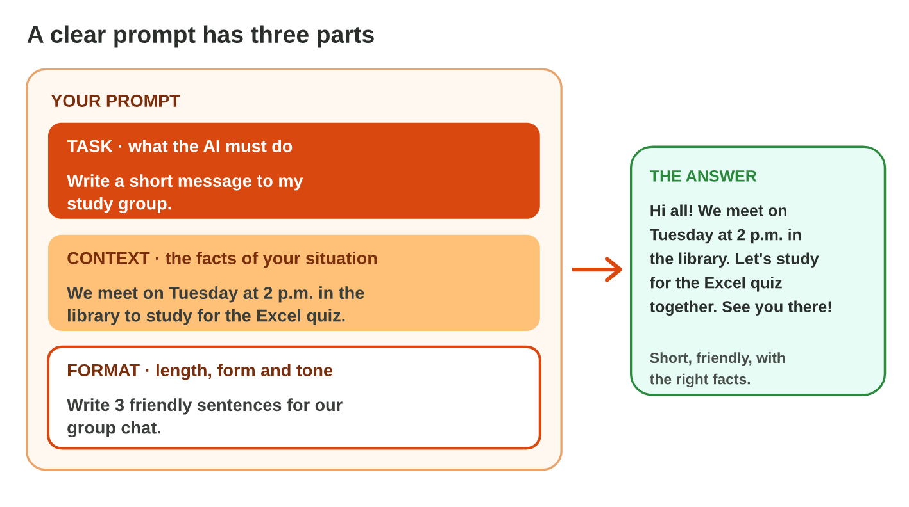
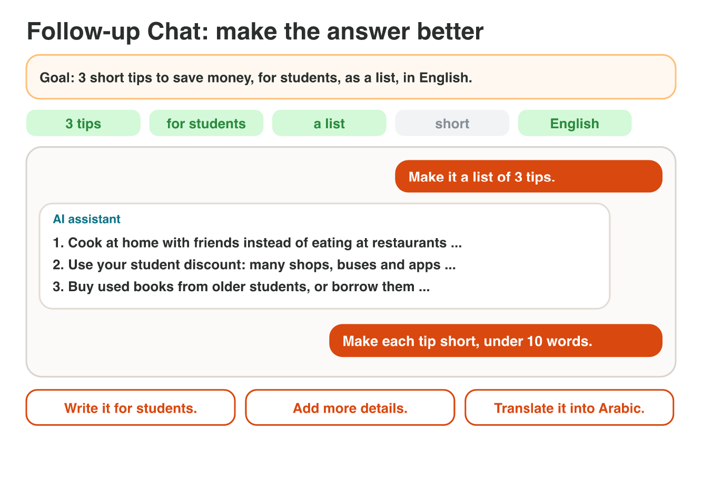
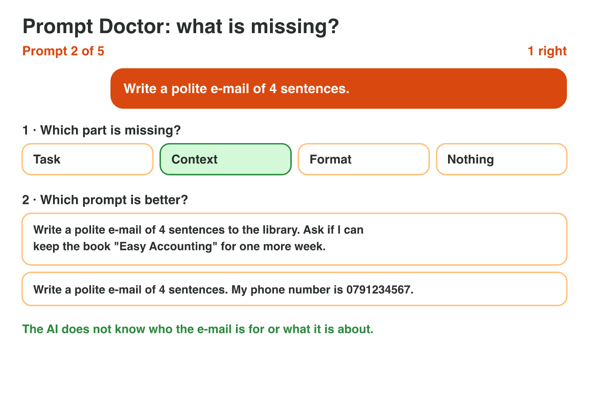

## Keywords



## The three parts of a clear prompt

:::: {.columns}
::: {.column width="50%"}
- The task says what the AI must do.
- The context gives the facts of your situation.
- The format sets the length, the form and the tone, like polite or friendly.
- Without context the answer is general, and without format it can be far too long.
:::
::: {.column width="50%"}

:::
::::

## Live demo · Prompt Builder



## Try it 1 · Parts of a prompt

a) "I will miss Thursday's class because of a doctor's appointment." Which part is it?
b) "Write 3 polite sentences, with a greeting and a thank-you." Which part is it?
c) A prompt has a task and a format, but no facts. What is the answer like?

::: {.answer}
a) the context
b) the format
c) general, without your facts
:::

## Follow-up prompts

:::: {.columns}
::: {.column width="50%"}
- A follow-up prompt makes the last answer better, like "Make it shorter."
- One short follow-up changes one thing: the length, the form, the readers or the language.
- You write it in the same chat, where the AI has the last answer.
- A new chat starts with nothing, so it does not remember the old answer.
:::
::: {.column width="50%"}

:::
::::

## Try it 2 · Follow-up prompts

a) The answer is a long paragraph, and you want 3 points. What do you write?
b) The answer is for everyone, but you want it for students. What do you write?
c) You start a new chat. Does the AI remember the old answer?

::: {.answer}
a) Make it a list of 3.
b) Write it for students.
c) no
:::

## Fix a weak prompt

:::: {.columns}
::: {.column width="50%"}
- A weak prompt misses a part: the task, the context or the format.
- You find the missing part, and you add it.
- "Make it very good" is not a format: say the length, the form and the tone.
- A prompt never has personal data, like a phone number or an ID number.
:::
::: {.column width="50%"}

:::
::::

## Try it 3 · What is missing?

a) "Write a polite e-mail of 4 sentences." What is missing?
b) "Shop sales: 3 500 JD in September, 4 200 JD in October. Use one short paragraph." What is missing?
c) "Write a polite e-mail. My phone number is 0791234567." What is wrong?

::: {.answer}
a) the context
b) the task
c) It has personal data.
:::

## Summary

- A clear prompt has a task, a context and a format.
- The context gives your facts, and the format sets the length, the form and the tone.
- A follow-up prompt in the same chat changes one thing of the last answer.
- A new chat starts with nothing from the old chat.
- You fix a weak prompt when you add the missing part, and you never type personal data.

## Your worksheet

:::: {.columns}
::: {.column width="50%"}
- Now do the three experiments of the worksheet alone.
- Part A is in an AI assistant, on the lab computer.
- Part B is on a simulator: scan its QR code, or click its link.
- Write your prompt or your result after each step.
:::
::: {.column width="50%"}

:::
::::

## Results of the worksheet

Which results do you have in your table?

::: {.reveal}
- Experiment 1: A task alone gives a general answer; the full prompt gives Tuesday, 2 p.m. and the library in 3 friendly sentences.
- Experiment 2: Each follow-up changes one thing, and a new chat does not know the old answer.
- Experiment 3: The clear notice has a task, a context and a format, and the healthy-food prompt has nothing missing.
:::
