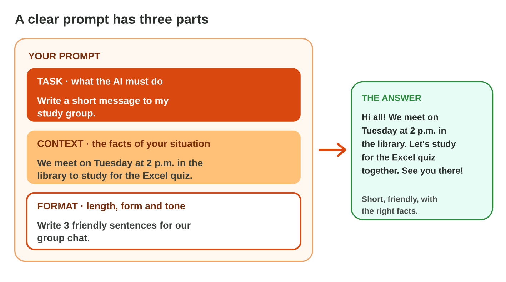

This page is the interactive version of Lecture 4. In class, the teacher
first explains the ideas with the slides. Then you do the **worksheet
(PDF)**: three experiments, each with Part A in an AI assistant and Part B
on a simulator of this page. Each section below explains one idea, then
shows its experiment: do each step, then tap or sort its result. The page
checks it at once and tells you why.

## Key terms



## Before you start

- **You need:** a browser and an AI assistant that the university allows
  (for example `copilot.microsoft.com` with your university account).
- **No lab computer?** Do Part B on your phone. Part A works on the phone
  too, in an AI app or its website.
- **Never type personal data** (ID numbers, phone numbers, addresses) into
  an AI tool.
- What you type in the table of results stays in this browser only.

{width=100%}

## 4.1 The three parts of a clear prompt

- The **task** says what the AI must do: *Write a short message to my
  teacher.*
- The **context** gives the facts of your situation: *I will miss
  Thursday's class because of a doctor's appointment.*
- The **format** sets the length, the form and the **tone** (for example
  polite): *Write 3 polite sentences, with a greeting and a thank-you.*
- No context: the answer is general. No format: it can be far too long.

{width=100%}





::: {.callout-tip title="Try it 1 · Parts of a prompt"}
Choose the part. You can use an answer more than once.

::: {.match extra="a follow-up prompt"}
"Write a short message to my teacher." Which part is it?
:   the task

    Why: It says what the AI must do.

"I will miss Thursday's class because of a doctor's appointment." Which part is it?
:   the context

    Why: It gives the facts of your situation.

"Write 3 polite sentences, with a greeting and a thank-you." Which part is it?
:   the format

    Why: It says how the answer must look: the length, the form and the tone.

A prompt has a task and a format, but no facts. What is the answer like?
:   general, without your facts

    Why: Without context, the AI does not know your situation.

"Polite" or "friendly" in a prompt. What does it set?
:   the tone

    Why: Polite or friendly is the tone, a part of the format.
:::
:::

## 4.2 Improve the answer with follow-up prompts

- A **follow-up prompt** makes the last answer better: *Make it shorter.*,
  *Make it a list of 3.*, *Write it for students.*
- One short follow-up changes one thing: the length, the form, the readers
  or the language.
- Write it in the **same chat**: the AI remembers the last answer only
  there. A new chat starts with nothing.





::: {.callout-tip title="Try it 2 · Follow-up prompts"}
Choose the right answer.

::: {.match extra="start a new chat|Add more details."}
The answer is a long paragraph. You want 3 points. What do you write?
:   Make it a list of 3.

    Why: A follow-up in the same chat changes the form of the last answer.

The answer is too long. What do you write?
:   Make it shorter.

    Why: One short follow-up changes the length.

The answer is for everyone, but you want it for students. What do you write?
:   Write it for students.

    Why: It changes who the text is for.

Where do you write a follow-up prompt?
:   in the same chat

    Why: The AI remembers the last answer only in the same chat.

You start a new chat. Does the AI remember the old answer?
:   no

    Why: A new chat starts with nothing from the old one.
:::
:::

## 4.3 Fix a weak prompt

- A weak prompt misses a part: the task, the context or the format.
- Find what is missing, and add it.
- Some prompts have all three parts: nothing is missing.
- A prompt never has personal data, such as a phone number or an ID number.



::: {.callout-warning title="Watch out!"}
"Make it very, very good" or "Please!!!" is not a format. Say the length,
the form and the tone.
:::



::: {.callout-tip title="Try it 3 · What is missing?"}
Choose what is missing. You can use an answer more than once.

::: {.match extra="the tone only"}
"Write a polite e-mail of 4 sentences." What is missing?
:   the context

    Why: It does not say to whom or about what.

"Shop sales: 3 500 JD in September, 4 200 JD in October. Use one short paragraph." What is missing?
:   the task

    Why: It gives facts and a format, but it does not say what to do.

"Write an invitation for our trip to Petra on 14 November at 8 a.m." What is missing?
:   the format

    Why: It does not say how long, which form or which tone.

"Sum up this text about healthy food in 3 bullet points for my classmates." What is missing?
:   nothing

    Why: It has a task, a context (healthy food, for classmates) and a format (3 bullet points).

"Write a polite e-mail. My phone number is 0791234567." What is wrong?
:   personal data

    Why: Never type a phone number into an AI tool.
:::
:::

## Table of results



## Summary {.summary}

- A clear prompt has a task, a context and a format.
- The task says what to do, the context gives your facts, the format sets length, form and tone.
- A follow-up prompt in the same chat changes one thing of the last answer.
- A new chat starts with nothing: it does not remember the old answer.
- Fix a weak prompt: find the missing part and add it.
- Never type personal data into a prompt.
