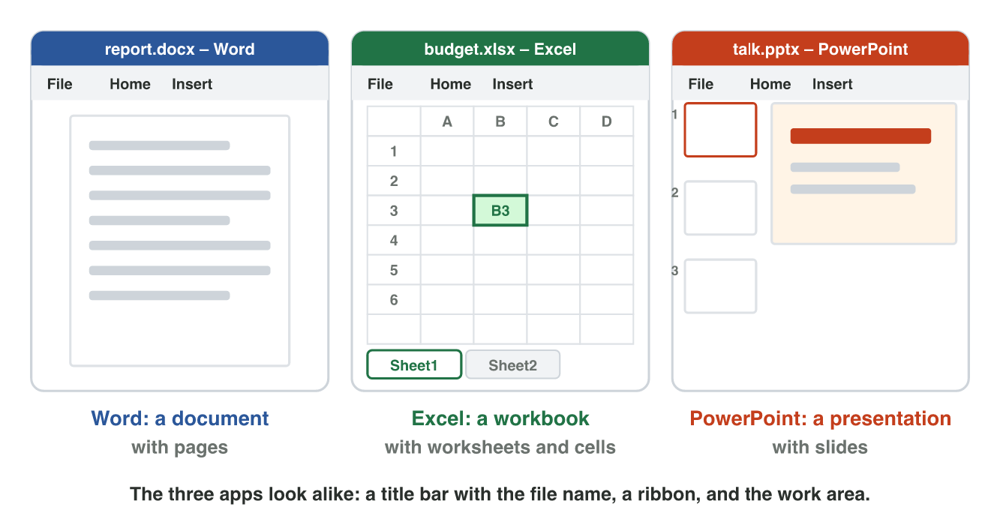
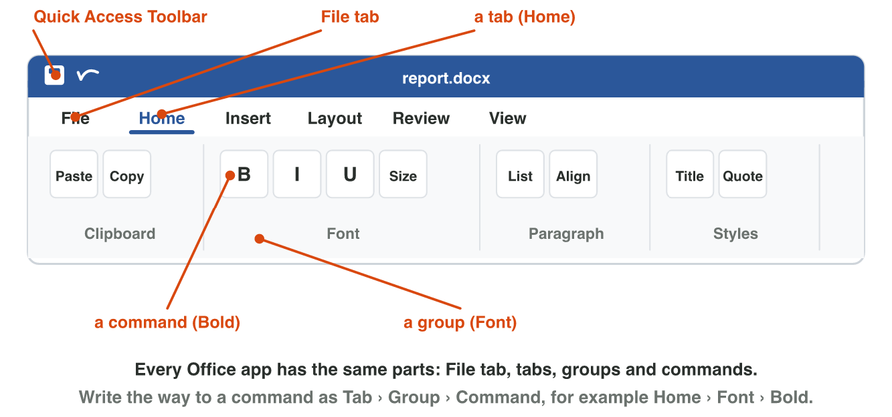
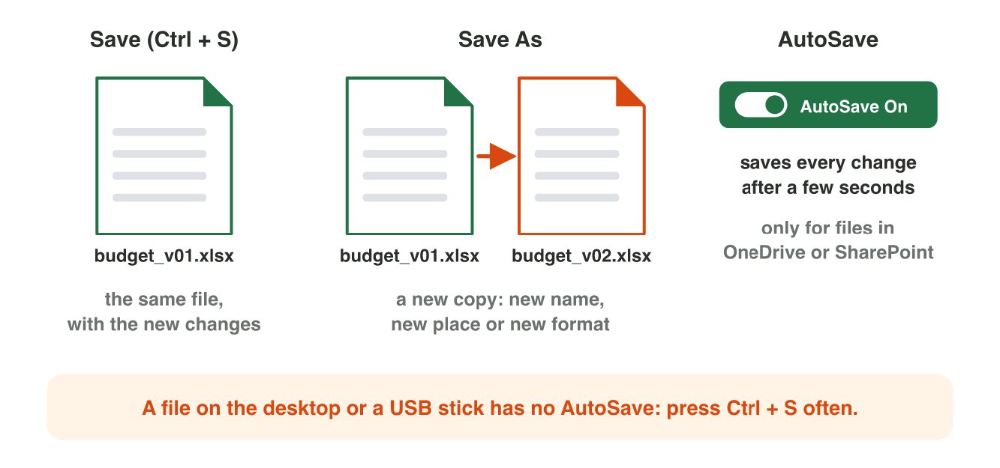

## Keywords



## Three apps and their files

:::: {.columns}
::: {.column width="50%"}
- Word makes a document, Excel a workbook with worksheets, and PowerPoint a presentation with slides.
- A cell is one box of a worksheet, and its name is its column and row, like B3.
- All three apps have a title bar, a ribbon and a status bar.
- File › New shows templates: ready-made files with a design.
:::
::: {.column width="50%"}

:::
::::

## Live demo · Window Tour



## Try it 1 · Apps and their files

a) What does Excel make?
b) What are the pages of a presentation called?
c) You want a ready-made invitation with a nice design. What do you use?

::: {.answer}
a) a workbook
b) slides
c) a template
:::

## The ribbon: tabs, groups and commands

:::: {.columns}
::: {.column width="50%"}
- The ribbon has tabs, each tab has groups, and each group has commands.
- You write the way of a command like this: Home › Font › Bold.
- Home has the common commands, Insert adds things, and Layout sets up the page.
- Save, Print and Share are on the File tab, not on Home.
:::
::: {.column width="50%"}

:::
::::

## Live demo · Ribbon Finder



## Try it 2 · Where is it?

a) You want to add the company logo. Which way do you use?
b) You want to turn the page sideways. Which way do you use?
c) You want to print the report. Where is Print?

::: {.answer}
a) Insert › Illustrations › Pictures
b) Layout › Page Setup › Orientation
c) File › Print
:::

## Save, Save As and AutoSave

:::: {.columns}
::: {.column width="50%"}
- Save (Ctrl + S) puts the new changes in the same file.
- Save As makes a new copy with a new name, place or format, and the old file stays.
- A PDF is for reading and printing, so its look stays the same.
- AutoSave works only for files in OneDrive, so press Ctrl + S often.
:::
::: {.column width="50%"}

:::
::::

## Live demo · Save Lab



## Try it 3 · Save it right

a) You want a copy with a new name, and you keep the old file. What do you use?
b) A customer must read the price list but not change it. Which format do you send?
c) Your file is on a USB stick. How do you keep your work safe?

::: {.answer}
a) Save As
b) .pdf
c) Press Ctrl + S often.
:::

## Summary

- Word makes documents, Excel makes workbooks, and PowerPoint makes presentations.
- The three apps share the title bar, the ribbon and the status bar.
- A command has a way: its tab, its group and its name.
- Save changes the same file, and Save As makes a new copy.
- A PDF keeps its look, and AutoSave works only for files in OneDrive.

## Your worksheet

:::: {.columns}
::: {.column width="50%"}
- Now do the three experiments of the worksheet alone.
- Part A is in Word, with the start file notice-start.docx.
- Part B is on a simulator: scan its QR code, or click its link.
- Write your result after each step, and fill in the table at the end.
:::
::: {.column width="50%"}

:::
::::

## Results of the worksheet

Which results do you have in your table?

::: {.reveal}
- Experiment 1: The notice has Page 1 of 1 and 59 words, and the three apps share the title bar, the ribbon and the status bar.
- Experiment 2: Center is on Home, Table on Insert, Orientation on Layout, and Print on the File tab.
- Experiment 3: Save As makes a .docx and a .pdf copy, and nothing is lost after Save or with AutoSave in OneDrive.
:::
