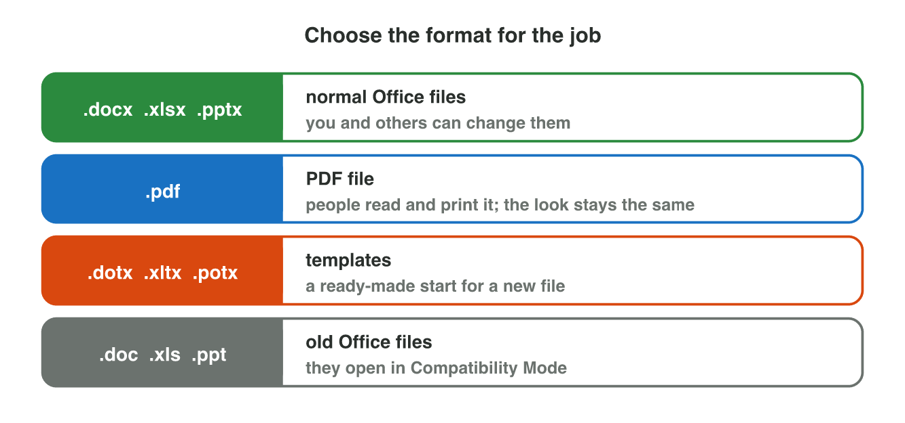
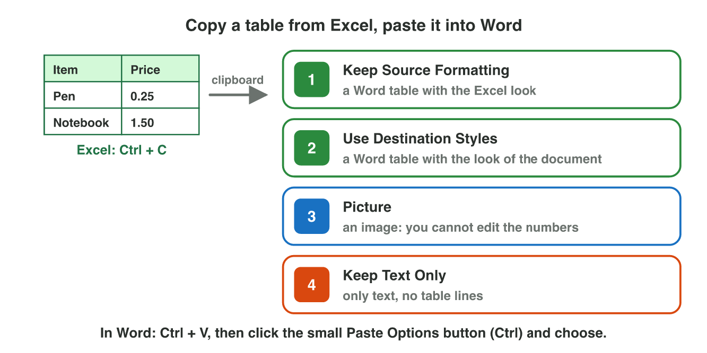
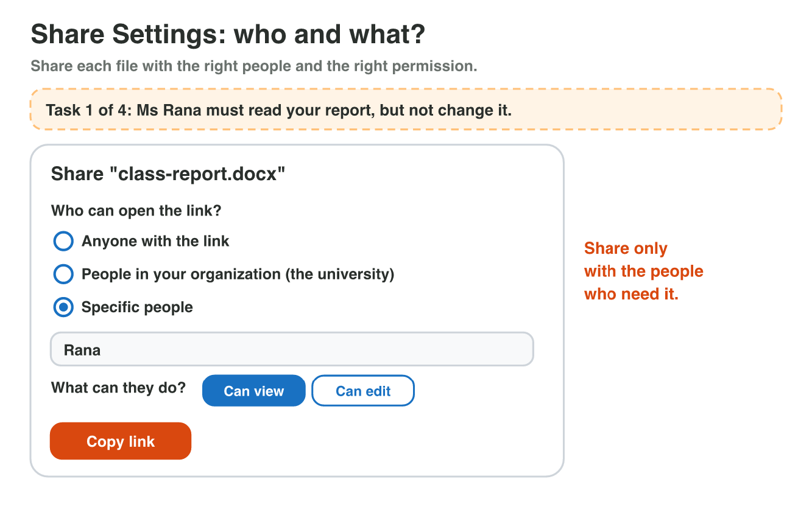

## Keywords



## One file, three places, and a PDF copy

:::: {.columns}
::: {.column width="50%"}
- The desktop app has all the features, and the phone app has the main ones.
- Office on the web needs no install, and AutoSave is always on there.
- A PDF keeps the look, and people do not easily change it.
- When you make a PDF copy, the .docx file stays.
:::
::: {.column width="50%"}

:::
::::

## Live demo · PDF Export



## Try it 1 · Three places and a PDF

a) You are at an Internet café without Word. Where can you open your file?
b) Where is AutoSave always on?
c) A customer must read the notice but not change it. What do you send?

::: {.answer}
a) Office on the web, in the browser
b) Office on the web
c) the PDF file
:::

## Copy a table from Excel to Word

:::: {.columns}
::: {.column width="50%"}
- Ctrl + C puts the table on the clipboard until you paste it.
- Keep Source Formatting keeps the Excel look of the table.
- Use Destination Styles gives it the look of your document, and you can still change it.
- Picture makes an image, and Keep Text Only drops the table lines.
:::
::: {.column width="50%"}

:::
::::

## Live demo · Paste Lab



## Try it 2 · Paste Options

a) The table must look like the rest of your report, and you must still change the prices. Which option do you use?
b) The table must look exactly as in Excel. Which option do you use?
c) Where is the table after Ctrl + C, before you paste?

::: {.answer}
a) Use Destination Styles
b) Keep Source Formatting
c) on the clipboard
:::

## Share a file safely

:::: {.columns}
::: {.column width="50%"}
- Share makes a link to a file in OneDrive.
- You choose who can open it: anyone with the link, your organization or specific people.
- You choose what they can do: Can view or Can edit.
- You give Can edit only to people who must change the file.
:::
::: {.column width="50%"}

:::
::::

## Try it 3 · Who and what?

a) Your teacher must read your report, but not change it. Which settings do you choose?
b) Your classmate must add two slides to your presentation. Which settings do you choose?
c) All students and staff of the university may read the club notes. Which settings do you choose?

::: {.answer}
a) Specific people, Can view
b) Specific people, Can edit
c) People in your organization, Can view
:::

## Summary

- One Office file opens in the desktop app, on the web and in the phone app.
- On the web AutoSave is always on, and a PDF copy keeps the look.
- Ctrl + C puts a table on the clipboard, and the Paste Options decide its look in Word.
- Picture makes an image that nobody can change.
- A share link has two settings: who can open it, and whether they can view or edit.

## Your worksheet

:::: {.columns}
::: {.column width="50%"}
- Now do the three experiments of the worksheet alone.
- Part A is in Word on the web, Excel, Word and OneDrive.
- Part B is on a simulator: scan its QR code, or click its link.
- Do not send any share link, and write your result after each step.
:::
::: {.column width="50%"}

:::
::::

## Results of the worksheet

Which results do you have in your table?

::: {.reveal}
- Experiment 1: Word on the web says Saved, and the PDF copy is in Downloads while the .docx stays in OneDrive.
- Experiment 2: With Use Destination Styles you can change a number, but not in a Picture.
- Experiment 3: People in your organization with Can view, and only the price list is for anyone with the link.
:::
