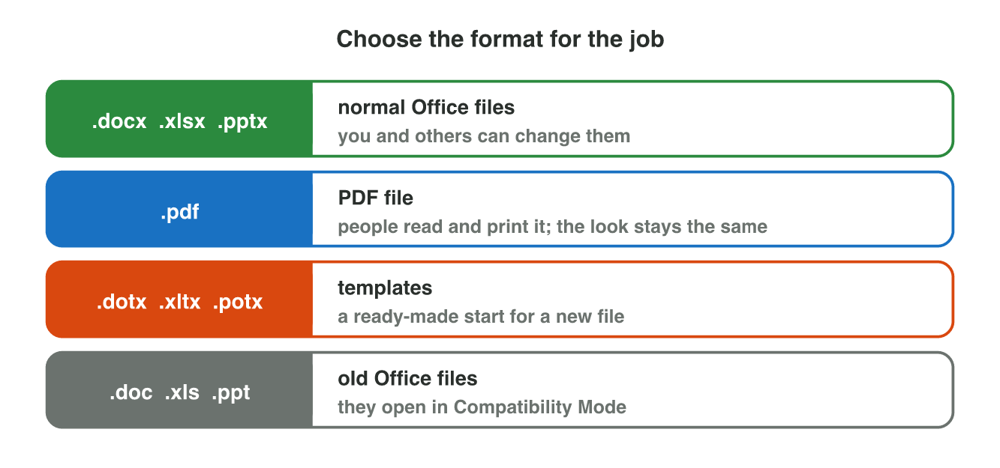
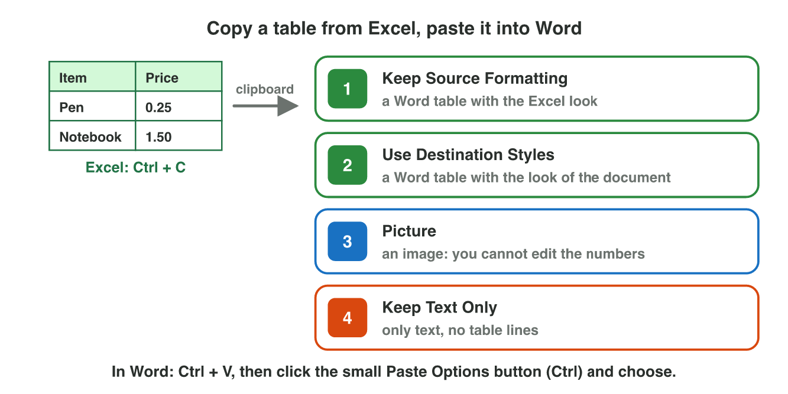

This page is the interactive version of Lecture 6. In class, the teacher
first explains the ideas with the slides. Then you do the **worksheet
(PDF)**: three experiments, each with Part A in Office and Part B on a
simulator of this page. Each section below explains one idea, then shows
its experiment: do each step, then tap, sort or put in order its result.
The page checks it at once and tells you why.

## Key terms



## Before you start

- **You need:** a computer with Excel and Word, a browser and your
  university account.
- **No lab computer?** Do Part B of each experiment on your phone. Do Part A
  later on any computer, with Office on the web at `office.com`.
- What you type in the table of results stays in this browser only.

{width=100%}

## 6.1 One file, three places, and a PDF copy

- The **desktop app** has all the features.
- **Office on the web** (`office.com`) needs no install, and AutoSave is
  always on there.
- The **phone app** has the main features.
- A **PDF** keeps the look, and people do not easily change it.
- In the desktop app: File → Save As → type PDF. On the web: File → Export
  → Download as PDF. The `.docx` file stays.

{width=90%}





::: {.callout-tip title="Try it 1 · Three places and a PDF"}
Choose the right answer.

::: {.match extra="the .docx file is deleted|only on the phone"}
You are at an Internet café without Word. Where can you open your file?
:   Office on the web, in the browser

    Why: Office on the web opens in any browser, with no install.

Where is AutoSave always on?
:   Office on the web

    Why: On the web, AutoSave is always on.

In the desktop app, how do you make a PDF?
:   File → Save As → type PDF

    Why: In the desktop app, Save As can change the type to PDF.

You make a PDF copy of notice.docx. What happens to notice.docx?
:   it stays, and notice.pdf is added

    Why: A PDF copy is a second file; the .docx stays.

A customer must read the notice but not change it. What do you send?
:   the PDF file

    Why: A PDF keeps the look, and people do not easily change it.
:::
:::

## 6.2 Copy a table from Excel to Word

- **Ctrl + C** puts the table on the **clipboard** until you paste it.
- In Word, press **Ctrl + V**, then click the small **Paste Options**
  button (Ctrl) and choose:
  - **Keep Source Formatting:** the Excel look;
  - **Use Destination Styles:** the look of your document, and you can
    still change it;
  - **Picture:** an image; nobody can change the numbers;
  - **Keep Text Only:** only the words and numbers, no table lines.

{width=100%}





::: {.callout-tip title="Try it 2 · Paste Options"}
Choose the right Paste Option. You can use an answer more than once.

::: {.match extra="Save As"}
The table must look like the rest of your report, and you must still change the prices.
:   Use Destination Styles

    Why: It takes the look of your document and stays a table that you can change.

The table must look exactly as in Excel.
:   Keep Source Formatting

    Why: It keeps the look of the Excel table.

Nobody may change the prices by mistake.
:   Picture

    Why: A picture is an image: nobody can change the numbers in it.

You want only the words and numbers, no table lines.
:   Keep Text Only

    Why: It pastes only the words and the numbers.

Where is the table after Ctrl + C, before you paste?
:   on the clipboard

    Why: Copy puts the table on the clipboard until you paste it.
:::
:::

## 6.3 Share a file safely

- **Share** makes a link to a file in OneDrive.
- **Who** can open the link: Anyone with the link, People in your
  organization, or Specific people.
- **What** they can do: **Can view** or **Can edit**.
- Share only with the people who need the file. Give Can edit only to
  people who must change it.



::: {.callout-warning title="Watch out!"}
"Anyone with the link" works for every person who gets the link, also when
somebody sends it on. Use it only for files that everybody may read.
:::



::: {.callout-tip title="Try it 3 · Who and what?"}
Choose the right settings.

::: {.match extra="Anyone with the link, Can edit"}
Your teacher must read your report, but not change it.
:   Specific people, Can view

    Why: Only your teacher gets the link, and only to read.

Your classmate must add two slides to your presentation.
:   Specific people, Can edit

    Why: Only your classmate gets the link, and they must change the file.

Every customer who gets the link may read the price list.
:   Anyone with the link, Can view

    Why: Every customer with the link may read the list, but not change it.

All students and staff of the university may read the club notes.
:   People in your organization, Can view

    Why: Only the people of the university may open it, and only to read.
:::
:::

## Table of results



## Summary {.summary}

- One Office file opens in the desktop app, on the web and in the phone app.
- On the web, AutoSave is always on; a PDF copy keeps the look, and the .docx stays.
- Ctrl + C puts a table on the clipboard; the Paste Options decide how it looks in Word.
- Picture makes an image that nobody can change; Use Destination Styles keeps it a table.
- Share makes a link: choose who can open it and whether they can view or edit.
