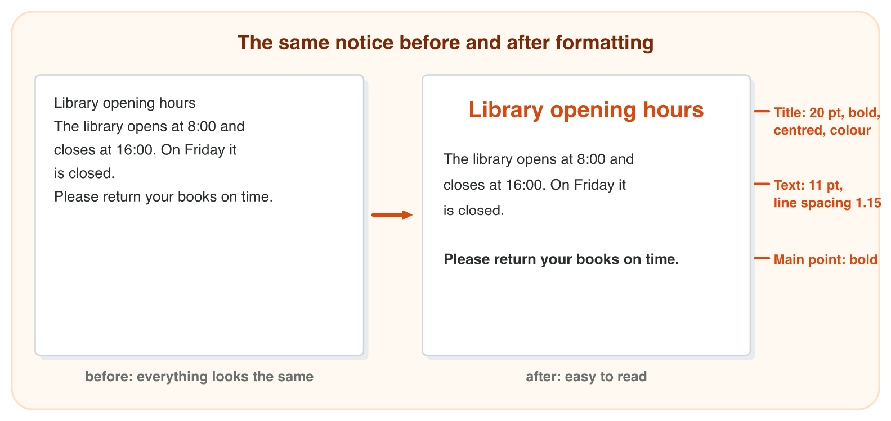
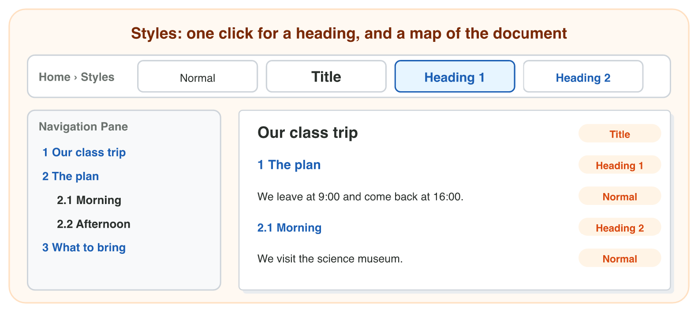
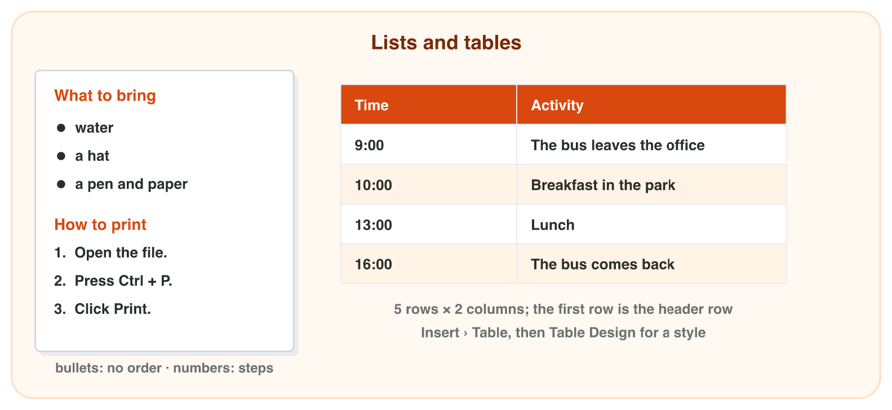
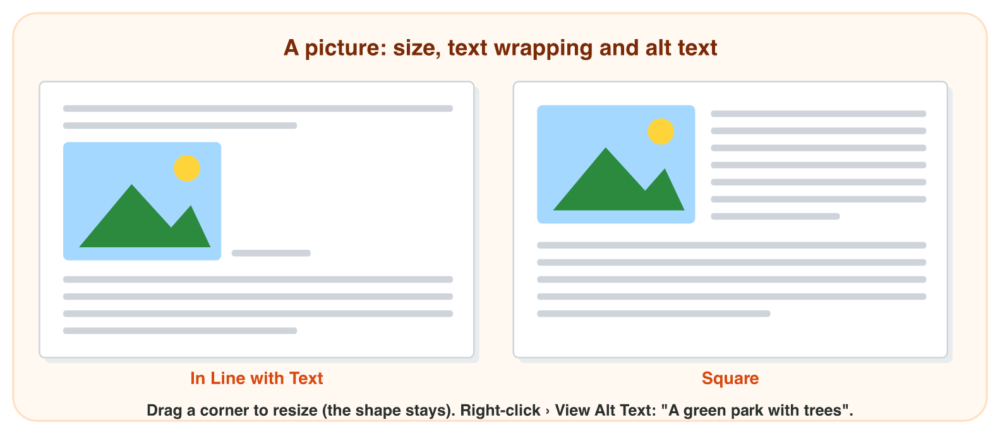

## Keywords



## Make text easy to read: formatting

:::: {.columns}
::: {.column width="50%"}
- Text formatting changes the font, the size, bold and the colour: Home › Font.
- You select the text first, and only the selection changes.
- Paragraph formatting changes the alignment and the line spacing: Home › Paragraph.
- A click inside the paragraph is enough, and the whole paragraph changes.
:::
::: {.column width="50%"}

:::
::::

## Live demo · Format Lab



## Try it 1 · Formatting

a) Where is the line spacing?
b) What must you do before you click Bold?
c) Why should not every line be bold?

::: {.answer}
a) Home › Paragraph
b) Select the text.
c) Then nothing stands out.
:::

## Styles: headings with one click

:::: {.columns}
::: {.column width="50%"}
- A style is saved formatting with a name, like Title, Heading 1 or Normal.
- When you change a style once, all the text with it changes.
- View › Navigation Pane shows the headings as a map of the document.
- A heading made bold and big by hand is normal text for Word.
:::
::: {.column width="50%"}

:::
::::

## Live demo · Style Lab



## Try it 2 · Which style?

a) "Our class trip" is the name of the whole report. Which style does it get?
b) "Morning" is a smaller heading under "The plan". Which style does it get?
c) You change the colour of Heading 1 once. What happens?

::: {.answer}
a) Title
b) Heading 2
c) All the Heading 1 headings change.
:::

## Lists and tables

:::: {.columns}
::: {.column width="50%"}
- A bulleted list is for things in no order.
- A numbered list is for steps in an order.
- A table puts information in rows and columns, and its header row names the columns.
- Tab in the last cell adds a new row, so never make columns with spaces.
:::
::: {.column width="50%"}

:::
::::

## Pictures: size, wrapping and alt text

:::: {.columns}
::: {.column width="50%"}
- Insert › Pictures adds a picture, and a corner handle keeps its shape.
- With In Line with Text, the picture sits in the line like a big letter.
- With Square, the text flows around the picture.
- Alt text says what the picture shows, and a screen reader reads it aloud.
:::
::: {.column width="50%"}

:::
::::

## Try it 3–4 · Lists, tables and pictures

a) A price list has 6 items, each with a price, and a header row. How many rows does the table need?
b) The steps to print a file: a bulleted or a numbered list?
c) The text must flow around the picture. Which wrapping do you choose?

::: {.answer}
a) 7
b) a numbered list
c) Square
:::

## Summary

- Text formatting changes the selected text, and paragraph formatting changes the whole paragraph.
- A style is saved formatting, and a change of the style changes all its text.
- Heading styles make the Navigation Pane.
- Bullets have no order, numbers are steps, and a table has rows and columns.
- A picture with Square wrapping lets the text flow around it, and alt text describes it.

## Your worksheet

:::: {.columns}
::: {.column width="50%"}
- Now do the four experiments of the worksheet alone.
- Part A is in Word, with book-fair-start.docx and books.png.
- Part B is on a simulator or the game Notice Maker: scan its QR code or click its link.
- Write your result after each step, and fill in the table at the end.
:::
::: {.column width="50%"}

:::
::::

## Results of the worksheet

Which results do you have in your table?

::: {.reveal}
- Experiment 1: Bold changes only the word free, and Center moves the whole line.
- Experiment 2: All four Heading 1 headings turn green, and the class trip plan has 4 headings in the pane.
- Experiment 3: The price table has 2 columns and 4 rows, and the bus plan has 5 rows.
- Experiment 4: With Square the text flows around the picture, and good alt text says what it shows.
:::
