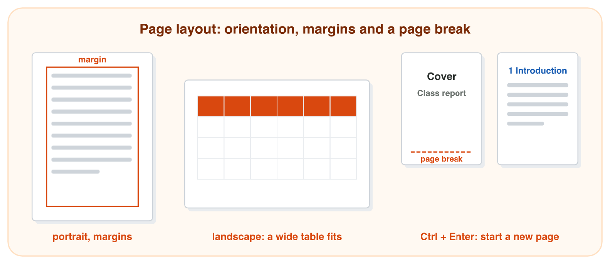
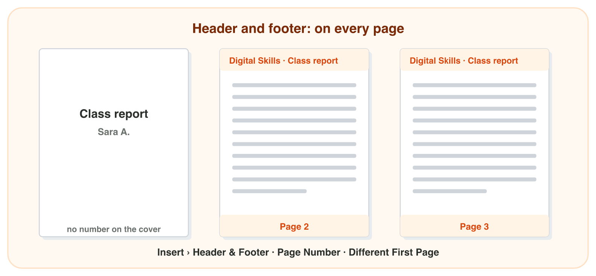
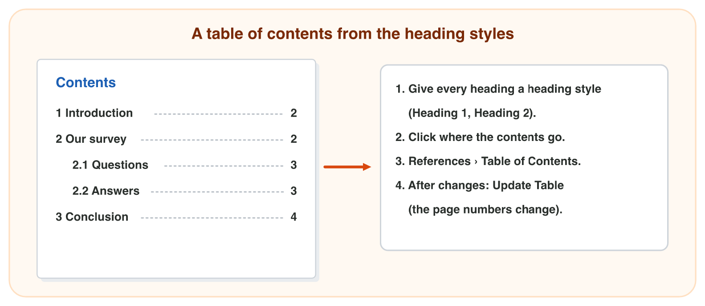

## Keywords



## The page: orientation, margins and a page break

:::: {.columns}
::: {.column width="50%"}
- Portrait is tall, and landscape is wide, so a wide table fits better on landscape.
- Margins are the empty space around the text, and smaller margins give more room.
- A page break (Ctrl + Enter) starts the next text on a new page.
- You never press Enter many times, because the empty lines move.
:::
::: {.column width="50%"}

:::
::::

## Live demo · Page Setup Lab



## Try it 1 · The page

a) Which margins give the text the most room: Normal, Narrow or Wide?
b) How do you start a new page after the cover?
c) Where are Orientation and Margins?

::: {.answer}
a) Narrow
b) Ctrl + Enter (a page break)
c) in the Layout tab
:::

## Header, footer and page numbers

:::: {.columns}
::: {.column width="50%"}
- The header is the top area of every page, and the footer is the bottom area.
- You type in them once, and the text is on every page.
- Insert › Page Number › Bottom of Page writes the right number on every page.
- Different First Page keeps the cover without a header and a number.
:::
::: {.column width="50%"}

:::
::::

## Live demo · Header and Footer Lab



## Try it 2 · Header and footer

a) You type the header once. Where does it appear?
b) The cover must have no header and no number. What do you tick?
c) You add a new page in the middle. What happens to the page numbers?

::: {.answer}
a) on every page
b) Different First Page
c) Word changes them by itself.
:::

## A table of contents

:::: {.columns}
::: {.column width="50%"}
- Word makes the table of contents from the heading styles.
- References › Table of Contents inserts it, with the page numbers.
- After you change a heading, you press Update Table.
- Word does not update the contents by itself while you write.
:::
::: {.column width="50%"}

:::
::::

## Live demo · Contents Builder



## Try it 3 · Contents

a) What does Word use to make the table of contents?
b) Where do you insert the table of contents?
c) A report has a cover. Where do you put the table of contents?

::: {.answer}
a) the heading styles
b) References › Table of Contents
c) after the cover, on page 2
:::

## Summary

- Landscape gives a wide table room, and narrow margins give the text more room.
- A page break starts the next text on a new page.
- A header and a footer appear on every page, and Word numbers the pages.
- Different First Page keeps the cover clean.
- The table of contents comes from the heading styles, and Update Table keeps it right.

## Your worksheet

:::: {.columns}
::: {.column width="50%"}
- Now do the three experiments of the worksheet alone.
- Part A is in Word, with your notice of Lecture 7 or book-fair-start.docx.
- Part B is on a simulator: scan its QR code, or click its link.
- Write your result after each step, and fill in the table at the end.
:::
::: {.column width="50%"}

:::
::::

## Results of the worksheet

Which results do you have in your table?

::: {.reveal}
- Experiment 1: Ctrl + Enter makes a cover page, and the 20 cm table fits only on a landscape page.
- Experiment 2: The header and the numbers are on every page, and the cover has none with Different First Page.
- Experiment 3: The contents list 4 headings, and Update Table changes Prices to Book prices.
:::
