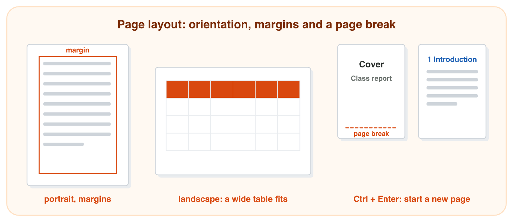
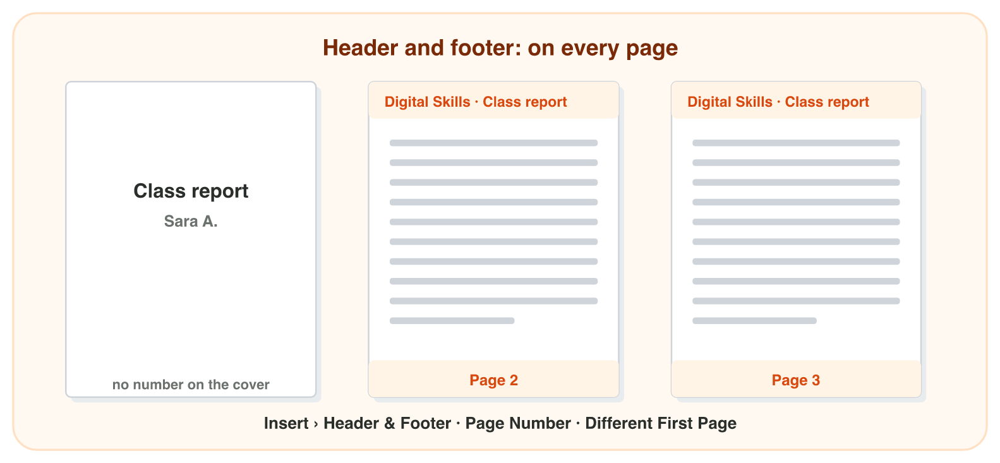
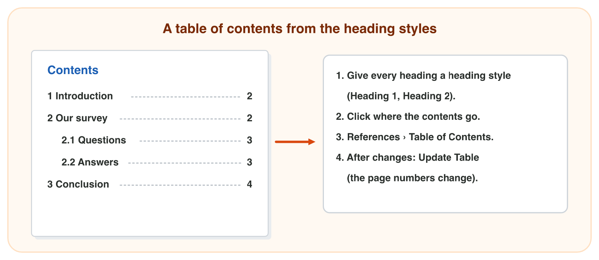

This page is the interactive version of Lecture 8. In class, the teacher
first explains the ideas with the slides. Then you do the **worksheet
(PDF)**: three experiments, each with Part A in Word and Part B on a
simulator of this page. Each section below explains one idea, with short
official videos, then shows its experiment: do each step, then tap, sort,
put in order or type its result. The page checks it at once and tells you
why.

## Key terms



## Before you start

- **You need:** Word (the desktop app, or Word on the web at `office.com`).
- **Get ready:** your notice of Lecture 7, or the start file: give the
  title the style Title and the four headings Heading 1.
- **No lab computer?** Do Part B of each experiment on your phone. Do Part A
  later on any computer with Word.



- What you type in the table of results stays in this browser only.

{width=100%}

## 8.1 The page: orientation, margins and a page break

Watch the two short videos first. Then read the main points and practise in the simulator.





- **Layout › Orientation:** **Portrait** (tall, the normal page) or
  **Landscape** (wide). A wide table fits better on a landscape page.
- **Layout › Margins:** the empty space around the text: **Normal**,
  **Narrow** or **Wide**. Smaller margins give the text more room.
- On an A4 page with Normal margins, the text is about 16 cm wide in
  portrait and about 25 cm wide in landscape.
- **Page break** (**Ctrl + Enter**, or Insert › Page Break): the next text
  starts on a new page. Use it after a cover page. Do not press Enter many
  times: when the text above changes, the empty lines move.

{width=100%}





::: {.callout-tip title="Try it 1 · The page"}
Choose the right answer.

::: {.match extra="Bold|Enter, many times"}
A table is 20 cm wide. Which orientation gives it room?
:   Landscape

    Why: A landscape page is wider: about 25 cm of text instead of about 16 cm.

Which margins give the text the most room?
:   Narrow

    Why: Smaller margins leave more room for the text.

How do you start a new page after the cover?
:   Ctrl + Enter (a page break)

    Why: A page break starts the next text on a new page.

Where are Orientation and Margins?
:   in the Layout tab

    Why: The setup of the page is on the Layout tab.

Which orientation is tall, like a normal letter?
:   Portrait

    Why: Portrait is tall; landscape is wide.
:::
:::

## 8.2 Header, footer and page numbers

Watch the two short videos first. Then read the main points and practise in the simulator.





- The **header** is the top area of every page; the **footer** is the
  bottom area. You type in them once, and the text is on **every page**.
- **Insert › Header** (or double-click at the top of a page). Type, for
  example, *Digital Skills · Class report*.
- **Insert › Page Number › Bottom of Page**: Word writes the right number
  on every page and changes it by itself.
- A cover page has no header and no number: tick **Different First Page**
  in the **Header & Footer** tab.
- Double-click in the text (or **Close Header and Footer**) to go back.

{width=100%}





::: {.callout-tip title="Try it 2 · Header and footer"}
Choose the right answer.

::: {.match extra="Layout › Margins|on page 1 only"}
You type the header once. Where does it appear?
:   on every page

    Why: You type the header once, and Word puts it on every page.

How do you add page numbers?
:   Insert › Page Number

    Why: Page numbers are added from the Insert tab.

The cover must have no header and no number. What do you tick?
:   Different First Page

    Why: It gives the first page its own header and footer, so the cover stays empty.

You add a new page in the middle. What happens to the page numbers?
:   Word changes them by itself

    Why: Word counts the pages again and changes every number.

Where is the footer?
:   at the bottom of every page

    Why: The footer is the bottom area of every page.
:::
:::

## 8.3 A table of contents

Watch the short video first. Then read the main points and practise in the simulator.



- Word makes the **table of contents** from the **heading styles** of
  Lecture 7. So first give every heading **Heading 1** or **Heading 2**.
- Click where the contents go (for example on page 2, after the cover).
- **References › Table of Contents**: choose an automatic table. Word lists
  the headings with their page numbers.
- After you change, add or move a heading: click the contents and press
  **Update Table** (choose *Update entire table*). Word does not update it
  by itself while you write.
- In the desktop app, **Ctrl + click** a line of the contents to jump to
  that heading.

{width=100%}





::: {.callout-tip title="Try it 3 · Contents"}
Choose the right answer.

::: {.match extra="Home › Font|Bold and size 16"}
What does Word use to make the table of contents?
:   the heading styles

    Why: The contents list every heading that has a heading style.

Where do you insert the table of contents?
:   References › Table of Contents

    Why: The table of contents is on the References tab.

You changed a heading. What do you press?
:   Update Table

    Why: Word does not update the contents by itself while you write.

A report has a cover. Where do you put the table of contents?
:   after the cover, on page 2

    Why: The reader sees the contents before the report starts.

"The questions" is a smaller heading under "Our survey". Which style?
:   Heading 2

    Why: A smaller heading under a Heading 1 gets Heading 2.
:::
:::

## Table of results



## Summary {.summary}

- Layout › Orientation: portrait is tall, landscape is wide; a wide table needs landscape.
- Layout › Margins: smaller margins give the text more room.
- Ctrl + Enter puts a page break: the next text starts on a new page.
- A header and a footer are typed once and appear on every page, with the page numbers.
- Different First Page keeps the cover without a header and a number.
- Word makes the table of contents from the heading styles; press Update Table after a change.
