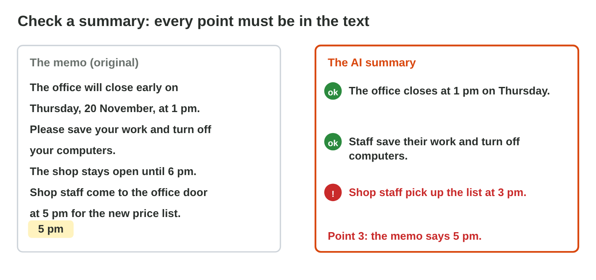
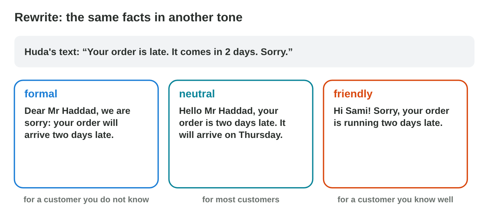
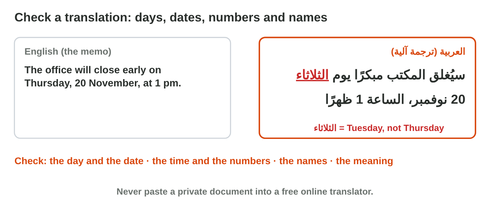

## Keywords



## Start fast: a first draft

:::: {.columns}
::: {.column width="50%"}
- AI writes a first draft fast: a notice, an e-mail or a letter.
- You give the facts in the prompt, and you read every line.
- The AI can add facts that nobody gave, so you delete them.
- Keep Text Only pastes only the words, and the styles of Word give the look.
:::
::: {.column width="50%"}

:::
::::

## Try it 1 · A first draft

a) Who is responsible for the words in an AI draft?
b) Which paste option takes only the text from the AI chat?
c) The draft says "Free coffee for all." Nobody said this. What do you do?

::: {.answer}
a) you
b) Keep Text Only
c) Delete it.
:::

## Long text, short time: a summary

:::: {.columns}
::: {.column width="50%"}
- A summary keeps only the main points of a long text.
- A summary can drop a point or change a number, a time or a name.
- You compare every point with the original.
- If a dropped detail matters to your reader, you add it again.
:::
::: {.column width="50%"}

:::
::::

## Live demo · Word AI Lab



## Try it 2 · A summary

a) The summary says 3 pm, and the memo says 5 pm. Which is right?
b) What does a summary keep?
c) What do you do with each point of a summary?

::: {.answer}
a) the memo
b) only the main points
c) Compare it with the original.
:::

## Same facts, better words: rewrite

:::: {.columns}
::: {.column width="50%"}
- A rewrite says the same facts in other words: shorter, simpler or more polite.
- The tone fits the reader: formal for a customer, friendly for a friend.
- A rewrite changes the words and the tone, never the facts.
- You delete every new promise, like a discount that nobody gave.
:::
::: {.column width="50%"}

:::
::::

## Live demo · Tone Lab



## Another language: translate and check

:::: {.columns}
::: {.column width="50%"}
- Review › Translate translates a short text in Word in seconds.
- A machine translation can change a day, a number or a name.
- You check the days, dates, numbers and names first.
- You never paste private texts into a free online translator.
:::
::: {.column width="50%"}

:::
::::

## Try it 3–4 · Tone and translation

a) After a rewrite, what must stay the same?
b) The memo says Thursday, and the Arabic says الثلاثاء. Is it right?
c) What do you check first in a translation?

::: {.answer}
a) the facts
b) No: الثلاثاء is Tuesday.
c) days, dates, numbers and names
:::

## Summary

- AI writes drafts, summaries, rewrites and translations fast.
- You give the facts in the prompt, and you delete every fact that nobody gave.
- A summary can drop a point or change a number, so you check it with the original.
- A rewrite changes the tone, never the facts.
- A translation must keep every day, number and name, and you check it.

## Your worksheet

:::: {.columns}
::: {.column width="50%"}
- Now do the four experiments of the worksheet alone.
- Part A is in an AI assistant and Word, with report-start.docx.
- Part B is on a simulator: scan its QR code, or click its link.
- Never type personal data into the AI, and write your result after each step.
:::
::: {.column width="50%"}

:::
::::

## Results of the worksheet

Which results do you have in your table?

::: {.reveal}
- Experiment 1: You delete every fact that you did not give, and the shop stays open until 6 pm.
- Experiment 2: The summary of the report drops details, and the price list is at 5 pm.
- Experiment 3: The rewrite keeps the facts, and each reader of Tone Lab gets the right tone.
- Experiment 4: Saturday is السبت, and Thursday is الخميس, not الثلاثاء.
:::
