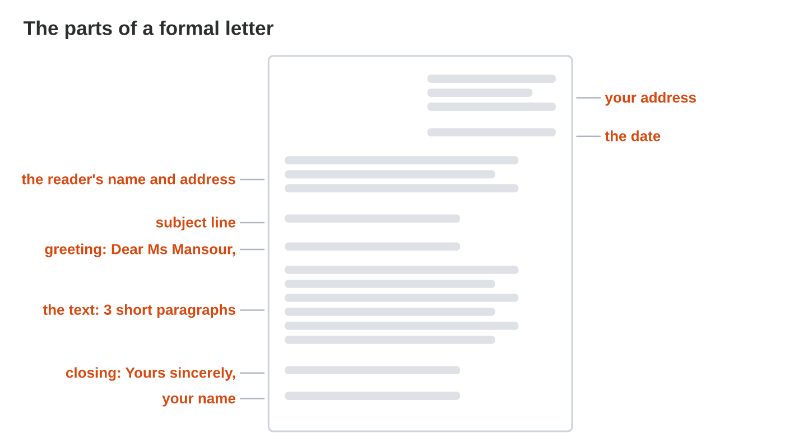
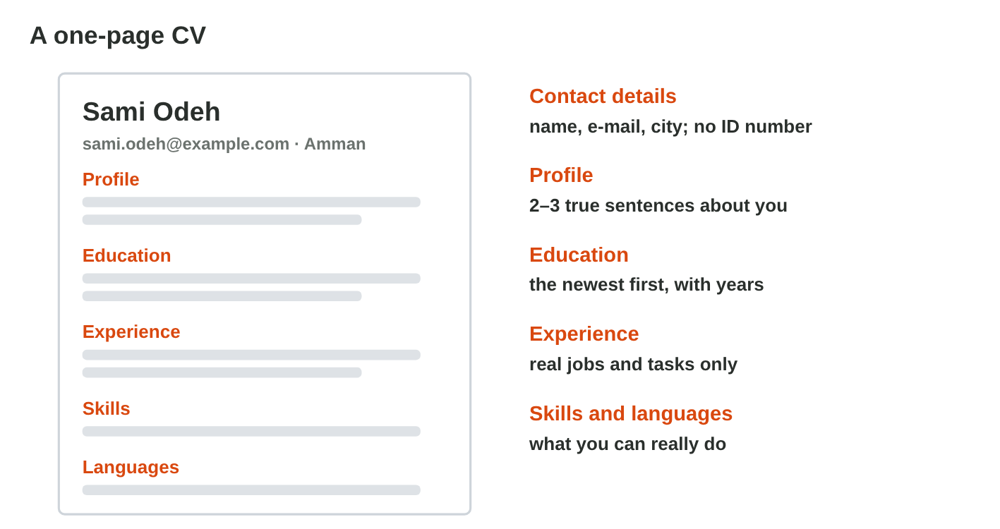
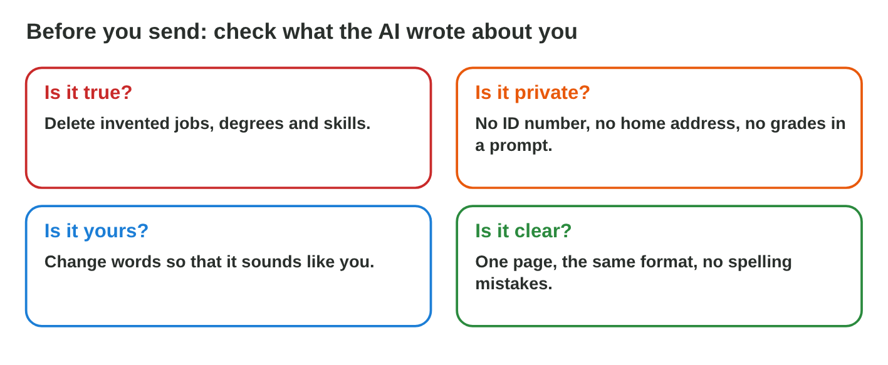

## Keywords



## The parts of a formal letter

:::: {.columns}
::: {.column width="50%"}
- A formal letter starts with your address and the date, then the reader's name and address.
- The subject line says the topic, and the greeting uses the name: Dear Ms Mansour,
- The text has three short paragraphs: why you write, about you, what you ask.
- It ends with Yours sincerely and your name, in a polite and clear tone.
:::
::: {.column width="50%"}

:::
::::

## Live demo · Letter Builder



## Try it 1 · The formal letter

a) What comes at the top of a formal letter?
b) Which closing fits a formal letter?
c) How many paragraphs does the text of a short letter have?

::: {.answer}
a) your address and the date
b) Yours sincerely,
c) three short ones
:::

## A one-page CV

:::: {.columns}
::: {.column width="50%"}
- A first CV tells a company about you on one page.
- Its parts are contact details, a profile, education, experience and skills.
- Word has CV templates: File › New, search for CV or resume.
- AI can suggest good words, but you keep only true facts.
:::
::: {.column width="50%"}

:::
::::

## Try it 2 · The CV

a) Which contact details are enough for a CV?
b) In which order do you write your education?
c) What is the profile of a CV?

::: {.answer}
a) name, e-mail and city
b) the newest first
c) 2–3 true sentences about you at the top
:::

## Check what the AI wrote about you

:::: {.columns}
::: {.column width="50%"}
- The AI does not know you, so it may invent a job, a degree or a skill.
- Before you send, you ask four questions: is it true, private, yours and clear?
- An ID number and a home address never go into a prompt or a CV.
- An invented line is dishonest, and a company can check it with one phone call.
:::
::: {.column width="50%"}

:::
::::

## Live demo · CV Checker



## Try it 3 · Check the AI

a) The AI wrote that Sami was a manager in 2019, when Sami was a child. What do you do?
b) Why does the AI sometimes invent a degree?
c) What do you ask first about each line the AI wrote about you?

::: {.answer}
a) Delete it.
b) It does not know you, so it guesses.
c) Is it true?
:::

## Summary

- A formal letter has fixed parts, from your address at the top to your name at the end.
- The subject line gives the topic, and the tone is polite and clear.
- A first CV is one page, and Word has templates for it.
- AI can suggest words, but you keep only your true facts.
- Before you send, you check that it is true, private, yours and clear.

## Your worksheet

:::: {.columns}
::: {.column width="50%"}
- Now do the three experiments of the worksheet alone.
- Part A is in an AI assistant and Word, with made-up details only.
- Part B is on a simulator: scan its QR code, or click its link.
- Write your result after each step, and fill in the table at the end.
:::
::: {.column width="50%"}

:::
::::

## Results of the worksheet

Which results do you have in your table?

::: {.reveal}
- Experiment 1: The AI letter often misses your address, the date or the subject line, and you add them.
- Experiment 2: The template has the parts of a CV, and you delete every big word that is not true.
- Experiment 3: The four questions find the problems, and CV Checker has four wrong lines.
:::
