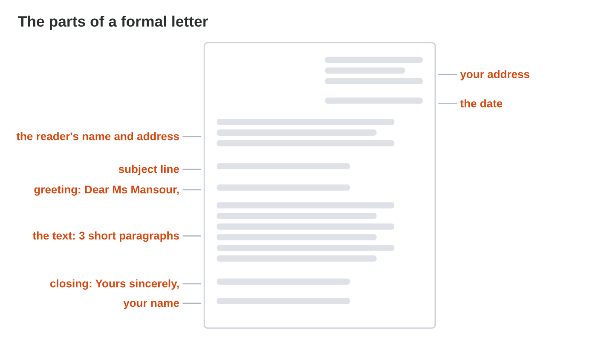
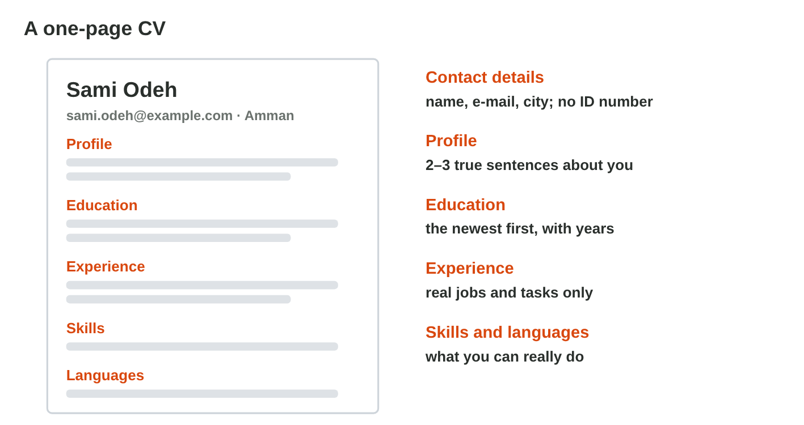
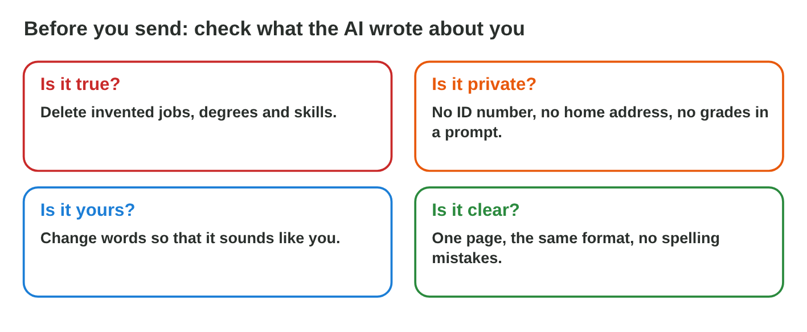

This page is the interactive version of Lecture 10. In class, the teacher
first explains the ideas with the slides. Then you do the **worksheet
(PDF)**: three experiments, each with Part A in an AI assistant and Word,
and Part B on a simulator of this page. Each section below explains one
idea, then shows its experiment: do each step, then tap, sort, put in order
or type its result. The page checks it at once and tells you why.

## Key terms



## Before you start

- **You need:** Word and an AI assistant that the university allows (for
  example `copilot.microsoft.com`).
- **No lab computer?** Do Part B of each experiment on your phone. Do Part A
  later on any computer with Word.
- **Never type personal data** (an ID number, your home address, a phone
  number) into an AI tool or a CV: use made-up details.
- What you type in the table of results stays in this browser only.

{width=100%}

## 10.1 The parts of a formal letter

- A **formal letter** goes to a company, a school or an office. It has fixed
  parts, from the top to the bottom:
  1. **your address** (at the top, on the right) and **the date**;
  2. **the reader's name and address** (on the left);
  3. the **subject line**: *Subject: Request for a training place*;
  4. the **greeting**: *Dear Ms Saleh,* (you know the name) or *Dear Sir or
     Madam,* (you do not);
  5. the text: **three short paragraphs**: why you write; about you; what
     you ask, and thanks;
  6. the **closing** *Yours sincerely,* and **your name**.
- The tone is **polite and clear**: no "Hi!", no emoji, no slang.
- An AI chat can draft the text. A good prompt: *Write a formal letter to
  Ms Rana Saleh, HR Manager of Sunrise Company. I am a first-year diploma
  student and I ask for a summer training place in the office. Three short
  paragraphs, formal tone.* Then you check every fact.

{width=100%}





::: {.callout-tip title="Try it 1 · The formal letter"}
Choose the right answer.

::: {.match extra="Hi Rana!|at the very end"}
What comes at the top of a formal letter?
:   your address and the date

    Why: A formal letter starts with your address and the date at the top.

Which greeting fits when you know the reader's name?
:   Dear Ms Saleh,

    Why: When you know the name, the greeting uses it.

Which closing fits a formal letter?
:   Yours sincerely,

    Why: It is the formal closing before your name.

What does the subject line give?
:   what the letter is about, in one line

    Why: The reader sees the topic of the letter at once.

How many paragraphs does the text of a short letter have?
:   three short ones

    Why: Why you write; about you; what you ask, and thanks.
:::
:::

## 10.2 A one-page CV

- A **CV** (curriculum vitae) tells a company about you, on **one page**.
- Its parts: **contact details** (name, e-mail, city; no ID number); a
  **profile** of 2–3 true sentences; **education** (the newest first, with
  the years); **experience** (real jobs, with the place, the time and your
  tasks); **skills** and **languages**.
- Word has **CV templates**: File › New, search for "resume" or "CV". Choose
  a simple one.
- AI can suggest good words for the profile and the tasks. Give it your real
  facts, and keep only what is true.

{width=100%}





::: {.callout-tip title="Try it 2 · The CV"}
Choose the right answer.

::: {.match extra="three pages|your ID number"}
How long is a CV for a first job or a training place?
:   one page

    Why: A first CV fits on one page.

Which contact details are enough?
:   name, e-mail and city

    Why: No ID number and no home address are needed.

In which order do you write your education?
:   the newest first

    Why: The reader sees your newest study first.

What is the profile?
:   2–3 true sentences about you at the top

    Why: The profile is a short, true start of the CV.

Where do you find a CV template in Word?
:   File › New, search "CV" or "resume"

    Why: Word has ready-made CV templates.
:::
:::

## 10.3 Check what the AI wrote about you

- The AI does not know you. It may **invent** a job, a degree or a skill to
  make the CV look better (a hallucination, Lecture 3).
- Before you send a letter or a CV, ask four questions:
  - **Is it true?** Delete invented jobs, degrees and skills.
  - **Is it private?** No ID number and no home address in a prompt or a CV.
  - **Is it yours?** Change words so that it sounds like you.
  - **Is it clear?** One page, the same format, no spelling mistakes.
- An invented line is dishonest, and a company can check it with one phone
  call.

{width=100%}





::: {.callout-tip title="Try it 3 · Check the AI"}
Choose the right answer.

::: {.match extra="keep it, it looks good|make it smaller"}
The AI wrote that Sami was a manager in 2019. Sami was a child then. What do you do?
:   delete it

    Why: It is not true: Sami was a child in 2019.

Why does the AI sometimes invent a degree?
:   it does not know you, it guesses

    Why: The AI writes likely words, not facts about you.

Should your ID number be in your CV?
:   no

    Why: An ID number is personal data, and a CV does not need it.

The CV says "Expert in Python". Sami never learned it. What is it?
:   an invented skill

    Why: Sami never learned it: the AI invented it.

What do you ask first about each line the AI wrote about you?
:   is it true?

    Why: An invented line is dishonest, and a company can check it.
:::
:::

## Table of results



## Summary {.summary}

- A formal letter has fixed parts: your address and the date, the reader, the subject, the greeting, three paragraphs, the closing.
- The tone of a formal letter is polite and clear.
- A first CV is one page: contact details, a profile, education, experience, skills.
- Word has CV templates; AI can suggest words, but you keep only true facts.
- Before you send: is it true, is it private, is it yours, is it clear?
