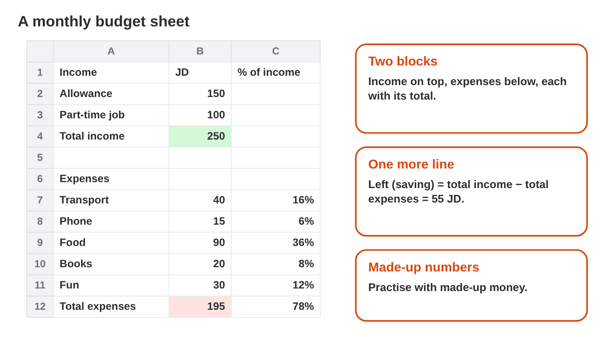
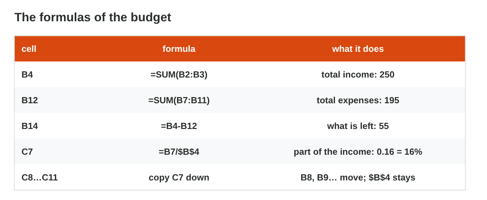
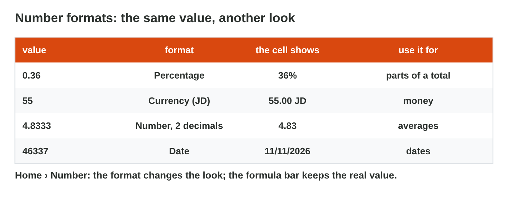

## Keywords



## The layout and the totals

:::: {.columns}
::: {.column width="50%"}
- A budget plans the money of one month: income comes in, and expenses go out.
- It has two blocks on one sheet, each with a Total line.
- =SUM adds each block, and Left is the total income minus the total expenses.
- JD goes in the heading, so the cells hold only numbers.
:::
::: {.column width="50%"}

:::
::::

## Live demo · Budget Builder



## Try it 1 · The layout

a) What is an expense?
b) Where do you write "JD"?
c) What does each block of a budget end with?

::: {.answer}
a) money that goes out
b) in the heading of the column
c) a Total line
:::

## The part of the income

:::: {.columns}
::: {.column width="50%"}
- Each expense is a part of the income: its amount divided by the total income.
- In C7 you write =B7/\$B\$4, then copy it down with the fill handle.
- B7 moves to B8 and B9, but \$B\$4, the total income, stays.
- If one amount changes, every total and every part changes by itself.
:::
::: {.column width="50%"}

:::
::::

## Try it 2 · The formulas

a) Sami's income is 150 + 100. Which formula gives the total income in B4?
b) Food is 90 of an income of 250. What does =B9/\$B\$4 give?
c) Why is there a \$ in \$B\$4?

::: {.answer}
a) =SUM(B2:B3)
b) 0.36
c) The total income stays the same in every row.
:::

## Make it readable: number formats

:::: {.columns}
::: {.column width="50%"}
- A number format changes how a number looks, not the number itself.
- Percentage shows 0.36 as 36%, and money gets 2 decimals.
- You make the Total lines bold, and you widen a column that shows ####.
- The formula bar always shows the real value.
:::
::: {.column width="50%"}

:::
::::

## Live demo · Number Format Lab



## Try it 3 · Formats

a) What does 0.36 look like in the Percentage format?
b) Does a number format change the value in the formula bar?
c) A cell shows ####. What do you do?

::: {.answer}
a) 36%
b) No, only the look.
c) Make the column wider.
:::

## Summary

- A budget has two blocks, income and expenses, each with a Total line.
- =SUM adds each block, and Left is the income minus the expenses.
- The part of an expense is its amount divided by \$B\$4.
- If one amount changes, every total and part changes by itself.
- A number format changes the look, not the value.

## Your worksheet

:::: {.columns}
::: {.column width="50%"}
- Now do the three experiments of the worksheet alone.
- Part A is in Excel, with the made-up month of Lina.
- Part B is on a simulator: scan its QR code, or click its link.
- Write your result after each step, and fill in the table at the end.
:::
::: {.column width="50%"}

:::
::::

## Results of the worksheet

Which results do you have in your table?

::: {.reveal}
- Experiment 1: Lina has 200 JD of income, 150 JD of expenses and 50 JD left.
- Experiment 2: Food is 0.35 of the income, and with 80 JD of food 40 JD are left.
- Experiment 3: C7 shows 15%, but the formula bar still shows the formula.
:::
