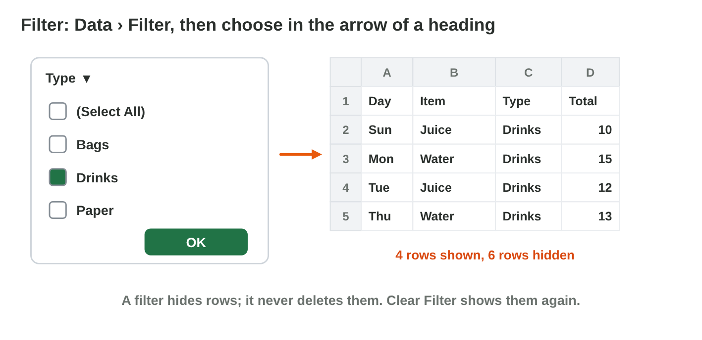
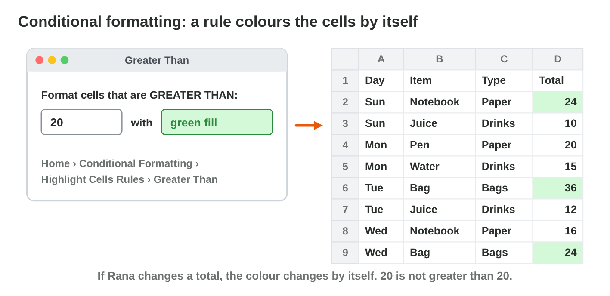
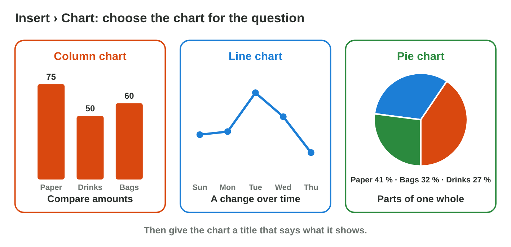

## Keywords



## Sort and filter

:::: {.columns}
::: {.column width="50%"}
- Sort puts the rows in order, by a number or by a word: Data › Sort.
- You click one cell of the table first, so each row moves as a whole.
- A filter shows only the rows that you need, like one type.
- The other rows are only hidden, and Clear Filter brings them back.
:::
::: {.column width="50%"}

:::
::::

## Live demo · Table Lab



## Try it 1–2 · Sort and filter

a) What happens to each row when you sort?
b) What happens to the rows a filter does not show?
c) How do you see all rows again?

::: {.answer}
a) It moves as a whole.
b) They are hidden.
c) Clear Filter
:::

## Colour by a rule

:::: {.columns}
::: {.column width="50%"}
- Conditional formatting colours cells by a rule, like Greater Than 20.
- It is on Home › Conditional Formatting › Highlight Cells Rules.
- The rule checks the cells again when a number changes.
- A colour that you add by hand does not follow the numbers.
:::
::: {.column width="50%"}

:::
::::

## Try it 3 · A colour rule

a) Is the total 20 coloured by the rule Greater Than 20?
b) The juice changes from 12 to 22. What happens to its cell?
c) Where is conditional formatting?

::: {.answer}
a) no
b) It turns green by itself.
c) Home › Conditional Formatting
:::

## Show it as a picture: charts

:::: {.columns}
::: {.column width="50%"}
- A column chart compares amounts, like the sales of three types.
- A line chart shows a change over time, like Sunday to Thursday.
- A pie chart shows the parts of one whole.
- Every chart gets a real title that says what it shows.
:::
::: {.column width="50%"}

:::
::::

## Live demo · Chart Lab



## Try it 4 · Which chart?

a) You compare Paper, Drinks and Bags. Which chart do you make?
b) You show the part of each type in the 185 JD. Which chart do you make?
c) You compare the sales of five shops in one month. Which chart do you make?

::: {.answer}
a) a column chart
b) a pie chart
c) a column chart
:::

## Summary

- Sort puts whole rows in order, and a filter hides the rows you do not need.
- A filter never deletes rows, and Clear Filter shows them again.
- A colour rule checks the cells again when the numbers change.
- Columns compare, a line shows change over time, and a pie shows parts of a whole.
- Every chart needs a real title.

## Your worksheet

:::: {.columns}
::: {.column width="50%"}
- Now do the four experiments of the worksheet alone.
- Part A is in Excel, with the start file sales-start.xlsx.
- Part B is on a simulator: scan its QR code, or click its link.
- Write your result after each step, and fill in the table at the end.
:::
::: {.column width="50%"}

:::
::::

## Results of the worksheet

Which results do you have in your table?

::: {.reveal}
- Experiment 1: The bag of Wednesday, 48 JD, is on top, and the water of Sunday at the bottom.
- Experiment 2: Paper has 4 rows and a Sum of 77, and Clear Filter shows all 10 rows.
- Experiment 3: The rule colours 24, 30 and 48, and the juice with 22 gets the colour by itself.
- Experiment 4: Paper has the highest column, and the pie shows 77, 51 and 72 of 200 JD.
:::
