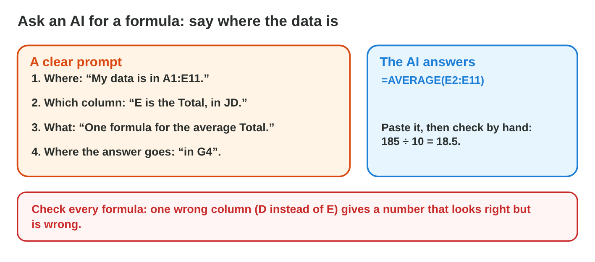
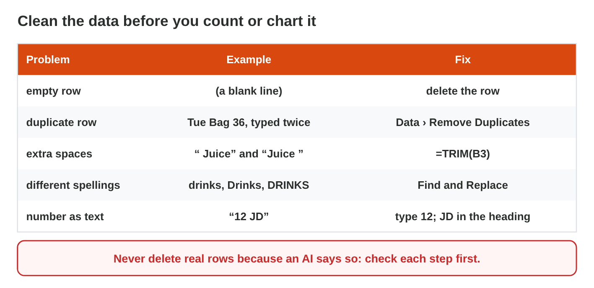
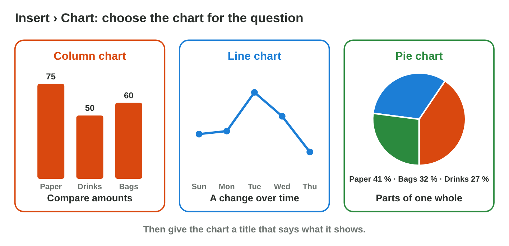

## Keywords



## Ask an AI for a formula, then test it

:::: {.columns}
::: {.column width="50%"}
- An AI tool can write a formula for you.
- Your prompt says where the data is, which column holds what, and what you want.
- You test every formula: you check one small result by hand.
- An AI can use a wrong column, and the number still looks normal.
:::
::: {.column width="50%"}

:::
::::

## Live demo · AI Formula Lab



## Try it 1 · Formulas from an AI

a) What must a prompt for a formula say?
b) How do you check a formula from an AI?
c) The 10 totals add up to 185 JD. What must the average be?

::: {.answer}
a) where the data is, which columns, and what you want
b) Compute one small result by hand.
c) 18.5 JD
:::

## Clean the data with AI advice

:::: {.columns}
::: {.column width="50%"}
- Messy data has rows typed twice, extra spaces, two spellings and "12 JD" as text.
- Messy data gives wrong results: a row typed twice counts twice, and SUM skips text.
- An AI tool can list the steps, but you check each step before you do it.
- You never delete real rows just because an AI says so.
:::
::: {.column width="50%"}

:::
::::

## Live demo · Clean Data Lab



## Try it 2 · Clean data

a) Which tool removes rows typed twice?
b) Which function removes extra spaces?
c) What do you do with "12 JD" in a Total cell?

::: {.answer}
a) Data › Remove Duplicates
b) TRIM
c) Type 12, and keep JD in the heading.
:::

## Check the AI's chart advice

:::: {.columns}
::: {.column width="50%"}
- An AI can suggest a chart and a title, but its advice is not always right.
- Columns compare amounts, a line shows change over time, and a pie shows parts of a whole.
- You make the chart from the clean data.
- You write a real title, never Chart 1.
:::
::: {.column width="50%"}

:::
::::

## Try it 3 · Check the advice

a) The AI says: "Show the sales of the 5 days in a pie chart." What do you make?
b) The AI says: "Compare Paper, Drinks and Bags in a column chart." Is it good advice?
c) Your chart shows Bags 96 JD, but the paper says 60 JD. What happened?

::: {.answer}
a) a line chart
b) Yes: columns compare amounts.
c) A row was typed twice.
:::

## Summary

- A prompt for a formula says where the data is, which column, and what you want.
- You test every AI formula with one small result by hand.
- Messy data gives wrong results, so you clean it first.
- You check each AI step, and you never delete real rows.
- You check AI chart advice with the rule of the three charts.

## Your worksheet

:::: {.columns}
::: {.column width="50%"}
- Now do the three experiments of the worksheet alone.
- Part A is in an AI assistant and Excel, with sales-start.xlsx.
- Part B is on a simulator: scan its QR code, or click its link.
- Write your result after each step, and fill in the table at the end.
:::
::: {.column width="50%"}

:::
::::

## Results of the worksheet

Which results do you have in your table?

::: {.reveal}
- Experiment 1: =AVERAGE(E2:E11) gives 20, and the AI of Job 3 used column D instead of E.
- Experiment 2: The clean list has 5 rows and a SUM of 87 JD, and you never delete the totals under 12.
- Experiment 3: The sales from Sunday to Thursday need a line chart with a real title.
:::
