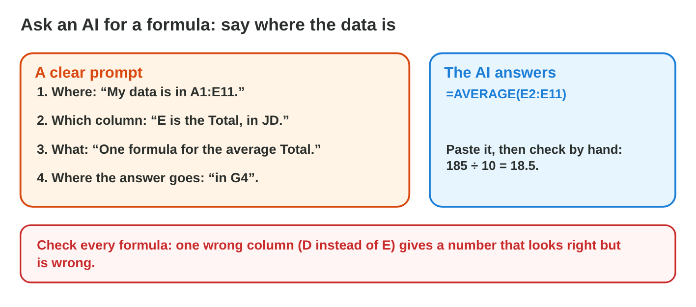
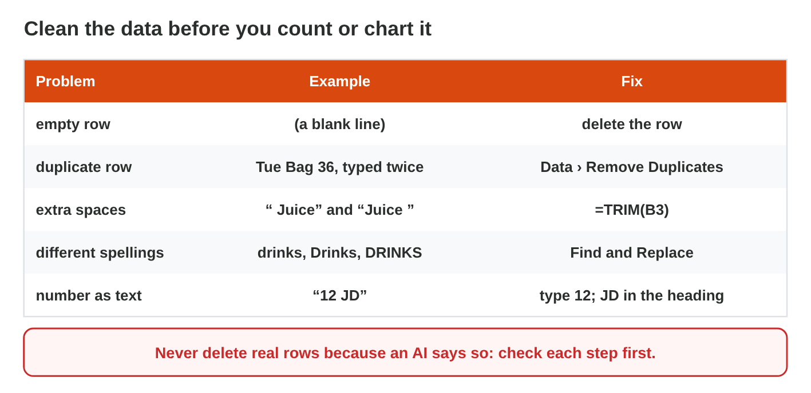
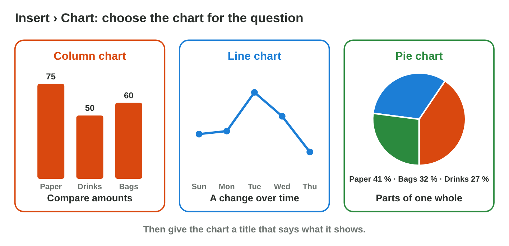

This page is the interactive version of Lecture 14. In class, the teacher
first explains the ideas with the slides. Then you do the **worksheet
(PDF)**: three experiments, each with Part A in an AI assistant and Excel,
and Part B on a simulator of this page. Each section below explains one
idea, then shows its experiment: do each step, then tap, sort or type its
result. The page checks it at once and tells you why.

## Key terms



## Before you start

- **You need:** Excel, an AI assistant that the university allows (for
  example `copilot.microsoft.com`) and the start file of Lecture 13.
- **No lab computer?** Do Part B of each experiment on your phone. Do Part A
  later on any computer with Excel.



- What you type in the table of results stays in this browser only.

{width=100%}

## 14.1 Ask an AI for a formula, then test it

- An AI tool can write a formula for you. Tell it three things: **where**
  the data is, **which column** holds what, and **what** you want.
- Example prompt: "My data is in A1:E11. Column E is the Total in JD. Write
  one formula for the average Total."
- The answer: `=AVERAGE(E2:E11)`: a function of Lecture 11.
- **Test every formula.** Check one small result by hand: 185 ÷ 10 = 18.5.
  An AI can use a wrong column, and the number still looks normal.

{width=100%}





::: {.callout-tip title="Try it 1 · Formulas from an AI"}
Use AI Formula Lab. Choose the right answer.

::: {.match extra="the AI is always right|19.5"}
What must a prompt for a formula say?
:   where the data is, which columns, and what you want

    Why: Then the AI uses the right cells for the right job.

What does =SUM(E2:E11) give?
:   185

    Why: The ten totals add up to 185 JD.

What does =MAX(E2:E11) give?
:   36

    Why: The bag of Tuesday, 36 JD, is the biggest total.

What was wrong in the AI answer of Job 3?
:   it used column D instead of E

    Why: Column D is the Qty, not the Total: 19.5 instead of 18.5.

How do you check a formula from an AI?
:   compute one small result by hand

    Why: A wrong column gives a number that looks normal.
:::
:::

## 14.2 Clean the data with AI advice

- Data from paper or from many people is often **messy**: empty rows, rows
  typed twice, extra spaces, "drinks" and "Drinks", "12 JD" as text.
- Messy data gives wrong results: a filter misses rows, and SUM skips text.
- An AI tool can list the steps. **You** check each step before you do it.
- The tools: delete empty rows; **Data › Remove Duplicates**; `=TRIM(B3)`
  for spaces; **Find and Replace** for spellings; type numbers without
  "JD".
- Never delete real rows just because an AI says so.

{width=100%}





::: {.callout-tip title="Try it 2 · Clean data"}
Use Clean Data Lab. Choose the right answer.

::: {.match extra="Data › Sort|keep them"}
Which tool removes rows typed twice?
:   Data › Remove Duplicates

    Why: It removes the rows that are typed twice.

Which function removes extra spaces?
:   TRIM

    Why: TRIM removes the extra spaces in a text.

What do you do with "12 JD" in a Total cell?
:   type 12 and keep JD in the heading

    Why: Then the cell holds a number, and SUM counts it.

Which AI step was a bad idea?
:   delete the totals under 12

    Why: It deletes real sales, so the total of the week is wrong.

What is the SUM of the clean list?
:   185 JD

    Why: The clean list has the ten real sales, as on the paper.
:::
:::

## 14.3 Check the AI's chart advice

- An AI can suggest a chart and a title. Its advice is not always right.
- Check it with the rule of Lecture 13: **compare** amounts → column chart;
  **change over time** → line chart; **parts of one whole** → pie chart.
- Make the chart from the **clean** list: a chart of messy data shows wrong
  numbers.
- Check the title: it says what the chart shows, never "Chart 1".
- In **Chart Lab**, try a pie chart of the sales per day, as a weak AI
  answer may advise. Read what the lab says, then make the right chart.

{width=100%}





::: {.callout-tip title="Try it 3 · Check the advice"}
Choose the right answer.

::: {.match extra="a pie chart of the days|keep the title Chart 1"}
The AI says: "Show the sales of the 5 days in a pie chart." What do you make?
:   a line chart

    Why: A line shows a change over time; a pie shows the parts of one whole.

The AI says: "Compare Paper, Drinks and Bags in a column chart." Is it good advice?
:   yes, columns compare amounts

    Why: Columns compare amounts side by side.

The AI suggests the title "Chart 1". What do you write?
:   what the chart shows

    Why: A real title says what the chart shows.

Your chart shows Bags 96 JD, but the paper says 60 JD. What happened?
:   a row was typed twice

    Why: The bag of Tuesday (36 JD) is counted twice: 60 + 36 = 96.
:::
:::

## Table of results



## Summary {.summary}

- Tell the AI where the data is, which column holds what, and what you want.
- Test every AI formula with one small result by hand.
- Messy data gives wrong results: remove duplicates, TRIM spaces, one spelling, numbers without JD.
- Check each AI step before you do it; never delete real rows.
- Check AI chart advice: columns compare, a line shows change, a pie shows parts of a whole.
