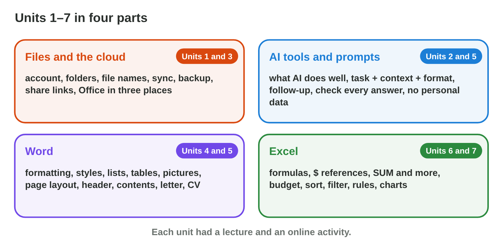
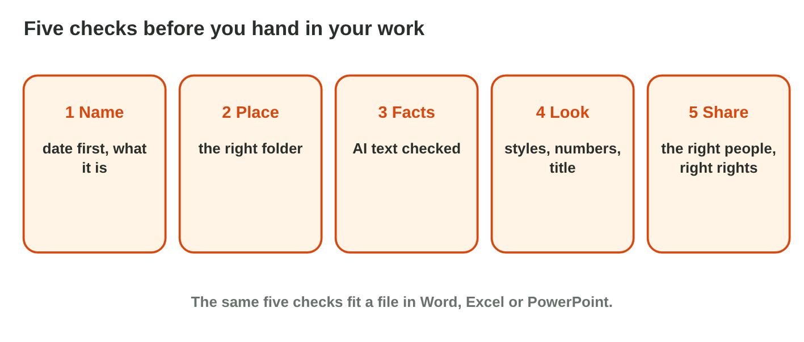
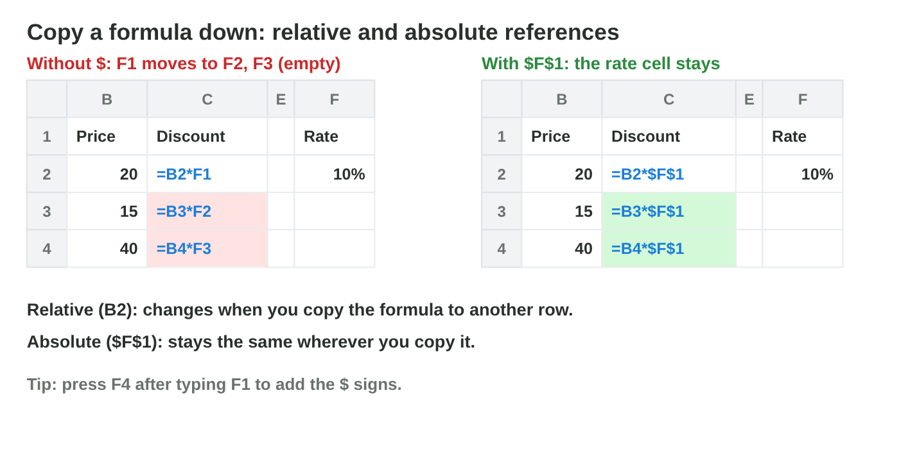

This page is the interactive version of Lecture 15. No new ideas: you
practise Lectures 1–14. In class, the teacher first recalls the main ideas
with the slides. Then you do the **worksheet (PDF)**: two experiments, each
with Part A in the apps and Part B on a simulator of this page. Each
section below shows its experiment: do each step, then tap or type its
result. The page checks it at once and tells you why.

## Before you start

- **You need:** Word, Excel and an AI assistant that the university allows
  (for example `copilot.microsoft.com`).
- **No lab computer?** Do Part B of each experiment on your phone. Do Part A
  later on any computer with Office.
- What you type in the table of results stays in this browser only.

{width=100%}

## Recall

- **Files and AI:** a good file name starts with the date. A clear prompt
  has a task, a context and a format. You check every AI answer, and you
  never type personal data.
- **Word:** the styles Title and Heading 1 make clear headings. Keep Text
  Only pastes plain text. A PDF keeps the look of the page.
- **Excel:** a formula starts with =. \$F\$1 stays the same when you copy.
  Sort, a rule and a chart answer questions about the data.

{width=100%}



::: {.callout-tip title="Try it 1 · Recall"}
Play **Huda's Busy Day**. Then choose the right answer.

::: {.match extra="Book1.xlsx|=B2\*F1"}
Which file name is best for the price list of 3 November 2026?
:   2026-11-03_price-list.xlsx

    Why: The date comes first (year-month-day), then what it is, with no spaces.

The AI's notice says that the shop also closes at 1 pm. That is not true. What does Huda do?
:   correct it before she sends it

    Why: Huda checks every AI answer, and she is responsible for the notice.

Every price is multiplied by the tax rate in F1. Which formula can Huda copy down?
:   =B2\*\$F\$1

    Why: \$F\$1 stays in every row, and B2 moves down.
:::
:::

## 15.1 A notice with AI, in Word

The library of the college closes early on **Sunday at 2 pm** because of a
meeting. Huda must put a short notice on the door and send it as a PDF.
She asks an AI tool for the text.

{width=100%}



::: {.callout-tip title="Try it 2 · The notice"}
Choose the right answer.

::: {.match extra="send it at once|Bold and size 20"}
The AI adds "Books are free this week." Nobody said it. What do you do?
:   delete it

    Why: A notice has only true facts, and the AI invented this one.

Which paste option takes only the words from the AI chat?
:   Keep Text Only

    Why: It pastes plain text, without the look of the chat.

Nobody may change the notice that you send. Which format do you use?
:   PDF

    Why: A PDF keeps the look, and people do not easily change it.
:::
:::

## 15.2 Prices with tax in Excel

Rana sells five items in the Sunrise shop: Notebook 2 JD, Pen 0.5 JD, Bag
12 JD, Folder 1.5 JD and Bottle 4 JD. The tax rate, **10 %**, is in cell
F1. Rana wants the price with tax of each item, the total, the most
expensive items first and a chart.

{width=100%}





::: {.callout-tip title="Try it 3 · The price list"}
Use the price list of Experiment 2. Choose the right answer.

::: {.match extra="=B3\*\$F\$2|3"}
C2 has =B2\*\$F\$1. You copy it to C3. Which formula is in C3?
:   =B3\*\$F\$1

    Why: B2 moves one row down, and \$F\$1 stays.

What is the price with tax of the bag (12 JD, tax 10 %)?
:   13.2 JD

    Why: The tax is 12 × 10 % = 1.2 JD, and 12 + 1.2 = 13.2 JD.

How many prices with tax are greater than 4 JD?
:   2

    Why: 13.2 and 4.4 are greater than 4; 2.2, 1.65 and 0.55 are not.
:::
:::

## Table of results



## Wrap-up {.summary}

- You can make a short document with AI help, check its facts, format it,
  and save it with a good name and a PDF copy.
- You can make a price list with formulas, a \$ reference, a sort, a rule
  and a chart.
