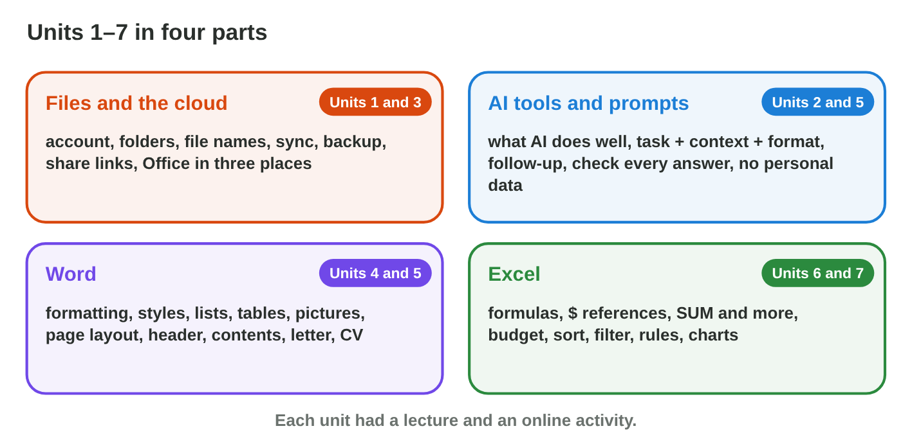

This page is the interactive version of Practice 2. No new ideas: you
practise Lectures 1–14 before the midterm exam. In class, the teacher first
recalls the main ideas with the slides. Then you do the **worksheet
(PDF)**: three experiments, each with Part A in the apps and Part B on a
simulator of this page. Each section below shows its experiment: do each
step, then tap, sort or type its result. The page checks it at once and
tells you why.

## Before you start

- **You need:** Word and Excel.
- **No lab computer?** Do Part B of each experiment on your phone. Do Part A
  later on any computer with Office.
- What you type in the table of results stays in this browser only.

{width=100%}

## Recall

- **Files and the cloud:** a good file name has the date, what it is and a
  version. Sync copies every change; a backup is a separate copy.
- **AI:** a clear prompt has a task, a context and a format. Check every AI
  answer, and never type personal data.
- **Word:** heading styles make the table of contents; page numbers go in
  the footer; a PDF copy keeps the look.
- **Excel:** SUM, AVERAGE and MAX work on a range; \$B\$7 stays the same
  when you copy a formula.

{width=100%}

## P2.1 Word: headings, contents and page numbers

**In Contents Builder:** give each heading a heading style, insert the
contents (**References › Table of Contents**), then add a heading and click
**Update Table**. A cover with no page number needs **Different First
Page**.





::: {.callout-tip title="Try it 1 · Word"}
Choose the right answer.

::: {.match extra="bold text|Insert › Picture"}
What does Word use to build the contents?
:   the heading styles

    Why: Word builds the contents from Heading 1 and Heading 2.

Where do you insert the contents?
:   References › Table of Contents

    Why: The table of contents is on the References tab.

You added a heading. What do you click?
:   Update Table

    Why: Word does not update the contents by itself.

The cover must have no page number. What do you tick?
:   Different First Page

    Why: The first page gets its own header and footer.
:::
:::

## P2.2 Excel: functions and a $ reference

- **SUM**, **AVERAGE** and **MAX** work on a range: `=SUM(B2:B6)`.
- A formula starts with = (`=B2*C2`); copied down with the **fill handle**,
  B2 becomes B3, B4 …
- A **\$** keeps a reference: `=B2/$B$7` keeps the total B7 in every row.
- The Percentage format shows 0.3 as 30%; the value stays the same.





::: {.callout-tip title="Try it 2 · Excel"}
Choose the right answer.

::: {.match extra="=B2\*F2|48"}
B2 = 6, C2 = 7. What does =B2\*C2 show?
:   42

    Why: 6 × 7 = 42.

You copy =B2\*\$F\$1 from C2 to C5. What is in C5?
:   =B5\*\$F\$1

    Why: B2 moves three rows down, and \$F\$1 stays.

Which part stays the same when you copy =B2\*\$F\$1?
:   \$F\$1

    Why: The \$ signs keep the address when you copy.

What does the fill handle do?
:   it copies the formula down

    Why: The fill handle copies the formula, and the relative references change.
:::
:::

## P2.3 Files and the practice quiz

- A good file name has the date (year-month-day), what it is and a version,
  with no spaces. A PDF copy keeps the look.

**In the Practice Quiz:** answer the 14 questions on
Lectures 1–14: files, AI, Word and Excel. Do **All** first, then the part with the most wrong
answers again. The feedback after each answer says the rule. Nothing is
saved or sent.





::: {.callout-tip title="Try it 3 · The quiz"}
Choose the right answer.

::: {.match extra="nothing|=SUM(B2:B9)"}
What keeps an older copy of your files that a mistake does not reach?
:   a backup

    Why: A backup is an extra copy in a separate place.

An AI answer gives a date that is not in your document. What is it?
:   a hallucination: check and correct it

    Why: AI tools can invent facts that sound right.

Where do you put the page number, so that it is on every page?
:   in the header or the footer

    Why: Insert › Page Number puts it there, on every page.

Which formula gives the biggest number in B2:B9?
:   =MAX(B2:B9)

    Why: MAX finds the largest value.
:::
:::

## Table of results



## Wrap-up {.summary}

- You can make a Word document with heading styles, a table of contents and page numbers.
- You can find the total, the average and the best day, and the part of each day with $.
- You can save your work with good names and a PDF copy.
- You know which part of Lectures 1–14 to study again before the exam.
