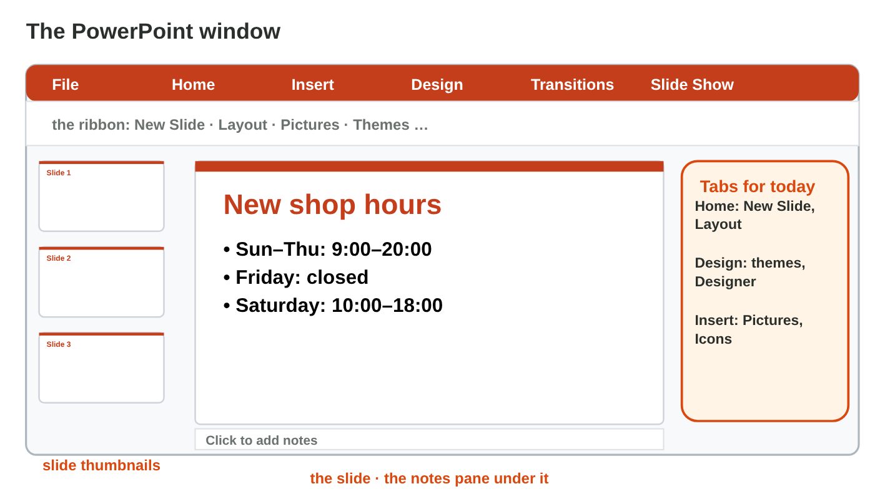
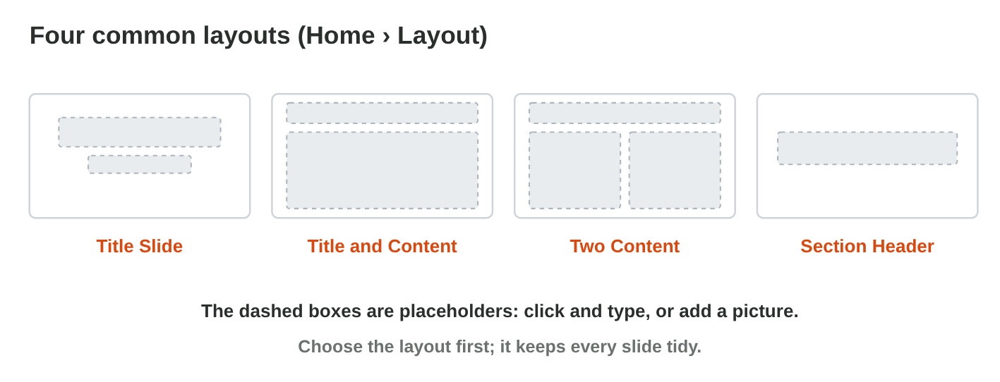
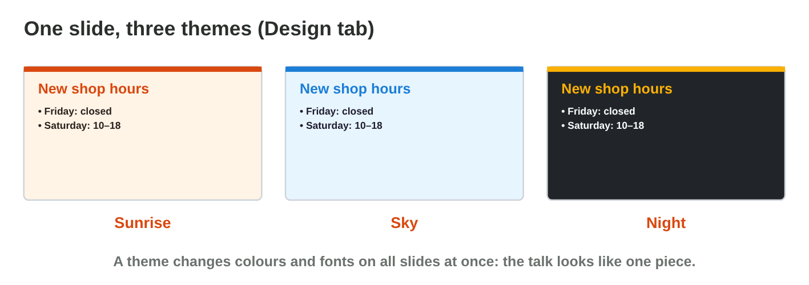
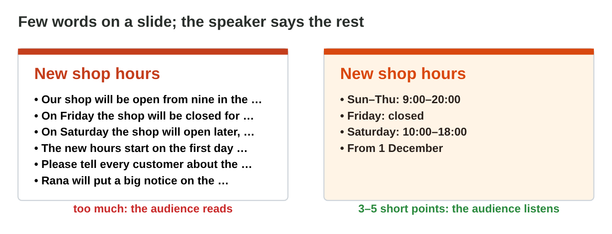
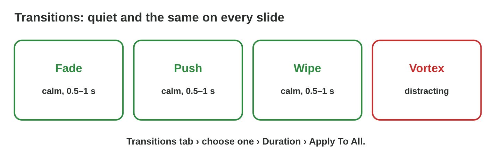
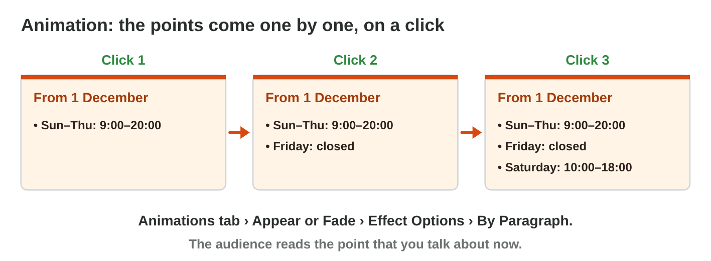

This page is the interactive version of Lecture 15. In class, the teacher
first explains the ideas with the slides. Then you do the **worksheet
(PDF)**: three experiments, each with Part A in PowerPoint and Part B on a
simulator of this page. Each section below explains one
idea, then shows its experiment: do each step, then tap, sort or type its
result. The page checks it at once and tells you why.

## Key terms



## Before you start

- **You need:** PowerPoint (the desktop app, or PowerPoint on the web at
  `office.com`).
- **No lab computer?** Do Part B of each experiment on your phone. Do Part A
  later on any computer with PowerPoint.
- **Start file:** download it, then open it in PowerPoint. Every student
  works with the same talk, *Saving Water at Home*.



- What you type in the table of results stays in this browser only.

{width=100%}

## 15.1 Slides, layouts and a theme

- The window: **thumbnails** on the left, the **slide** in the middle, the
  **notes pane** under it.
- A **layout** is the plan of a slide. Its **placeholders** are dashed
  boxes: click and type.
- **Home › New Slide** (choose the layout) and **Home › Layout**.
- First slide: **Title Slide**. Most slides: **Title and Content**. A list
  next to a picture: **Two Content**.
- A picture works as in Word: resize it from a corner, write its alt text.
- **F5** starts the slide show, **Esc** stops it.
- A **theme** gives all slides the same colours, fonts and background:
  **Design** tab.
- **Variants** change the colours of the same theme.
- **Designer** (Design › Designer) suggests designs for the slide you are
  on.
- Strong **contrast**: dark text on light, or light text on dark.

{width=100%}

{width=100%}

{width=100%}



::: {.callout-warning title="Watch out!"}
Do not draw your own text boxes on a Blank slide. Use the placeholders. Light grey text on light blue cannot be read from the back of the room.
:::



::: {.callout-tip title="Try it 1 · Layouts and themes"}
Choose the right answer.

::: {.match extra="Insert › Table|Home › Font"}
What is the dashed box "Click to add title"?
:   a placeholder

    Why: A placeholder is a box of the layout where you click and type.

Which layout fits the first slide?
:   Title Slide

    Why: The first slide gives the topic and your name.

Which layout puts a list next to a picture?
:   Two Content

    Why: It has two placeholders side by side.

Where do you choose a theme?
:   Design tab

    Why: Themes, Variants and Designer are on the Design tab.

What changes when you click a theme?
:   the colours and fonts of all slides

    Why: A theme gives the whole talk one look.

Which text is easy to read on a dark background?
:   light text

    Why: Light on dark is a strong contrast.
:::
:::

## 15.2 Few words on the slide, the rest in the notes

- **One idea** per slide, a short title, **3 to 5 points**.
- Each point about **8 words or fewer**; text about **24 pt** or bigger.
- The details are what you **say**: write them in the **speaker notes**,
  the notes pane under the slide (View › Notes).
- In the slide show, **Presenter View** shows the notes only to you.

{width=100%}

::: {.callout-warning title="Watch out!"}
A smaller font does not fix a slide with too much text.
:::

Part B of this experiment is the Game challenge of this page: **Slide
Doctor**, below.



::: {.callout-tip title="Try it 2 · Few words and notes"}
Choose the right answer.

::: {.match extra="10 points|a smaller font|everybody"}
How many points should a slide have?
:   3 to 5

    Why: One idea and a few short points per slide.

How long is a good point?
:   about 8 words or fewer

    Why: Short points can be read from the back at a glance.

Where do you write what you will say?
:   in the speaker notes

    Why: The notes pane under the slide keeps the details.

Who sees the speaker notes in the slide show?
:   only the speaker

    Why: Presenter View shows the notes to you; the audience sees the slide.
:::
:::

## 15.3 Movement: transitions and animations

- A **transition** is the way one slide changes to the next: **Transitions**
  tab › Fade › Duration 0.5–1 s › **Apply To All**.
- An **animation** makes one thing on a slide appear or move: select the
  list › **Animations** tab › **Appear** or **Fade** › Effect Options ›
  **By Paragraph**. The points come one by one, on a click.
- Use few effects: one quiet transition, and points one by one only where it
  helps.

{width=100%}

{width=100%}



::: {.callout-warning title="Watch out!"}
Wild effects (Vortex, Spin) pull the eyes away from your message.
:::



::: {.callout-tip title="Try it 3 · Transitions and animations"}
Choose the right answer.

::: {.match extra="Insert › Video|5 seconds"}
On which tab do you find transitions?
:   Transitions tab

    Why: The Transitions tab has Fade, Push, Wipe and the duration.

Which button gives every slide the same transition?
:   Apply To All

    Why: Apply To All puts the same transition on all slides.

How long should a transition be?
:   0.5 to 1 second

    Why: A longer transition makes the audience wait.

You want the points of a list to come one by one. What do you add?
:   an animation, By Paragraph

    Why: An animation By Paragraph shows one point on each click.

Why not Spin or Vortex in a work talk?
:   they pull the eyes away from the message

    Why: The audience watches the effect, not the points.
:::
:::

## Table of results



## Game challenge: Slide Doctor {.challenge}

Work alone. Use every section of today.

Huda's colleagues send slides for the Monday meeting. Each slide has
one problem: too much text, weak contrast, a stretched photo, a photo
without alt text, and a "Thank you!" slide in the wrong layout.



::: {.callout-tip title="Try it 4 · Huda's talk (harder)"}
The slides for Monday: seven long sentences on one slide, light grey text
on light blue, a tall and thin shop photo, a "Thank you!" slide, and the
detail "Rana puts a notice on the door". Choose the right answer.

::: {.match extra="add an animation|change the file name|Blank"}
What is the best fix for the slide with seven long sentences?
:   keep a few short points, say the rest

    Why: One idea and a few short points; the details are what you say.

What is the best fix for light grey text on light blue?
:   dark text on a light background

    Why: Strong contrast can be read from the back.

The shop photo is tall and thin. What do you do?
:   resize it from a corner

    Why: A corner keeps the shape; a side handle stretched it.

Which layout fits the last slide with "Thank you!"?
:   Title Slide

    Why: A short last slide with one big line uses a title layout.

Where does "Rana puts a notice on the door" go?
:   in the speaker notes

    Why: It is something to say, not something on the slide.
:::
:::

## Summary {.summary}

- Choose a layout and type in its placeholders.
- One theme gives the talk one look; keep a strong contrast.
- One idea, 3–5 short points per slide; the rest goes in the speaker notes.
- One quiet transition for all slides; an animation shows points one by one.
- A picture keeps its shape from a corner, and it has alt text.
