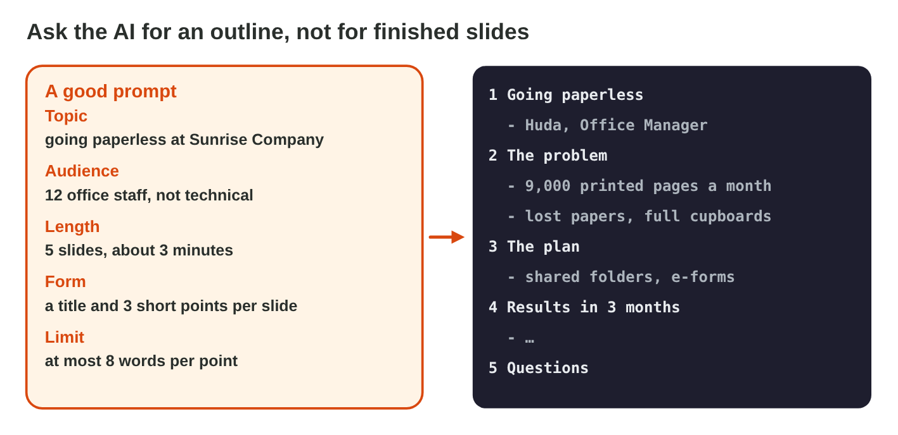
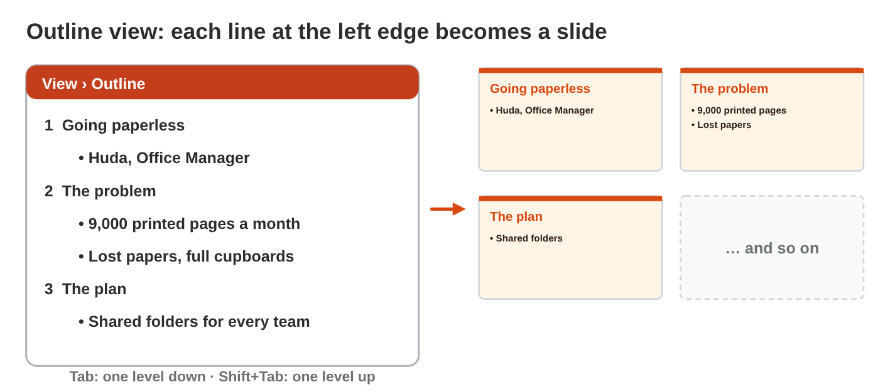
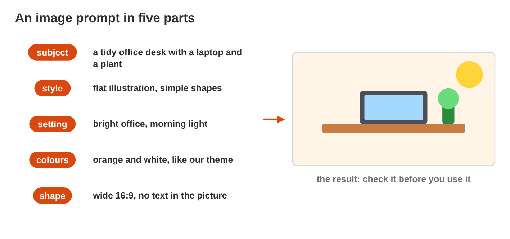
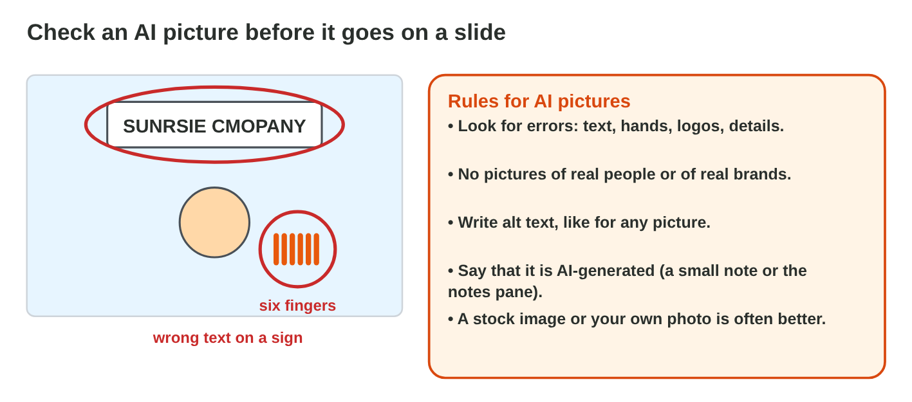
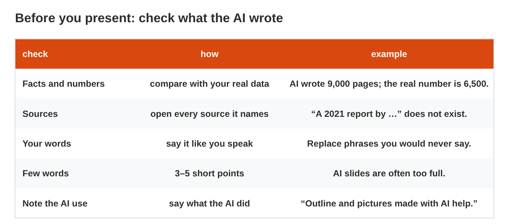

This page is the interactive version of Lecture 16. In class, the teacher
first explains the ideas with the slides. Then you do the **worksheet
(PDF)**: three experiments, each with Part A in an AI assistant and
PowerPoint, and Part B on a simulator of this page. Each section below
explains one idea, then shows its experiment: do each step, then tap or
sort its result. The page checks it at once and tells you why.

## Key terms



## Before you start

- **You need:** PowerPoint and an AI assistant that the university allows
  (for example `copilot.microsoft.com`).
- **No lab computer?** Do Part B of each experiment on your phone. Do Part A
  later on any computer with PowerPoint.
- Use no personal data of other people in a prompt.
- What you type in the table of results stays in this browser only.

{width=100%}

## 16.1 From an AI outline to slides

- Ask an AI tool for an **outline**, not for finished slides.
- A good outline prompt has five parts: **topic**, **audience** (12 office
  staff, your classmates), **length** (5 slides, 3 minutes), **form** (a
  title and 3 points per slide) and a **limit** (at most 8 words per
  point). Add: "Do not invent numbers or sources."
- In PowerPoint, **View › Outline**: paste the outline. A line at the left
  edge is a **new slide**; **Tab** makes a line a point; **Shift + Tab**
  makes it a title again.
- Then choose a theme and the layouts (Lecture 15). Copilot in PowerPoint
  can also make slides, if your account has it.

{width=100%}

{width=100%}





::: {.callout-tip title="Try it 1 · The outline"}
Choose the right answer.

::: {.match extra="the font|Ctrl+P"}
"12 office staff, not technical": which part of the prompt is it?
:   the audience

    Why: It says who will listen to the talk.

"5 slides, a 3-minute talk": which part of the prompt is it?
:   the length

    Why: It says how many slides and how much time.

"At most 8 words per point": which part of the prompt is it?
:   the limit

    Why: It keeps every point short.

Where do you paste an outline in PowerPoint?
:   View › Outline

    Why: In Outline view, every line at the left edge becomes a slide.

Which key makes a line a point under a title?
:   Tab

    Why: Tab moves the line one level in; Shift + Tab moves it back.
:::
:::

## 16.2 A picture with AI, checked

- An **image prompt** has five parts: the **subject**, the **style**
  (a flat illustration, a photo), the **colours** of your theme, the
  **shape** (wide 16:9 next to the points) and "**no text** in the
  picture".
- Check the picture closely: letters, hands, logos and small details are
  often wrong.
- No real people and no brands. Write **alt text**, and the note
  "AI-generated" under the picture.
- A **stock image** (Insert › Pictures › Stock Images) or your own photo is
  often the better choice.

{width=100%}

{width=100%}





::: {.callout-tip title="Try it 2 · The picture"}
Use Image Prompt Lab. Choose the right answer.

::: {.match extra="a famous singer|tall 9:16"}
Which shape fits a picture next to the points?
:   wide 16:9

    Why: A wide picture fits next to the points on the slide.

What do you ask about text in the picture?
:   no text in the picture

    Why: AI pictures often get letters wrong; you type text on the slide.

Which note goes under an AI picture?
:   AI-generated

    Why: The audience knows that a tool made the picture.

The AI picture has wrong letters and odd hands. What do you do?
:   use a stock image

    Why: A stock image or your own photo has no such errors.
:::
:::

## 16.3 Check before you present

- **Facts and numbers:** compare every number with your own data.
- **Sources:** open each one; delete a source that does not exist.
- **Your words:** write the speaker notes yourself, two or three sentences
  per slide.
- **Few words** on the slides: 3–5 points of at most 8 words.
- **Honest:** a short note on the last slide says what the AI did.

{width=100%}





::: {.callout-tip title="Try it 3 · Five checks"}
Choose the check.

::: {.match extra="the theme|the transition"}
The AI wrote 9,000 pages; your notes say 6,500. Which check finds it?
:   facts and numbers

    Why: Every number must match your own data.

"Green Office Report 2021" cannot be found. Which check finds it?
:   sources

    Why: You open every source; a made-up one goes.

A slide has five long sentences. Which check finds it?
:   few words

    Why: A slide has 3–5 short points; you say the rest.

"Outline and pictures made with AI help." Which check is it?
:   the note on the AI use

    Why: It says honestly what the AI did.
:::
:::

## Table of results



## Summary {.summary}

- Ask the AI for an outline: topic, audience, length, form and a limit.
- In Outline view, a line at the left edge is a slide; Tab makes a point.
- An image prompt has a subject, a style, colours, a shape and "no text".
- Check AI pictures; write alt text and the note "AI-generated", or use a stock image.
- Before the talk: facts, sources, your own notes, few words, and an honest note.
