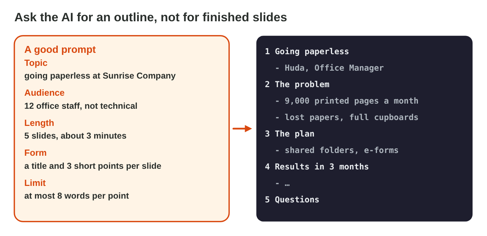
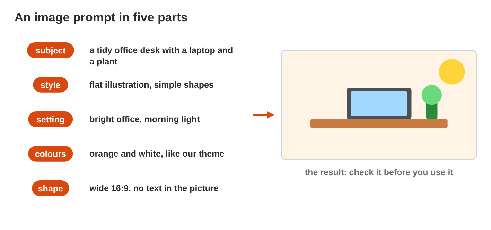
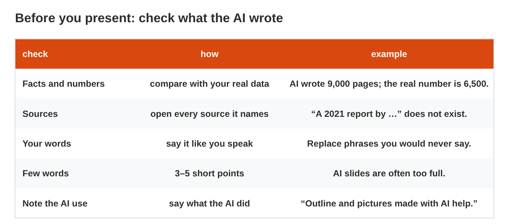

## Keywords



## From an AI outline to slides

:::: {.columns}
::: {.column width="50%"}
- You ask the AI for an outline, not for finished slides.
- The prompt has a topic, an audience, a length, a form and a limit.
- In View › Outline, a line at the left edge is a new slide.
- Tab makes a line a point, and Shift + Tab makes it a title again.
:::
::: {.column width="50%"}

:::
::::

## Live demo · Outline Lab



## Try it 1 · The outline

a) "12 office staff, not technical": which part of the prompt is it?
b) Where do you paste an outline in PowerPoint?
c) Which key makes a line a point under a title?

::: {.answer}
a) the audience
b) View › Outline
c) Tab
:::

## A picture with AI, checked

:::: {.columns}
::: {.column width="50%"}
- An image prompt has a subject, a style, the colours, a shape and "no text".
- AI pictures often have wrong letters, hands and small details.
- You write alt text and the note AI-generated under an AI picture.
- A stock image or your own photo is often the better choice.
:::
::: {.column width="50%"}

:::
::::

## Live demo · Image Prompt Lab



## Try it 2 · The picture

a) Which shape fits a picture next to the points?
b) Which note goes under an AI picture?
c) The AI picture has wrong letters and odd hands. What do you do?

::: {.answer}
a) wide 16:9
b) AI-generated
c) Use a stock image.
:::

## Check before you present

:::: {.columns}
::: {.column width="50%"}
- You compare every number with your own data, and you open every source.
- You write the speaker notes yourself, in two or three sentences.
- Each slide keeps 3 to 5 points of at most 8 words.
- A short note on the last slide says what the AI did.
:::
::: {.column width="50%"}

:::
::::

## Try it 3 · Five checks

a) "Green Office Report 2021" cannot be found. Which check finds it?
b) A slide has five long sentences. Which check finds it?
c) "Outline and pictures made with AI help." Which check is it?

::: {.answer}
a) sources
b) few words
c) the note on the AI use
:::

## Summary

- The AI gives an outline from a prompt with five parts.
- Outline view turns the outline into slides with Tab and Shift + Tab.
- An image prompt has five parts, and you check every AI picture.
- Alt text and the note AI-generated go with an AI picture.
- Before the talk, you check facts, sources, your own words, few words and honesty.

## Your worksheet

:::: {.columns}
::: {.column width="50%"}
- Now do the three experiments of the worksheet alone.
- Part A is in an AI assistant and PowerPoint, on Healthy habits in the exam weeks.
- Part B is on a simulator or the game Slide Doctor: scan its QR code or click its link.
- Write your result after each step, and fill in the table at the end.
:::
::: {.column width="50%"}

:::
::::

## Results of the worksheet

Which results do you have in your table?

::: {.reveal}
- Experiment 1: The outline becomes 4 slides with Tab, and the AI in Outline Lab wrote 9,000 instead of 6,500.
- Experiment 2: A wide stock image with alt text, and AI pictures draw wrong letters.
- Experiment 3: One change after the checks, a note on the AI use, and dark text on a light background.
:::
