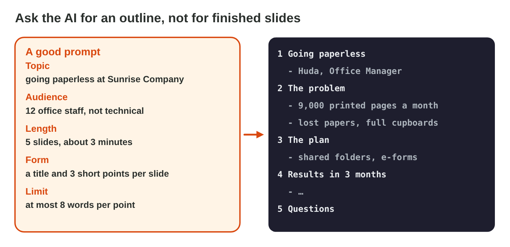
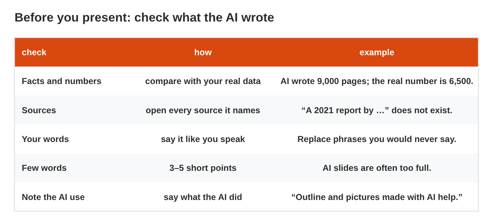

This page is the interactive version of Lecture 19. No new ideas: you
practise Lectures 3, 4, 17 and 18. In class, the teacher first recalls the
main ideas with the slides. Then you do the **worksheet (PDF)**: two
experiments, each with Part A in an AI assistant and PowerPoint, and Part B
on a simulator of this page. Each section below shows its experiment: do
each step, then tap its result. The page checks it at once and tells you
why.

## Before you start

- **You need:** PowerPoint and an AI assistant that the university allows
  (for example `copilot.microsoft.com`).
- **No lab computer?** Do Part B of each experiment on your phone. Do Part A
  later on any computer with PowerPoint.
- What you type in the table of results stays in this browser only.

{width=100%}

## Recall

- **Lecture 3:** AI writes likely words, so it can invent a number or a
  source. You check every fact and number, and you never type personal
  data into an AI tool.
- **A clear prompt** has a task, a context and a format (Lecture 4).
- **Lecture 17:** one idea per slide, 3–5 points of about 8 words; Title
  Slide first, then Title and Content; a picture has alt text.

{width=100%}

::: {.callout-tip title="Try it 1 · Recall"}
Choose the right answer.

::: {.match extra="a theme|about 20 words"}
An AI answer names a report that nobody can find. What is it?
:   a hallucination

    Why: The AI invented the report; it sounds sure, but it is not real.

How many words should a point on a slide have?
:   about 8 or fewer

    Why: Short points can be read from the back of the room.

Which three parts make a clear prompt?
:   task, context and format

    Why: Say what to do, give the facts, and say how the answer must look.
:::
:::

## 19.1 An outline from an AI tool

Huda, the office manager of Sunrise Company, must give a 3-minute talk,
"Going paperless", to 12 office staff. Her notes say: *we print 6,500 pages
a month; the plan is shared folders and e-forms; our goal is half the paper
in three months.*





::: {.callout-tip title="Try it 2 · The outline"}
Choose the right answer.

::: {.match extra="keep it: the AI knows best|Two Content"}
The AI writes "We print 9,000 pages a month". Huda's notes say 6,500. What do you do?
:   correct it from the notes

    Why: Numbers come from your own data, not from the AI.

The prompt says "12 office staff". Why not the names of the staff?
:   names are personal data

    Why: The AI does not need them, and personal data stays out of a prompt.

Which layout fits the first slide, "Going paperless"?
:   Title Slide

    Why: The first slide gives the topic and the speaker.
:::
:::

## 19.2 Ready for Monday?

An AI tool made Huda's six slides. Before the meeting on Monday, she checks
each slide: the numbers, the sources, the picture, the prompt, the amount
of text and a note about the AI help.

{width=100%}





::: {.callout-tip title="Try it 3 · Huda's deck"}
Use AI Deck Check. Choose the right answer.

::: {.match extra="make the font smaller|say nothing"}
The AI picture shows "SUNRSIE CMOPANY" on a sign. What is the fix?
:   a picture without text; type the name on the slide

    Why: AI pictures often get letters wrong.

The slide "Our goal" has five long sentences. What is the fix?
:   keep 3–5 short points, say the rest

    Why: One idea and a few short points per slide.

How does Huda tell the staff that AI helped?
:   a short note: outline and pictures made with AI help

    Why: Be honest and short about what the AI did.
:::
:::

## Table of results



## Wrap-up {.summary}

- You can get an outline for a talk from an AI tool, and check its
  numbers, sources and words.
- You can check an AI-made deck slide by slide before you present it.
