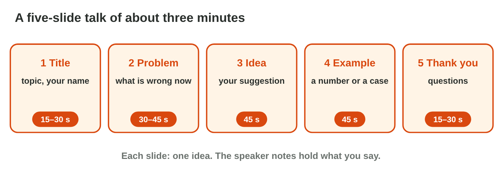
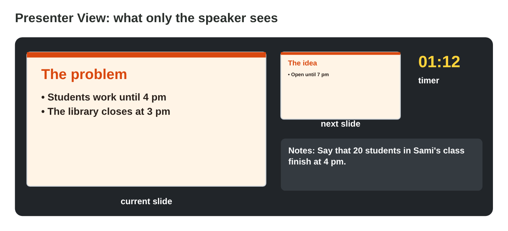

This page is the interactive version of Practice 4. No new ideas: you
practise Lectures 15 and 16. In class, the teacher first recalls the main
ideas with the slides. Then you do the **worksheet (PDF)**: two
experiments, each with Part A in PowerPoint and Part B on a simulator of
this page. Each section below shows its experiment: do each step, then
tap, put in order or type its result. The page checks it at once and tells
you why.

## Before you start

- **You need:** PowerPoint (the desktop app works best for Presenter View).
- **No lab computer?** Do Part B of each experiment on your phone. Do Part A
  later on any computer with PowerPoint.
- What you type in the table of results stays in this browser only.

{width=100%}

## Recall

- **Layouts:** Title Slide for the first and the last slide, Title and
  Content for the others.
- **Few words:** 3–5 short points on a slide; what you say goes in the
  speaker notes.
- **Movement:** one quiet transition with Apply To All; By Paragraph shows
  the points one by one.

## P4.1 Plan a five-slide talk

Watch the two short videos first: speaker notes and animations, as in Lecture 15. Then plan the talk in the simulator.





- A short talk of **three minutes** needs about **five slides**, one
  idea on each.
- A good order: **1 Title** (topic, your name) › **2 The problem** › **3
  The idea** › **4 An example** (a number or a case) › **5 Thank you and
  questions**.
- Give each slide its time: the problem, the idea and the example take the
  most. The first and the last slide are short.
- Write the speaker notes of each slide before you rehearse.

{width=100%}





::: {.callout-tip title="Try it 1 · The plan"}
Use Talk Planner. Choose the right answer.

::: {.match extra="Thank you and questions first|10 minutes"}
Which slide comes right after the title?
:   the problem

    Why: First the audience hears the problem, then your idea.

Which slide gives a number or a case?
:   the example

    Why: An example makes the idea real, for example "20 students would come".

How long is Sami's whole talk?
:   about three minutes

    Why: Five slides of about 30–45 seconds make about three minutes.

How long is the last slide?
:   at most 30 seconds

    Why: "Thank you" is short; then the questions come.
:::
:::

## P4.2 Rehearse with Presenter View

Watch the short video first. Then rehearse in the simulator.



- In the slide show, **Presenter View** shows you the current slide, the
  next slide, your speaker notes and a **timer**. The audience sees only
  the slide.
- With a projector it opens by itself. On one screen: start the show,
  right-click › **Show Presenter View** (or **Alt + F5** in Windows).
- **Rehearse** twice. Watch the timer: is each slide close to its time?
  Where a slide is too long, say less; where it is too short, say your notes
  fully.
- Look at the audience, not at the notes: notes are short reminders.

{width=100%}





::: {.callout-tip title="Try it 2 · Rehearse"}
Choose the right answer.

::: {.match extra="on the slide in small letters|everybody"}
What does Presenter View show you?
:   the slide, the next slide, the notes and a timer

    Why: It helps you talk and keep the time.

Who sees the speaker notes in the slide show?
:   only the speaker

    Why: The audience sees only the slide.

Which keys open Presenter View on one screen in Windows?
:   Alt + F5

    Why: Alt + F5 starts the slide show with Presenter View.

Your rehearsal took 4 minutes for a 3-minute talk. What do you do?
:   say less, then rehearse again

    Why: The timer shows where you are too long.
:::
:::

## Table of results



## Wrap-up {.summary}

- You can plan a short talk in five slides: title, problem, idea, example, thanks.
- You can write speaker notes and add one quiet transition to every slide.
- You can rehearse with Presenter View and its timer, and keep the talk close to its time.
