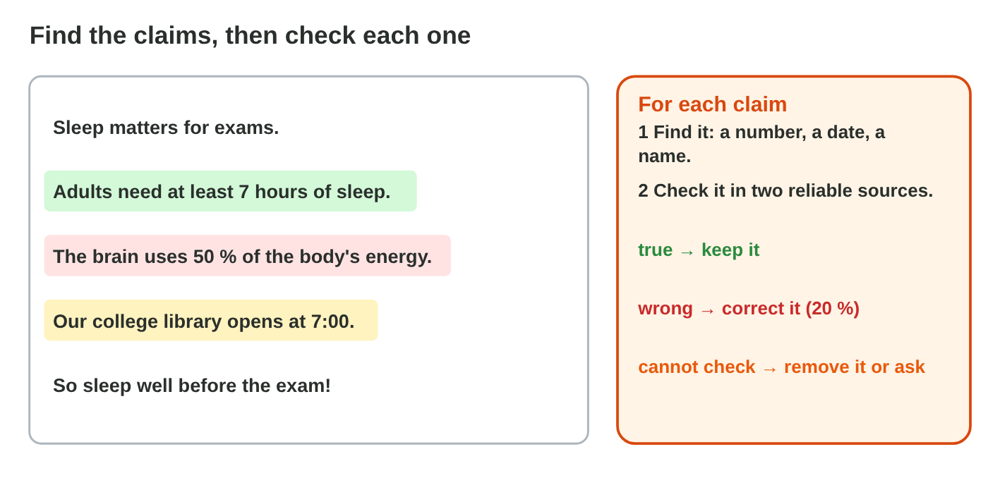
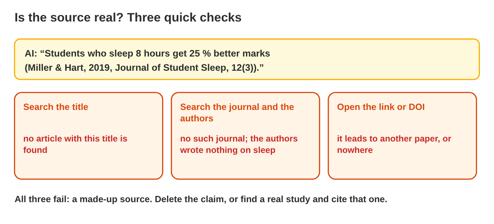
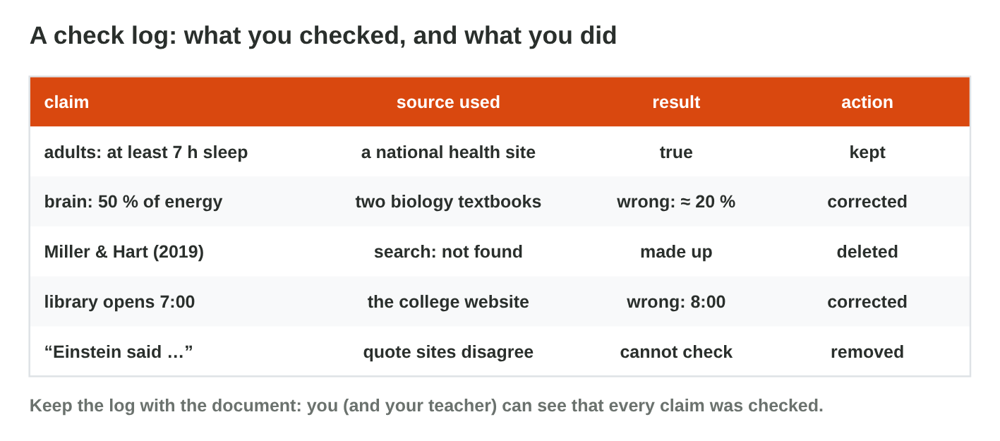

## Keywords



## Find every claim

:::: {.columns}
::: {.column width="50%"}
- A claim can be checked: a number, a date, a name, a price or a quote.
- "A study shows" and "experts say" are claims too.
- An opinion, like "tea tastes better with mint", is not a claim.
- You highlight every claim before you check anything.
:::
::: {.column width="50%"}

:::
::::

## Live demo · Claim Finder



## Try it 1 · Claim or opinion?

a) "The college café opens at 7:30." Is it a claim or an opinion?
b) "The café has the nicest cakes in Amman." Is it a claim or an opinion?
c) "Doctors say that breakfast helps you focus." Is it a claim or an opinion?

::: {.answer}
a) a claim
b) an opinion
c) a claim
:::

## Check facts and sources

:::: {.columns}
::: {.column width="50%"}
- You check each claim in two reliable sources, like official health pages.
- You open other pages about the claim: lateral reading.
- For a study, you search its title, its authors and its journal.
- Then you keep it, correct it with the source, or remove it.
:::
::: {.column width="50%"}

:::
::::

## Try it 2 · Decisions

a) Two reliable sources say another number. What do you do?
b) The study cannot be found. What do you do?
c) The sum in an AI table is wrong. What do you do?

::: {.answer}
a) Correct it.
b) Delete it.
c) Compute it yourself.
:::

## Fair words and a check log

:::: {.columns}
::: {.column width="50%"}
- You rewrite stereotypes and one-sided parts with neutral words and both sides.
- A check log is a table: claim, source, result and action.
- The corrected text ends with an AI-use statement.
- It says what the AI did, and that you checked it.
:::
::: {.column width="50%"}

:::
::::

## Try it 3 · Fair and documented

a) "Every office manager knows her team." What do you do?
b) What are the four columns of a check log?
c) What does the last sentence of the corrected text say?

::: {.answer}
a) Use neutral language.
b) claim, source, result and action
c) what the AI did, and that you checked it
:::

## Summary

- A claim can be checked, and an opinion cannot.
- You check each claim in two reliable sources.
- A study that no search finds is a made-up source, and you remove it.
- You rewrite stereotypes and give both sides.
- A check log and an AI-use statement show your work.

## Your worksheet

:::: {.columns}
::: {.column width="50%"}
- Now do the three experiments of the worksheet alone.
- Part A is in Word and a search engine, on the text Walk more at work!
- Part B is on a simulator or the game Claim Court: scan its QR code or click its link.
- Write your result after each step, and fill in the table at the end.
:::
::: {.column width="50%"}

:::
::::

## Results of the worksheet

Which results do you have in your table?

::: {.reveal}
- Experiment 1: The text has five claims, and Claim Finder has three opinions.
- Experiment 2: The WHO claim is true, the study of Omar Haddad is made up, and 75 + 50 + 60 is 185.
- Experiment 3: The check log has claim, source, result and action, and the text ends with an AI-use statement.
:::
