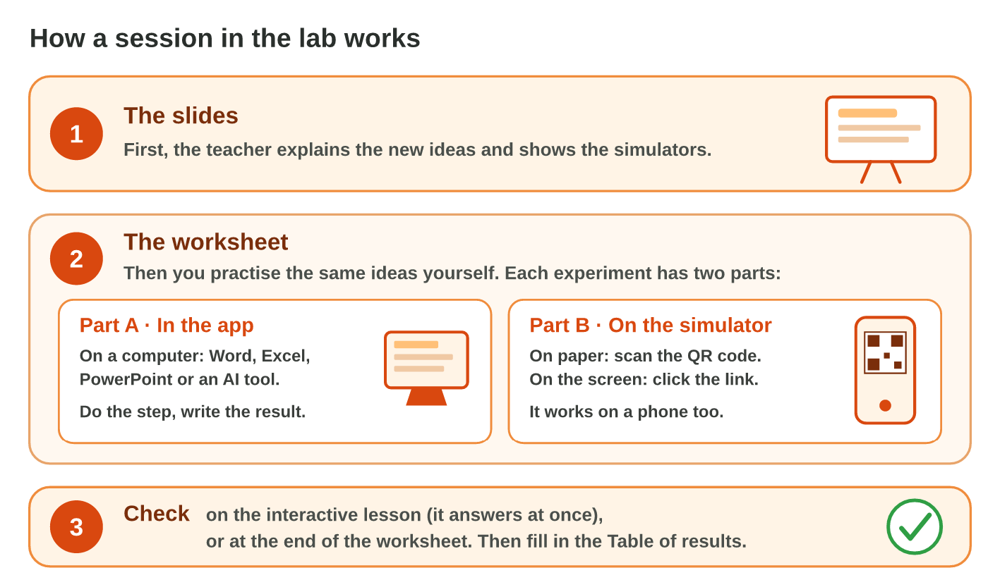
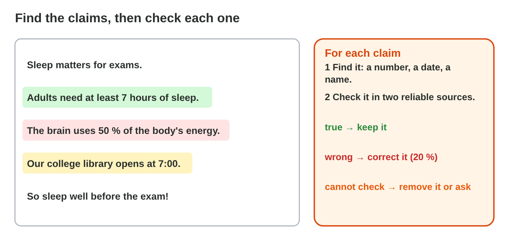
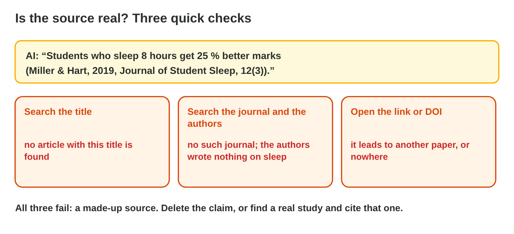
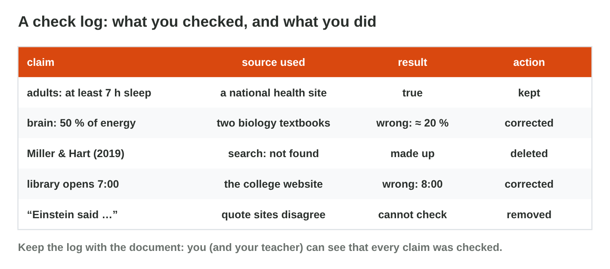

This page is the interactive version of Lecture 22. In class, the teacher
first explains the ideas with the slides. Then you do the **worksheet
(PDF)**: three experiments on a short AI-written text, each with Part A in
Word and a search engine, and Part B on a simulator of this page. Each
section below explains one idea, then shows its experiment: do each step,
then tap, sort, put in order or type its result. The page checks it at
once and tells you why.

## Key terms



## Before you start

- **You need:** Word and a browser with a search engine.
- **No lab computer?** Do Part B of each experiment on your phone. Do Part A
  later on any computer with Word.
- **The AI-written text** of the worksheet, to copy into Word:

> **Walk more at work!** The World Health Organization says that adults
> should be active for at least 150 minutes a week. A study by Omar Haddad
> (Journal of Office Steps, 2020) showed that workers who walk 10,000 steps
> a day make 50 % fewer mistakes. Walking uses no energy at all. Every good
> manager knows that his staff walk too little. Walking is always better
> than every other sport.

- What you type in the table of results stays in this browser only.

{width=100%}

## 22.1 Find every claim

Watch the short video: it shows the whole check, from the claims to the
check log (with captions; the words are also under it).



- A **claim** can be checked: a number, a date, a name, a price, a quote,
  "a study shows", "experts say".
- Highlight every claim before you check anything.
- Opinions ("tea tastes better with mint") are not claims; leave them.

{width=100%}





::: {.callout-tip title="Try it 1 · Claim or opinion?"}
Choose the right answer.

::: {.match extra="a question|a title"}
"The college café opens at 7:30." What is it?
:   a claim

    Why: A time can be checked, for example on the café's notice.

"The café has the nicest cakes in Amman." What is it?
:   an opinion

    Why: "The nicest" is a matter of taste; nobody can check it.

"A 2021 survey of 500 students shows that most skip breakfast." What is it?
:   a claim

    Why: A survey, a year and a number can be checked.

"Doctors say that breakfast helps you focus." What is it?
:   a claim

    Why: "Doctors say" must be checked in reliable sources.
:::
:::

## 22.2 Check facts and sources

- Check each claim in **two reliable sources**: official health
  organisations, universities, encyclopedias, known newspapers.
- Open other pages about the claim (**lateral reading**).
- For a source or a quote: search the title, the authors and the journal,
  and open the link.
- Decide: **keep**, **correct** (with the source), or **remove**.

{width=100%}





::: {.callout-tip title="Try it 2 · Decisions"}
Use Claim Court. Choose the action.

::: {.match extra="keep it because it sounds sure|ask the same AI"}
Two reliable sources say another number. What do you do?
:   correct it

    Why: The reliable sources win over the AI.

The study cannot be found. What do you do?
:   delete it

    Why: A study that no search finds is made up.

The AI's knowledge is two years old. What do you do with "the newest laptop"?
:   check a current source

    Why: The AI does not know what came after its knowledge cutoff.

The sum in an AI table is wrong. What do you do?
:   compute it yourself

    Why: AI can make mistakes in sums; a spreadsheet adds exactly.
:::
:::

## 22.3 Fair words and a check log

- Look for **stereotypes** and one-sided parts; rewrite them with neutral
  words and both sides.
- Keep a **check log**: claim · source used · result · action.
- End the text with an **AI-use statement**: what the AI did, and that you
  checked it.

{width=100%}





::: {.callout-tip title="Try it 3 · Fair and documented"}
Choose the right answer.

::: {.match extra="remove all people|use capital letters"}
"Every office manager knows her team." What do you do?
:   use neutral language

    Why: "Her" guesses that every manager is a woman.

"Breaks are always a waste of time." What do you do?
:   give both sides with reasons

    Why: A one-sided sentence is a kind of bias.

What are the four columns of a check log?
:   claim, source, result, action

    Why: The log shows what you checked, where, and what you did.

What does the last sentence of the corrected text say?
:   what the AI did, and that you checked it

    Why: An AI-use statement makes the use of AI honest.
:::
:::

## Table of results



## Summary {.summary}

- A claim can be checked: a number, a date, a name, a study, "experts say".
- Highlight every claim first; opinions are not claims.
- Check each claim in two reliable sources, and search the title, authors and journal of a study.
- Keep, correct with the source, or remove; compute sums yourself.
- Rewrite stereotypes and one-sided parts; keep a check log and end with an AI-use statement.
