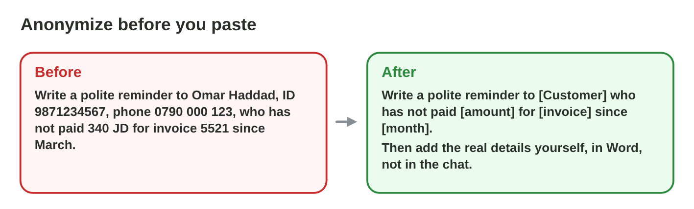
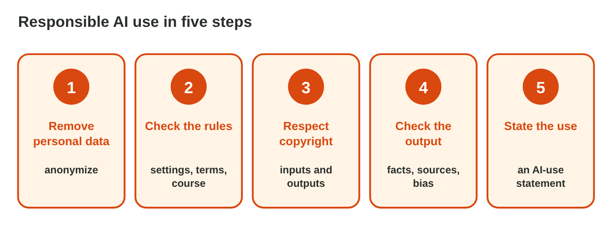

This page is the interactive version of Lecture 23. No new ideas: you
practise Lectures 21 and 22. In class, the teacher first recalls the main
ideas with the slides. Then you do the **worksheet (PDF)**: two
experiments, each with Part A in Word and an AI assistant, and Part B on a
simulator of this page. Each section below shows its experiment: do each
step, then tap, sort or put in order its result. The page checks it at
once and tells you why.

## Before you start

- **You need:** Word and an AI assistant that the university allows (for
  example `copilot.microsoft.com`).
- **No lab computer?** Do Part B of each experiment on your phone. Do Part A
  later on any computer with Word.
- All names and numbers here are made up. Never paste real personal data
  into an AI tool.
- What you type in the table of results stays in this browser only.

{width=100%}

## Recall

- Personal data, sensitive data and confidential information stay out of a
  prompt. **Anonymize** with placeholders such as [Customer].
- Check the **settings** and the **rules** of a tool, and respect the
  **copyright** of what you upload and of what you use.
- Hand in your own work, with an **AI-use statement**: the tool, the use,
  your changes and your checks.

::: {.callout-tip title="Try it 1 · Recall"}
Choose the right answer.

::: {.match extra="a font|a theme"}
Which placeholder replaces a customer's name in a prompt?
:   [Customer]

    Why: The AI still knows the task, but not who the person is.

Sami hands in a report that an AI wrote, with no statement. What is it?
:   plagiarism

    Why: Sami presents work that is not Sami's own.

Which four parts does an AI-use statement have?
:   tool, use, changes, checks

    Why: Then everybody knows which parts are your own work.
:::
:::

## 23.1 Safe prompts at work

Three people want to paste these prompts into a free AI chat tool:

- **Huda:** *Write a birthday message for our colleague Lina Hasan, born
  2 March 1995, who lives at 5 Olive Street.*
- **Omar:** *Write a reply to Faris Nasser (faris.n@example.com, phone
  0795 111 222), who asks for a refund of 25 JD for a broken lamp.*
- **Sami:** *Here are the questions of tomorrow's quiz. Write the answers
  for me.*

{width=100%}





::: {.callout-tip title="Try it 2 · The prompts"}
Choose the right answer.

::: {.match extra="paste them all|they are public"}
Does the birthday message need Lina's birthday and address?
:   no, leave them out

    Why: The AI needs the task, not the details of the person.

May "25 JD" and "a broken lamp" stay in Omar's prompt?
:   yes, they stay

    Why: Without the name, they say nothing about a person, and the AI needs them.

What kind of information are tomorrow's quiz questions?
:   confidential information

    Why: Exam questions are a secret of the college.
:::
:::

## 23.2 Five steps and a statement

Rana makes a poster for the new teas of the Sunrise shop with an AI tool.
Her plan: paste the supplier's catalogue page (its text and photo), paste
the price list of the regular customers with their names, ask for "a nice
text", and use the AI picture as it is.

{width=100%}





::: {.callout-tip title="Try it 3 · Rana's poster"}
Choose the step.

::: {.match extra="buy a faster PC|use capital letters"}
Rana wants to paste the supplier's catalogue page. Which step stops her?
:   respect copyright

    Why: The supplier's text and photo are not hers to upload.

The poster says "tea sets from 9 JD", but the price list says 12 JD. Which step finds it?
:   check the output

    Why: Every price and fact is checked against the shop's list.

"Picture made with an AI tool." Which step is it?
:   state the use

    Why: The note says honestly what the AI did.
:::
:::

## Table of results



## Wrap-up {.summary}

- You can rewrite a prompt so that no personal or confidential data goes
  into an AI tool.
- You can plan an AI task with the five steps of responsible use and write
  its AI-use statement.
