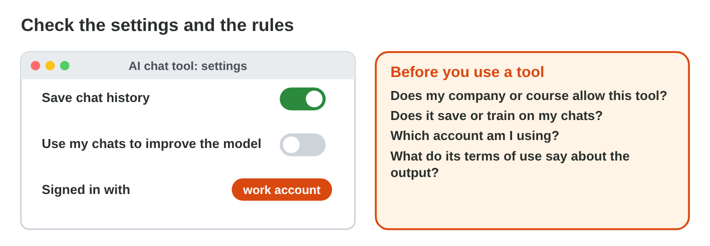
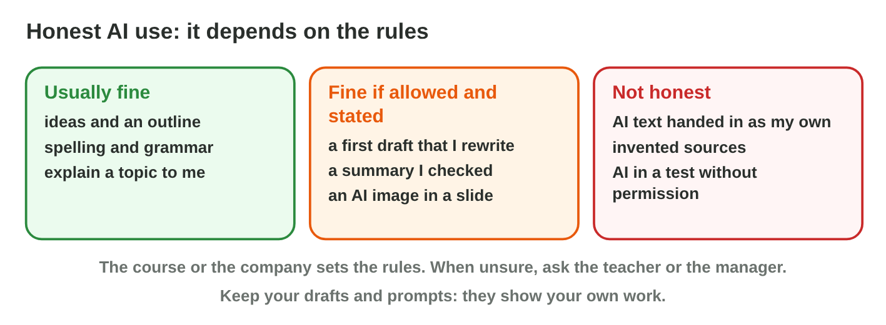
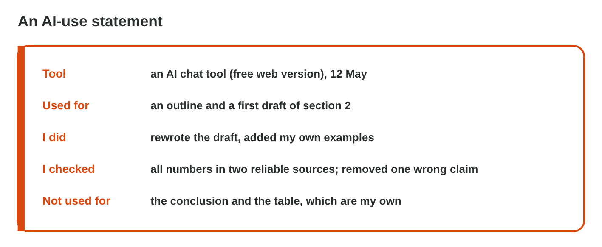

This page is the interactive version of Practice 6. No new ideas: you
practise Lectures 17 and 18. In class, the teacher first recalls the main
ideas with the slides. Then you do the **worksheet (PDF)**: two
experiments, each with Part A in an AI assistant and Word, and Part B on a
simulator of this page. Each section below shows its experiment: do each
step, then tap or sort its result. The page checks it at once and tells
you why.

## Before you start

- **You need:** Word and an AI assistant that the university allows (for
  example `copilot.microsoft.com` with your university account).
- **No lab computer?** Do Part B of each experiment on your phone. Do Part A
  later on any computer with Word.
- All names and numbers here are made up. Never paste real personal data
  into an AI tool.
- What you type in the table of results stays in this browser only.

{width=100%}

## Recall

- Personal, sensitive and confidential data stay out of a prompt; use
  placeholders and add the real details in Word.
- Check the settings and the rules of an AI tool, and respect copyright.
- An AI-use statement names the tool, the use, your changes and your checks.

## P6.1 Settings, rules and copyright

Before you use an AI tool, check four things:

- **Settings:** Is the chat history saved? Are your chats used for
  training? Switch it off if you can.
- **Account and rules:** use the university or work account if there is
  one, and follow the AI rules of the course or the company.
- **Terms of use:** they say how the tool uses your data and what you may
  do with its output.
- **Copyright:** upload only files that you may share; for a picture,
  check that the tool allows your use.

{width=100%}

{width=100%}





::: {.callout-tip title="Try it 1 · Settings and rules"}
Choose the right answer.

::: {.match extra="a bigger screen|a new password"}
A tool uses your chats to improve its model. What do you do?
:   switch the training off, if you can

    Why: Then your chats are not used to train the tool.

Your university gives you an account for an AI tool. Which account do you use for course work?
:   the university account

    Why: The university account follows the university's rules.

Where do you read what you may do with the output of a tool?
:   in the terms of use

    Why: The terms of use set the rules for the data and the output.

Rana wants to upload the supplier's catalogue photos for a new poster. What does she check first?
:   that she may share them

    Why: The photos belong to the supplier; copyright decides.
:::
:::

## P6.2 A safe prompt and an AI-use statement

**A safe prompt:**

- Find every **personal, sensitive or confidential** part: names with
  contact details, ID numbers, health, salaries, passwords, customer lists,
  secret deals.
- Replace each with a **placeholder**: [Customer], [employee 1], [price].
- Keep what the AI needs for the task; add the real details later, in Word.

**An AI-use statement:**

- Name the **tool**, say **what it did**, what **you changed**, and how
  you **checked** it.
- Keep it short, specific and true; put it at the end of the work.
- Keep your drafts and prompts.

{width=100%}





::: {.callout-tip title="Try it 2 · The statement"}
Use Statement Builder. Choose the right answer.

::: {.match extra="the colour of the text|the price of the tool"}
"I used an AI chat tool for an outline." Which part of the statement is it?
:   the tool and the use

    Why: It names the tool and what it did.

"I rewrote it in my own words." Which part is it?
:   what you changed

    Why: It shows your own work.

"I checked every fact in two reliable sources." Which part is it?
:   how you checked it

    Why: It shows that the facts are true.

"I kept the AI draft as it was." What is it?
:   a warning sign

    Why: An unchanged AI draft is not your own work.
:::
:::

## Table of results



## Wrap-up {.summary}

- You can check the settings, the account and the rules of your AI tool.
- You can make a prompt safe with placeholders, and add the real details in Word.
- You can finish an AI text in your own words and write an honest AI-use statement.
