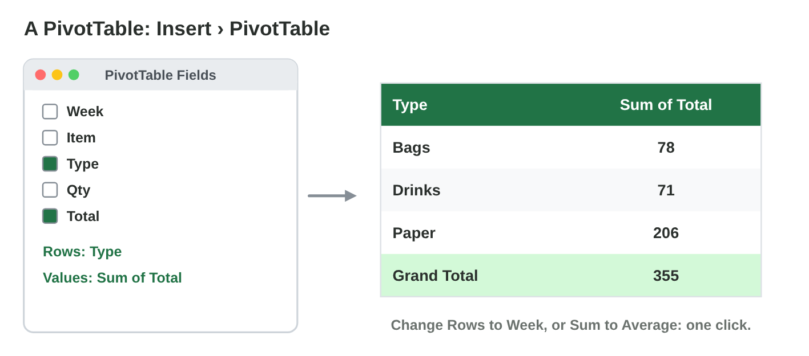
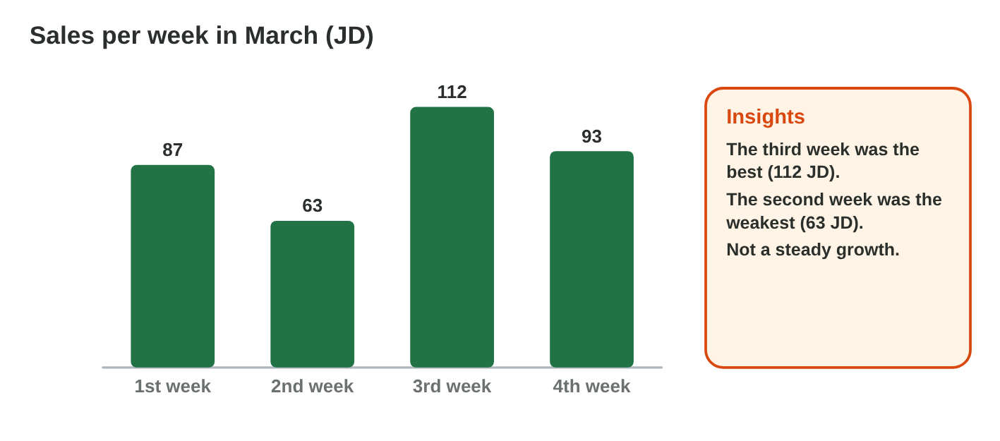
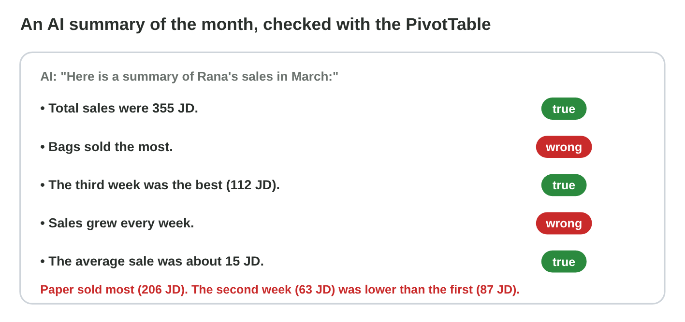

## Keywords



## Totals by group: the PivotTable

:::: {.columns}
::: {.column width="50%"}
- A PivotTable makes a summary table of a long list in a few clicks.
- Click one cell of the list, then Insert › PivotTable › OK.
- One field goes to Rows (the groups), and one number field goes to Values.
- Typed totals do not change when the list changes, so do not type them.
:::
::: {.column width="50%"}

:::
::::

## Live demo · Pivot Lab



## Try it 1 · The PivotTable

a) What do you click first, before Insert › PivotTable?
b) You want one row for each type. Which field goes into Rows?
c) You want the money of each type. Which field goes into Values?

::: {.answer}
a) one cell of the list
b) Type
c) Total
:::

## New questions, same table

:::: {.columns}
::: {.column width="50%"}
- Change the row field to ask another question, like Week instead of Type.
- Value Field Settings changes the calculation, like Sum to Average.
- PivotTable Analyze › PivotChart › Line shows the change from week to week.
- A PivotTable does not change by itself, so click Refresh after a change.
:::
::: {.column width="50%"}

:::
::::

## Example · Refresh after a change

The PivotTable shows the four weeks of March. Week 4 has 93 JD. Then Rana corrects the coffee of week 4 in the list, from 4 JD to 14 JD.

::: {.reveal}
- Step 1: Week 4 still shows 93 JD: the PivotTable did not change by itself.
- Step 2: Rana clicks a cell of the PivotTable, then PivotTable Analyze › Refresh.
- Step 3: Week 4 now shows 103 JD, and the Grand Total 365 JD.
- Step 4: She changes the coffee back to 4 JD and refreshes again.
:::

## Try it 2 · Other questions

a) You add new sales to the list. What must you do?
b) Which chart shows the four weeks?
c) How do you get the average of each type?

::: {.answer}
a) Refresh the PivotTable.
b) a line chart
c) Value Field Settings › Average
:::

## An AI summary: check every number

:::: {.columns}
::: {.column width="50%"}
- An AI tool can describe the numbers fast, but it can be wrong.
- Give it only the summary table, with no personal data.
- Check every number of its sentences with the PivotTable.
- Add an AI-use statement under a text that AI helped to write.
:::
::: {.column width="50%"}

:::
::::

## Live demo · Summary Check



## Try it 3 · The AI summary

a) What does Rana give the AI tool?
b) An AI sentence has a number that is not in the data. What is it?
c) What goes under a summary that an AI tool helped to write?

::: {.answer}
a) the summary table
b) a hallucination
c) an AI-use statement
:::

## Summary

- A PivotTable makes a summary table, with one field in Rows and one in Values.
- Rana changes the row field or the calculation to ask another question.
- She refreshes the PivotTable after a change, and a line chart shows the weeks.
- An AI summary can be wrong, so she checks every number with the PivotTable.
- She adds an AI-use statement under a text that AI helped to write.

## Your worksheet

:::: {.columns}
::: {.column width="50%"}
- Now do the three experiments of the worksheet alone.
- Part A is in Excel and an AI assistant, with the start file month-start.xlsx.
- Part B is on a simulator: scan its QR code, or click its link.
- Write your result after each step, and fill in the table at the end.
:::
::: {.column width="50%"}

:::
::::

## Results of the worksheet

Which results do you have in your table?

::: {.reveal}
- Experiment 1: Paper 206 JD, Drinks 71 JD and Bags 78 JD make 355 JD, and the notebooks bring 148 JD.
- Experiment 2: The third week is the best, week 3 shows 122 only after Refresh, and Paper has the biggest average.
- Experiment 3: Every AI number is checked, and three sentences of Summary Check are wrong.
:::
