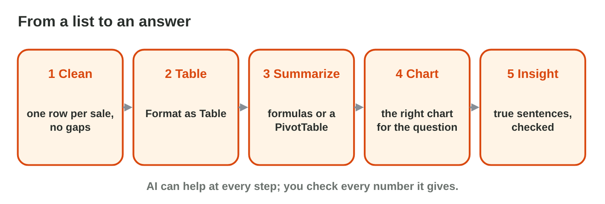
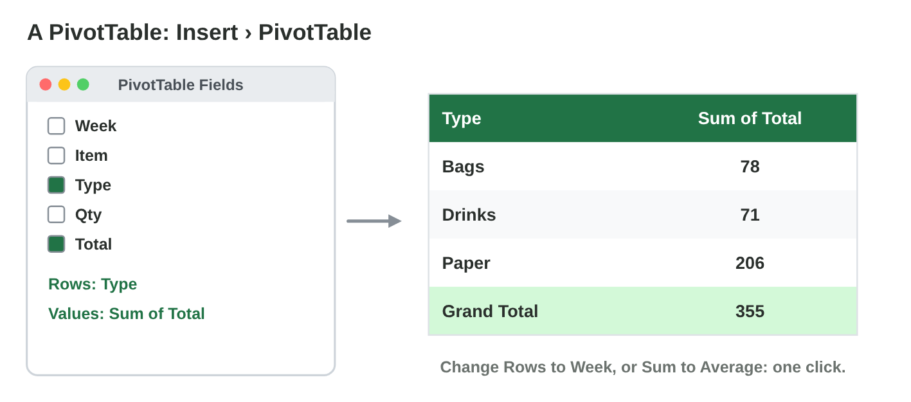
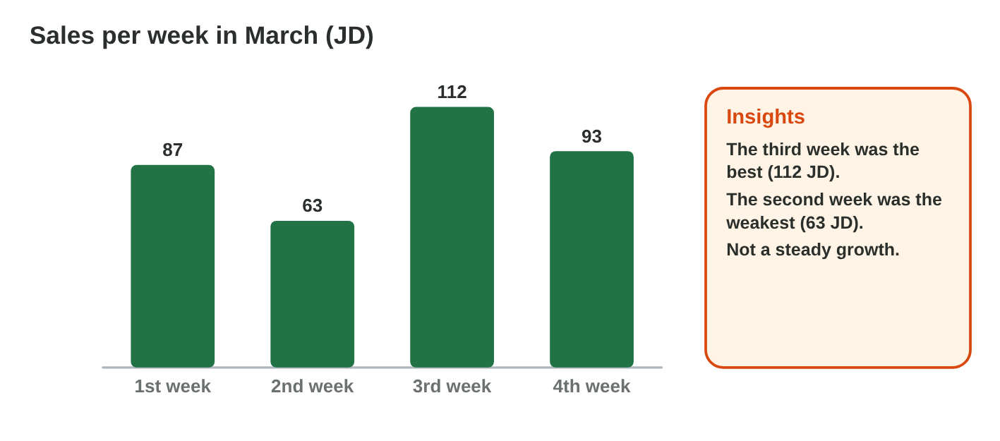

## Keywords



## Clean the data and make a table

:::: {.columns}
::: {.column width="50%"}
- A clean list has one row for each record and no empty rows.
- Data › Remove Duplicates removes the rows that were typed twice.
- Each name is written the same way, like Gloves and never Glove.
- Then Ctrl + T makes an Excel table, and the Total Row adds the numbers.
:::
::: {.column width="50%"}

:::
::::

## Live demo · Clean Data Lab



## Try it 1 · Clean data

a) The same row is in the list twice. What do you do?
b) One column has Glove and Gloves. What do you do?
c) What is the step after cleaning?

::: {.answer}
a) Remove the duplicate.
b) Write the name the same way.
c) Format as Table, with a total row
:::

## Summarize with a PivotTable

:::: {.columns}
::: {.column width="50%"}
- Insert › PivotTable makes a summary table of the clean table.
- One field goes to Rows, and the number field goes to Values.
- Change the row field to see the data from another side.
- The Grand Total must equal the total row of the table.
:::
::: {.column width="50%"}

:::
::::

## Live demo · Pivot Lab



## Try it 2 · PivotTables

a) You want the total of each type. What goes in Rows and in Values?
b) You add new rows to the list. What must you do?
c) What must the Grand Total equal?

::: {.answer}
a) Rows Type, Values Sum of Total
b) Refresh the PivotTable.
c) the total row of the table
:::

## The right chart and checked insights

:::: {.columns}
::: {.column width="50%"}
- A column chart compares categories, and a line shows a change over time.
- A pie shows the parts of one whole, with few parts.
- Every chart gets a clear title.
- An insight is a short, true sentence with a number: check every AI insight.
:::
::: {.column width="50%"}

:::
::::

## Live demo · Chart Lab



## Try it 3 · Charts and insights

a) You compare the boxes of three items. Which chart do you make?
b) You show the share of each item in all the boxes. Which chart do you make?
c) An AI tool writes an insight. What do you do before you use it?

::: {.answer}
a) a column chart
b) a pie chart
c) Check it with the PivotTable.
:::

## Summary

- Clean a list first: no duplicate rows, and each name written the same way.
- An Excel table with a total row keeps the clean data together.
- A PivotTable sums the numbers for each group, and its Grand Total equals the total row.
- Columns compare, a line shows a change over time, and a pie shows parts of a whole.
- Check every AI insight with the PivotTable before you use it.

## Your worksheet

:::: {.columns}
::: {.column width="50%"}
- Now do the three experiments of the worksheet alone.
- Part A is in Excel and an AI assistant, with Huda's list of the store room.
- Part B is on a simulator: scan its QR code, or click its link.
- Write your result after each step, and fill in the table at the end.
:::
::: {.column width="50%"}

:::
::::

## Results of the worksheet

Which results do you have in your table?

::: {.reveal}
- Experiment 1: 8 rows stay after cleaning, the total row shows 37 boxes, and the clean lab list has 4 drinks.
- Experiment 2: Paper 19, Gloves 12 and Cups 6 make 37, week 3 took 17 boxes, and Pen, Juice and Notebook were sold four times.
- Experiment 3: A line chart shows the weeks, every AI number is checked, and Paper is about 41 % of the pie.
:::
