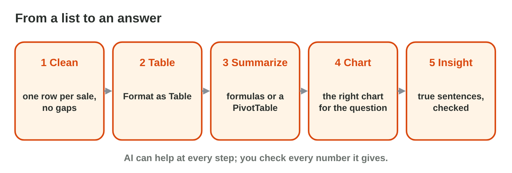
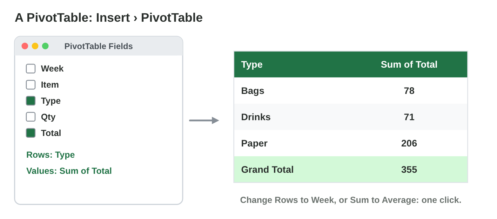
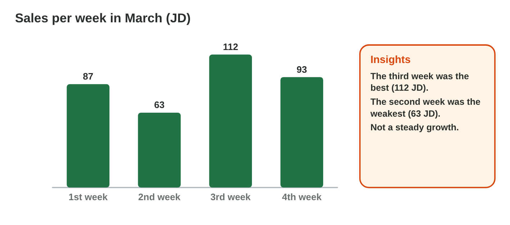

This page is the interactive version of Lecture 26. In class, the teacher
first explains the ideas with the slides. Then you do the **worksheet
(PDF)**: three experiments on Huda's list of the store room, each with
Part A in Excel and an AI assistant, and Part B on a simulator of this
page. Each section below explains one idea, then shows its experiment: do
each step, then tap, sort or type its result. The page checks it at once
and tells you why.

## Key terms



## Before you start

- **You need:** Excel (the desktop app, or Excel on the web at `office.com`)
  and an AI assistant that the university allows (for example Microsoft
  Copilot with your university account).
- **No lab computer?** Do Part B of each experiment on your phone. Do Part A
  later on any computer with Excel.
- **Huda's list** of the store room, to copy into Excel. It has two
  mistakes: the row *2, Cups, 2* was typed twice, and one item is *Glove*
  instead of *Gloves*.

| Week | Item   | Boxes |
|:----:|--------|------:|
| 1    | Paper  | 6     |
| 1    | Gloves | 4     |
| 2    | Paper  | 5     |
| 2    | Glove  | 3     |
| 2    | Cups   | 2     |
| 2    | Cups   | 2     |
| 3    | Paper  | 8     |
| 3    | Gloves | 5     |
| 3    | Cups   | 4     |

- What you type in the table of results stays in this browser only.

{width=100%}

## 26.1 Clean the data and make a table

- One row for each record, one kind of value in each column, no empty rows.
- Remove **duplicate rows** (Data › Remove Duplicates) and write each name
  the same way ("Glove" → "Gloves").
- Then **Format as Table** (Ctrl + T) and switch on the **Total Row**.

{width=100%}





::: {.callout-tip title="Try it 1 · Clean data"}
Choose the right answer.

::: {.match extra="a bigger font|a new sheet"}
the same row twice
:   remove the duplicate

    Why: A row typed twice counts twice in every total.

"Glove" and "Gloves" in one column
:   make the spelling the same

    Why: "Glove" and "Gloves" would be two different items in a summary.

an empty row in the middle
:   delete it

    Why: An empty row stops the table and the filter early.

the step after cleaning
:   Format as Table

    Why: A clean list becomes a table with a name, filters and a total row.
:::
:::

## 26.2 Summarize with a PivotTable

Watch the short video first. Then read the main points and practise in the
simulator.



- **Insert › PivotTable**; one field in **Rows**, the number field in
  **Values**.
- Change the rows to see the data from another side (by item, by week).
- Check: the Grand Total must equal the total row of the table.

{width=100%}





::: {.callout-tip title="Try it 2 · PivotTables"}
Use Pivot Lab. Choose the right answer.

::: {.match extra="Values: Item|Rows: Total"}
the total of each type
:   Rows Type, Values Sum of Total

    Why: Rows give one line per type, and Sum adds the totals.

the money of each week
:   Rows Week, Values Sum of Total

    Why: The row field makes the groups: here, the weeks.

the Grand Total of Rana's month
:   355

    Why: The Grand Total equals the total row of the table.

after you add new rows
:   Refresh

    Why: A PivotTable does not update by itself.
:::
:::

## 26.3 The right chart and checked insights

Watch the short video first. Then read the main points and practise in the
simulator.



- Compare categories: a **column chart**; a change over time: a **line**
  or column chart in time order; parts of one whole: a **pie** (few parts).
- Give the chart a clear title and axis labels.
- An **insight** is a short, true sentence with a number. AI can draft
  insights; check each one with the PivotTable.

{width=100%}





::: {.callout-tip title="Try it 3 · Charts and insights"}
Choose the right answer.

::: {.match extra="a table of text|no chart at all"}
the boxes of three items compared
:   a column chart

    Why: Columns compare amounts side by side.

the boxes from week 1 to week 3
:   a line or column chart in week order

    Why: A change over time needs the weeks in their order.

the share of each item in all boxes
:   a pie chart

    Why: A pie shows the parts of one whole.

an AI insight before you use it
:   check it with the PivotTable

    Why: An AI insight can have a wrong number.
:::
:::

## Table of results



## Summary {.summary}

- Clean a list first: no duplicate rows, and each name written the same way.
- Then make it an Excel table with a total row.
- A PivotTable sums the number field for each group of the row field; its
  Grand Total equals the total row.
- Columns compare, a line shows a change over time, and a pie shows the
  parts of one whole.
- An insight is a short, true sentence with a number: check every AI
  insight with the PivotTable.
