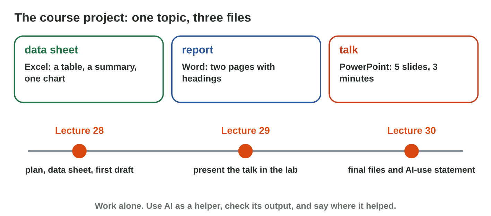
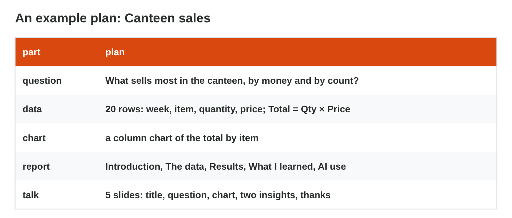
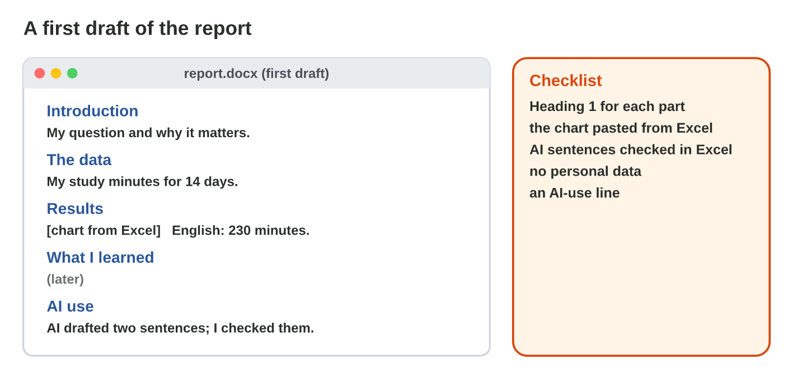

This page is the interactive version of Lecture 28. No new ideas: you start
your course project with what you learned in Lectures 6–26. In class, the
teacher first recalls the main ideas with the slides. Then you do the
**worksheet (PDF)**: three experiments, each with Part A on your own
project in the apps, and Part B on a simulator of this page. Each section
below shows its experiment: do each step, then tap or type its result. The
page checks it at once and tells you why.

## Before you start

- **You need:** Excel and Word, and an AI assistant that the university
  allows (for example `copilot.microsoft.com`). Save your files in your
  OneDrive: you go on with them in Lectures 29 and 30.
- **No lab computer?** Do Part B of each experiment on your phone. Do Part A
  later on any computer with Office.
- **The course project:** one topic, three files: a data sheet (Excel), a
  report (Word) and a short talk (PowerPoint). In Lecture 29 you present
  the talk; in Lecture 30 you finish the three files.
- What you type in the table of results stays in this browser only.

{width=100%}

**Choose one topic.** **Topic B · My study week:** your own study minutes
for two weeks, every day (at least 14 rows: Day, Subject, Minutes). Only
your own data. **Topic A · Canteen sales:** the canteen of Sunrise Company
sold these items in four weeks. Copy the list into a new Excel workbook,
starting in cell A1:

| Week | Item     | Qty | Price (JD) |
|:----:|----------|----:|-----------:|
| 1    | Tea      | 40  | 0.5        |
| 1    | Coffee   | 30  | 1          |
| 1    | Water    | 20  | 0.25       |
| 1    | Sandwich | 24  | 1.5        |
| 1    | Cake     | 10  | 1          |
| 2    | Tea      | 36  | 0.5        |
| 2    | Coffee   | 34  | 1          |
| 2    | Water    | 28  | 0.25       |
| 2    | Sandwich | 20  | 1.5        |
| 2    | Cake     | 12  | 1          |
| 3    | Tea      | 44  | 0.5        |
| 3    | Coffee   | 28  | 1          |
| 3    | Water    | 32  | 0.25       |
| 3    | Sandwich | 26  | 1.5        |
| 3    | Cake     | 8   | 1          |
| 4    | Tea      | 30  | 0.5        |
| 4    | Coffee   | 36  | 1          |
| 4    | Water    | 40  | 0.25       |
| 4    | Sandwich | 22  | 1.5        |
| 4    | Cake     | 14  | 1          |

{width=100%}

## Recall

- **A clear question** that your data can answer, and no personal data of
  other people (Lectures 21, 25 and 26).
- **The data sheet:** a table with a total row, a formula, a PivotTable and
  one chart with a title (Lectures 11, 25 and 26).
- **The report:** Heading 1 for each part, the chart pasted from Excel, and
  every AI number checked (Lectures 6, 7, 9 and 25).

## 28.1 A question and a plan

- Choose **one topic**: *Canteen sales* (the data is above) or *My study
  week* (your own study minutes for two weeks).
- Write **one clear question** that your data can answer.
- **No personal data:** no names, phone numbers or marks of other people.
- Plan the five parts: the question, the data, the chart, the report
  headings and the slides.

{width=100%}





::: {.callout-tip title="Try it 1 · A good plan"}
Use Plan Checker. Choose the right answer.

::: {.match extra="Is the canteen good?|20 slides full of text"}
a clear project question
:   What sells most in the canteen, by money and by count?

    Why: It is clear, and the canteen data can answer it.

data you must never collect
:   names and phone numbers of buyers

    Why: Personal data of other people stays out of your project.

the chart for the total by item
:   a column chart

    Why: Columns compare the totals of the items.

the talk
:   5 slides: few words and one chart

    Why: A talk of about three minutes has five clear slides.
:::
:::

## 28.2 The data sheet

- Type the data into Excel, one row for each record, and make it a
  **table** (Ctrl + T) with a total row.
- Add a column with a **formula**, for example `Total = Qty × Price`.
- Summarize it with a **PivotTable** (Lectures 25 and 26), and make **one
  chart** with a title.





::: {.callout-tip title="Try it 2 · The data sheet"}
Use Pivot Lab. Choose the right answer.

::: {.match extra="a pie with 20 slices|Ctrl + P"}
make a list a table
:   Ctrl + T

    Why: Ctrl + T makes the list an Excel table.

the total of each item in one table
:   a PivotTable with Rows Item

    Why: It gives one row per item, with the sum of its totals.

Total for 24 cups at 0.5 JD
:   12 JD

    Why: 24 × 0.5 = 12 JD.

compare the items
:   a column chart

    Why: Columns compare the items side by side.
:::
:::

## 28.3 The first draft of the report

- In Word, write the **headings** first (Heading 1): Introduction, The
  data, Results, What I learned, AI use.
- Copy your chart in Excel and paste it into Word (Paste Options, Lecture
  6).
- AI can draft sentences; **check every number** in your data sheet and
  write the text in your own words.

{width=100%}





::: {.callout-tip title="Try it 3 · The first draft"}
Choose the right answer.

::: {.match extra="one long paragraph|a screenshot"}
how a part of the report starts
:   a Heading 1

    Why: Each part of the report starts with a Heading 1.

how the chart goes into Word
:   copy it in Excel, paste it in Word

    Why: The chart comes from your data sheet, not from a drawing.

an AI sentence with a number
:   check it in the data sheet

    Why: An AI number can be wrong.

where AI helped
:   the AI-use statement

    Why: It says honestly where AI helped.
:::
:::

## Table of results



## Wrap-up {.summary}

- You can write a clear project question that your data can answer, and a
  plan in five lines.
- You can build a data sheet: a table with a total row, a formula, a
  PivotTable and one chart.
- You can write the first draft of a report with headings, your chart and
  checked AI sentences.
