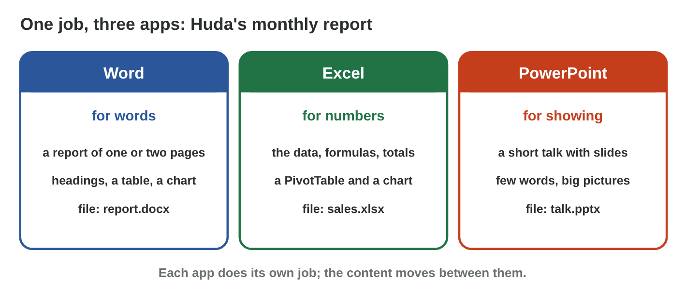
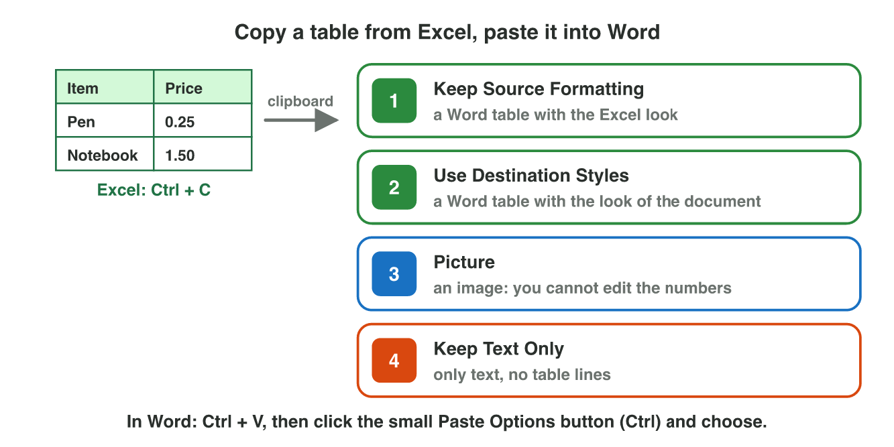
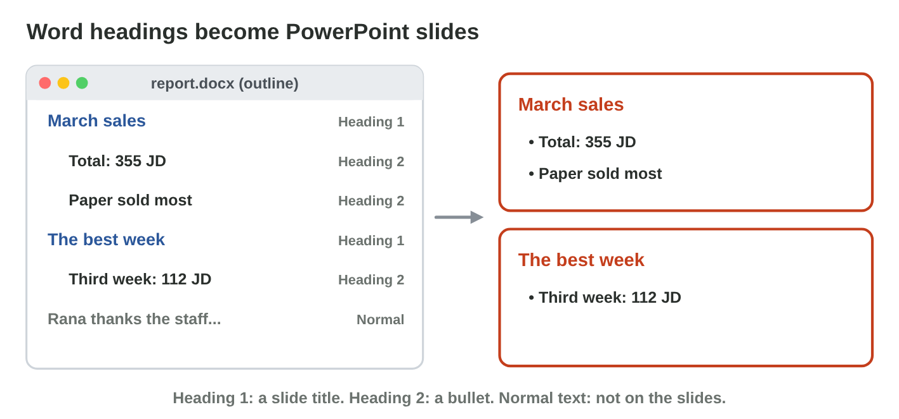

This page is the interactive version of Practice 7. No new ideas: you
practise Lectures 6, 7, 11 and 15. In class, the teacher first recalls the
main ideas with the slides. Then you do the **worksheet (PDF)**: two
experiments, each with Part A in Excel, Word, PowerPoint and an AI
assistant, and Part B on a simulator of this page. Each section below
shows its experiment: do each step, then tap, sort or type its result. The
page checks it at once and tells you why.

## Before you start

- **You need:** Excel, Word and PowerPoint (the desktop apps: Slides from
  Outline is in the desktop app of PowerPoint) and an AI assistant that the
  university allows (for example `copilot.microsoft.com`).
- **No lab computer?** Do Part B of each experiment on your phone. Do Part A
  later on any computer with Office.
- What you type in the table of results stays in this browser only.

{width=100%}

## Recall

- **Lecture 11:** Excel makes the numbers: a SUM formula, a summary table
  and a chart.
- **Lecture 7:** the styles Heading 1 and Heading 2 make the headings of a
  Word report.
- **Lecture 15:** a slide has one idea and 3–5 short points; the details go
  in the notes.

{width=100%}

::: {.callout-tip title="Try it 1 · Recall"}
Choose the right answer.

::: {.match extra="with a phone calculator|20 points"}
Huda needs the total of 24 sales for the report. Where does she make it?
:   in Excel, with a SUM formula

    Why: Excel adds exactly, and the formula is easy to check.

Which style does a main heading of the report get?
:   Heading 1

    Why: Heading 1 is for the main headings; Heading 2 for smaller ones.

How many points should a slide have?
:   3 to 5 short points

    Why: One idea and a few short points; you say the rest.
:::
:::

## P7.1 From Excel to Word

Huda's summary of March is in Excel: Paper 206 JD, Drinks 71 JD, Bags 78
JD. She needs the table, its total and a chart in her Word report, in the
look of the report. The four Paste Options are in Lecture 6.

{width=100%}





::: {.callout-tip title="Try it 2 · Paste Options"}
Choose the right answer.

::: {.match extra="Keep Text Only|Save As"}
Which paste option gives a Word table in the look of your report?
:   Use Destination Styles

    Why: It takes the styles of the Word document, and it stays a table.

Nobody may change the numbers by mistake. Which paste option do you use?
:   Picture

    Why: A picture is an image: nobody can edit the numbers in it.

Bags change from 78 to 98 JD in Excel. Does the pasted Word table change by itself?
:   no: paste it again or change it

    Why: A normal paste is a copy; it does not follow Excel.
:::
:::

## P7.2 From the report to slides, with AI help

Huda needs three slides for the Monday meeting from her report. PowerPoint
can make the slides from the report's headings: a **Heading 1** line
becomes a slide title, a **Heading 2** line becomes a bullet, and Normal
text stays out.

{width=100%}





::: {.callout-tip title="Try it 3 · Slides from the report"}
Use Heading Slides. Choose the right answer.

::: {.match extra="a picture|a new file"}
What does a Heading 1 line become with Slides from Outline?
:   a slide title

    Why: Each Heading 1 starts a new slide.

What does a Normal line become?
:   nothing on the slides

    Why: Only the heading styles go to the slides.

The AI writes "The best week was the second week." The report says the third week, 112 JD. What do you do?
:   correct it before you use it

    Why: Every AI number is checked against the data.
:::
:::

## Table of results



## Wrap-up {.summary}

- You can move a table and a chart from Excel into a Word report in the
  report's look.
- You can make slides from the headings of a report, and check an AI
  sentence before it goes on a slide.
