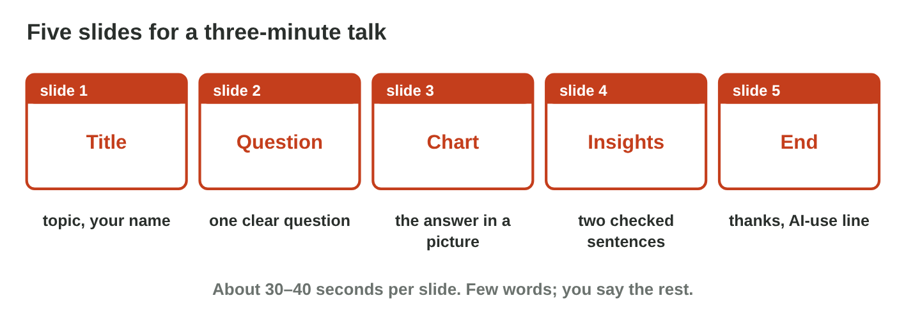
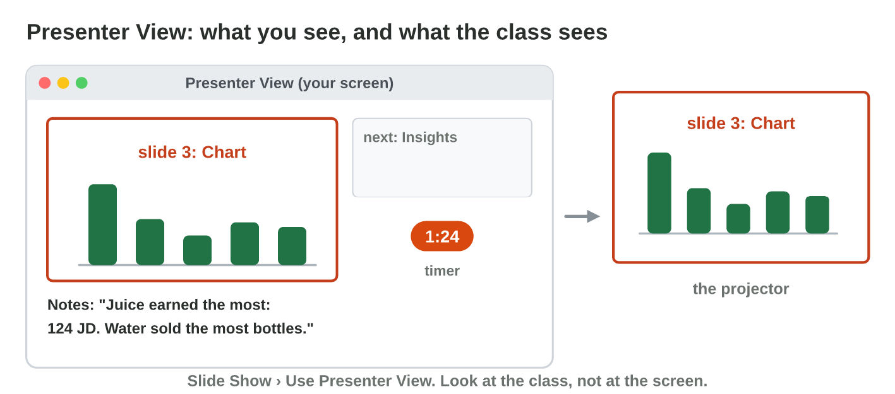

This page is the interactive version of Practice 9. No new ideas: you make
the talk of your course project with what you learned in Lectures 6–20,
and you present it.
In class, the teacher first recalls the main ideas with the slides. Then
you do the **worksheet (PDF)**: two experiments, each with Part A on your
own talk in PowerPoint, and Part B on a simulator of this page. Each
section below shows its experiment: do each step, then tap, sort or type
its result. The page checks it at once and tells you why.

## Before you start

- **You need:** PowerPoint (the desktop app works best for Presenter View),
  your files `project.xlsx` and `report.docx` from Practice 8, and an AI
  assistant that the university allows.
- **No lab computer?** Do Part B of each experiment on your phone. Do Part A
  later on any computer with PowerPoint.
- What you type in the table of results stays in this browser only.

{width=100%}

## Recall

- A slide has one idea and a few words; the details go in the speaker
  notes. Presenter View shows you the notes and a timer (Lectures 15 and
  16).
- An AI outline can become slides (Lecture 16); every number and every
  claim is checked with your data (Lectures 17 and 19).
- An AI-use statement says where AI helped and how you checked it
  (Lecture 17).

::: {.callout-tip title="Try it 1 · Recall"}
Choose the right answer.

::: {.match extra="the whole report|a theme"}
Where do the details of a slide go?
:   in the speaker notes

    Why: the slide keeps a few words; you say the rest.

What does Presenter View show you that the class does not see?
:   your notes, the next slide and a timer

    Why: the class sees only the slide.

An AI tool wrote the first outline. What does the last slide say?
:   where AI helped and how you checked it

    Why: an AI-use statement keeps your work honest.
:::
:::

## P9.1 Five slides and four checks

Sami presents his canteen project: which items earn the most. His five
slides are the title, the question, the chart, the insights and the end.
To make them fast, he gives the five titles of his report the style
Heading 1 and uses **Home › New Slide › Slides from Outline**, or he asks an
AI tool for an outline of five slides. He pastes his chart from Excel on
slide 3. Then he checks every slide four times: **accuracy** (the numbers
are as in Excel), **claims** (the data shows each sentence), **pictures**
(they fit the topic and are fair) and **honesty** (the end says where AI
helped).

{width=100%}





::: {.callout-tip title="Try it 2 · Four checks"}
Choose the check that fails.

::: {.match extra="the theme|the font"}
A slide says 320 minutes, and Excel says 230 minutes. Which check fails?
:   accuracy

    Why: the number on the slide is not the number in Excel.

A slide says "Everyone loves sandwiches." Which check fails?
:   claims

    Why: the data shows sales, not what everyone loves.

An AI tool wrote the outline, and no slide says so. Which check fails?
:   honesty

    Why: the end of the talk must say where AI helped.
:::
:::

## P9.2 Rehearse and present

A talk of three minutes gives each of the five slides about 30–40 seconds.
Sami writes short speaker notes, not a text to read. He rehearses once with
a timer in Presenter View before his turn. Then he looks at the class,
speaks slowly and ends with his main insight.

{width=100%}





::: {.callout-tip title="Try it 3 · The talk"}
Choose the best thing to do.

::: {.match extra="present it anyway|speak very fast"}
The rehearsal takes 4 minutes, but the talk has 3. What do you do?
:   cut one sentence on each slide

    Why: the chart and the numbers stay; the extra words go.

The talk is at 2:40, and two slides are left. What do you do?
:   say the main insight and finish

    Why: the main insight is the most important part.

You notice that you read every word from the slides. What do you do?
:   look at the class and use the notes

    Why: notes are short reminders, not a text to read.
:::
:::

## Table of results



## Wrap-up {.summary}

- You can make five clear slides from a report and check them with four
  checks.
- You can rehearse a three-minute talk with Presenter View and present it.
