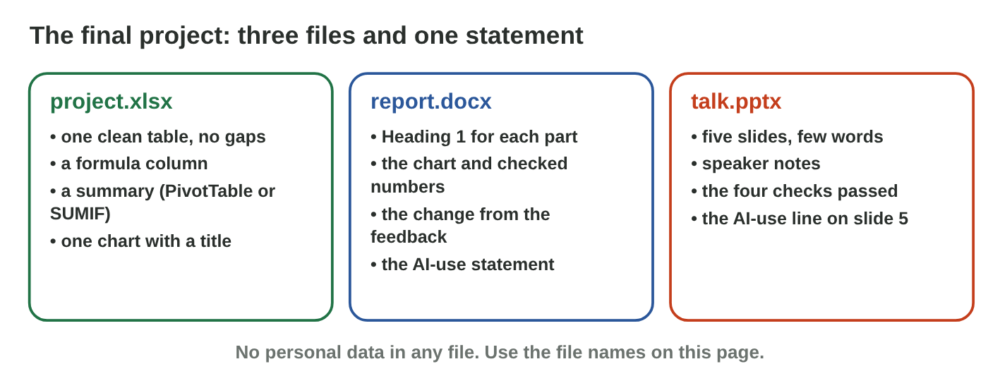

This page is the interactive version of Practice 10. No new ideas: you
finish your course project with what you learned in Lectures 6–20. In
class, the teacher first recalls the main ideas with the slides. Then you
do the **worksheet (PDF)**: three experiments, each with Part A on your
own project in the apps, and Part B on a simulator of this page. Each
section below shows its experiment: do each step, then tap its result. The
page checks it at once and tells you why.

## Before you start

- **You need:** Excel, Word and PowerPoint, your three files from Practices
  8 and 9 (`project.xlsx`, `report.docx`, `talk.pptx`), and an AI
  assistant that the university allows.
- **No lab computer?** Do Part B of each experiment on your phone. Do Part A
  later on any computer with Office.
- What you type in the table of results stays in this browser only.

{width=100%}

{width=100%}

## Recall

- **The data sheet:** a clean table, a formula, a PivotTable that you
  refresh, and one chart with a real title (Lectures 11, 13, 19 and 20).
- **The report:** five Heading 1 parts, a table of contents and page
  numbers, and every number checked against Excel (Lectures 7, 8, 9 and
  19).
- **The talk and the AI use:** the four checks on every slide, and one
  AI-use statement for the whole project (Lectures 15, 17 and 18).

## P10.1 The final data sheet

- One clean **table**: one row per record, no empty rows, the same
  spelling in each column.
- A **formula** column (for example Total = Qty × Price) and a total row.
- A **PivotTable** for the summary. After a change in the table,
  **Refresh** it.
- **One chart** that answers your question, with a title that says what it
  shows (Lecture 13: columns compare, a line shows a change over time).





::: {.callout-tip title="Try it 1 · The data sheet"}
Use Chart Lab. Choose the right answer.

::: {.match extra="Chart 1|a pie with 20 slices"}
Your question compares the money of five items. Which chart answers it?
:   a column chart

    Why: Columns compare the items side by side.

Your question asks how the sales changed in four weeks. Which chart answers it?
:   a line chart

    Why: A line shows how a value changes over time.

Which title is good for the chart of the canteen?
:   Total by item in four weeks (JD)

    Why: A good title says what the chart shows.

You corrected a number in the table. What do you do to the PivotTable?
:   Refresh it

    Why: A PivotTable does not change by itself.
:::
:::

## P10.2 The final report

- Keep the five **headings** (Heading 1): Introduction, The data, Results,
  What I learned, AI use.
- Did a number change in Excel? Copy the chart again and paste it over the
  old one. Then check every number in the text against Excel.
- Check every AI sentence: is it **true**, **shown by the data**, and in
  **your own words**?
- Add a **table of contents** after the title (References › Table of
  Contents) and **page numbers** (Insert › Page Number), as in Lecture 8.
- Under "What I learned", write one thing that you changed after your
  rehearsal or your talk in Practice 9.





::: {.callout-tip title="Try it 2 · The report"}
Use Contents Builder. Choose the right answer.

::: {.match extra="type the numbers again|paste a screenshot"}
Your report has five parts with the style Heading 1. What does the table of contents show?
:   the five headings with their page numbers

    Why: Word makes it from the heading styles and finds the pages.

You add a heading after you made the table of contents. What do you press?
:   Update Table

    Why: The table of contents does not change by itself.

An AI sentence says "I studied Maths the most." Excel says English, 230 minutes. What do you do?
:   correct it with the Excel number

    Why: Every AI sentence is checked against your data.

Where do you write what you changed after your talk?
:   under "What I learned"

    Why: This part shows what the project taught you.
:::
:::

## P10.3 The final slides and the AI-use statement

- After your changes, use the **four checks** of Practice 9 on every slide
  again: accuracy, claims, pictures, honesty.
- Keep **five slides** with speaker notes.
- Write one **AI-use statement** for the whole project: the tool, what it
  did, what you changed and how you checked it. Put it at the end of the
  report (under AI use), and a short AI-use line on slide 5.
- No personal data in any file or prompt.





::: {.callout-tip title="Try it 3 · Slides and AI use"}
Use Statement Builder. Choose the right answer.

::: {.match extra="nothing about AI|a password"}
You changed a total in Excel after the talk. Which check do you do again on the slides?
:   accuracy

    Why: Every number on a slide must be the same as in Excel.

A statement says only "AI was used." What is missing?
:   for what, what you changed and how you checked it

    Why: The four parts show which work is your own.

Where does the AI-use statement of the project go?
:   at the end of the report, and a short line on slide 5

    Why: Readers and listeners both see where AI helped.

What never goes into a file or a prompt of your project?
:   personal data of other people

    Why: Names, phone numbers and marks of others stay private.
:::
:::

## Table of results



## Wrap-up {.summary}

- You can finish a data sheet: a clean table, a refreshed PivotTable and
  the right chart with a real title.
- You can finish a report with a table of contents, page numbers and
  checked numbers.
- You can check your final slides again, and write one honest AI-use
  statement for the whole project.
