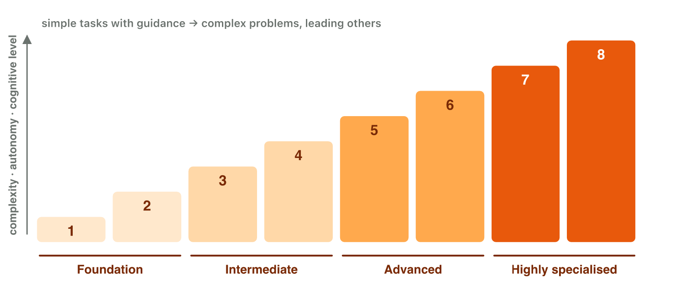

## Keywords



## Think · A job without a computer?

Name one job today that needs **no digital skills at all**.

::: {.answer}
Very hard to find: almost every job now uses a screen.
:::

## 1.1 Skills, literacy, competence

:::: {.columns}
::: {.column width="38%"}
- skills: use the tools
- literacy: + understanding
- competence: + knowledge, attitudes
- basic · intermediate · advanced
- **Lab task:** your digital week
:::
::: {.column width="62%"}

:::
::::

## Try it 1 · Which term, which level?

a) a chart of test results in a spreadsheet
b) programming a game server
c) types fast, shares the password?

::: {.answer}
a) intermediate
b) advanced
c) skills, not competence
:::

## 1.2 DigComp 2.2: five areas

:::: {.columns}
::: {.column width="38%"}
- 1 information and data
- 2 communication
- 3 content creation
- 4 safety · 5 problem solving
- **Lab task:** your DigComp profile
:::
::: {.column width="62%"}

:::
::::

## Eight proficiency levels

:::: {.columns}
::: {.column width="38%"}
- foundation 1–2
- intermediate 3–4
- advanced 5–6
- highly specialised 7–8
:::
::: {.column width="62%"}

:::
::::

## Live demo · DigComp self-check



## Example · Tasks in DigComp

::: {.reveal}
1. is this forum post reliable? → **information**
2. polite team chat → **communication**
3. licence of a free sound → **content creation**
4. "I cannot make a chart yet" → **problem solving**
:::

## Try it 2 · Place it in DigComp

a) a screen lock on your phone
b) polite messages in the team chat
c) a group that helps others?

::: {.answer}
a) safety
b) communication and collaboration
c) advanced
:::

## 1.3 The labour market

:::: {.columns}
::: {.column width="38%"}
- work is digital
- automation of routine tasks
- **lifelong learning**
- **Lab task:** a real job advertisement
:::
::: {.column width="62%"}

:::
::::

## Try it 3 · Skills at work

a) EU target: adults with basic skills?
b) learning new tools all your working life?
c) "handle player data responsibly": area?

::: {.answer}
a) 80 %
b) lifelong learning
c) safety
:::

## Game challenge · Hiring at Pixel Harbor



## Try it 4 · Read the candidates (harder)

tester: bug reports in a shared tracker · marketing assistant: short videos · everyone: a code on the phone

a) bug reports in a tracker
b) short social-media videos
c) trains colleagues in a new tool

::: {.answer}
a) communication and collaboration
b) digital content creation
c) advanced
:::

## Summary

- skills ⊂ literacy ⊂ competence
- DigComp: 5 areas · 4 level groups
- programming = 1 of 21
- automation → lifelong learning
- start with your own gaps
