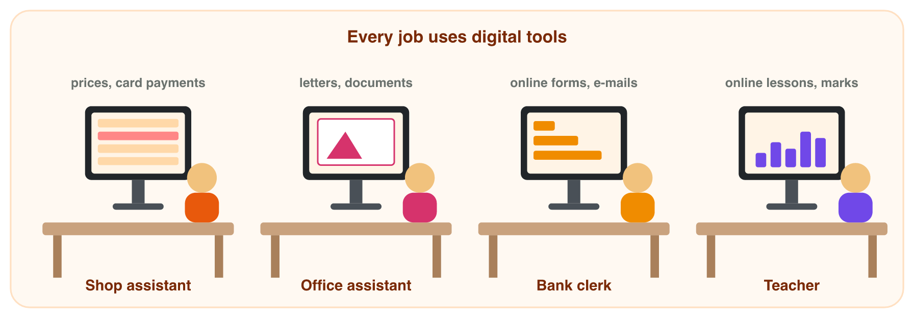

## Keywords



## 1.1 Skills, literacy, competence

:::: {.columns}
::: {.column width="50%"}
- **Skills:** what you can do, like sending an e-mail.
- **Literacy:** you also check if information is true.
- **Competence:** you also use the tools safely.
- **Lab task:** Write five things you did on a computer this week. Which level is each one?
:::
::: {.column width="50%"}

:::
::::

## Try it 1 · Which word, which level?

The levels are basic, intermediate and advanced.

a) Which level is sending an e-mail?
b) Which level is making a chart in a spreadsheet at work?
c) Ahmad types fast but gives his password to friends. Does he have skills or competence?

::: {.answer}
a) basic
b) intermediate
c) skills, but not competence
:::

## 1.2 DigComp: five areas

:::: {.columns}
::: {.column width="50%"}
- DigComp is a European list of digital skills.
- It has five areas: information, communication, content, safety, problem solving.
- Programming is only one small part of it.
- **Lab task:** Do the DigComp self-check. Which area is your strongest?
:::
::: {.column width="50%"}

:::
::::

## Four groups of levels

:::: {.columns}
::: {.column width="50%"}
- **Foundation:** you do simple tasks with help.
- **Intermediate:** you do normal tasks alone.
- **Advanced:** you help other people.
- **Highly specialised:** you lead other people.
:::
::: {.column width="50%"}

:::
::::

## Live demo · DigComp self-check



## Example · Daily tasks in DigComp

Here are four tasks from daily life.
**In which DigComp area is each task?**

::: {.reveal}
1. You check if a message about free phones is true: **information**.
2. You send a polite note to your teacher: **communication**.
3. You make a birthday card with a photo: **content creation**.
4. You learn to make a chart from an online lesson: **problem solving**.
:::

## Try it 2 · Which DigComp area?

a) You use a screen lock on your phone. Which area is this?
b) You send your homework to your teacher with a polite note. Which area is this?
c) A person teaches other workers a new app. Which group of levels is this?

::: {.answer}
a) safety
b) communication and collaboration
c) advanced
:::

## 1.3 Every job needs digital skills

:::: {.columns}
::: {.column width="50%"}
- Shops, banks, schools and offices all use computers.
- Computers do simple tasks; people use and check them.
- Apps change, so we keep learning (**lifelong learning**).
- **Lab task:** Find a real job advert in your field. Which DigComp areas does it ask for?
:::
::: {.column width="50%"}

:::
::::

## Try it 3 · Skills at work

a) What do we call learning new skills during your whole working life?
b) A job advert asks for "a visitor list in a spreadsheet". Which area is this?
c) A job advert asks to "keep customer data private". Which area is this?

::: {.answer}
a) lifelong learning
b) information and data
c) safety
:::

## Game challenge · Sunrise Company



## Try it 4 · Read the people (harder)

The facts: the office assistant answers e-mails from customers. The sales assistant makes short videos about new products.

a) In which DigComp area is answering e-mails from customers?
b) In which area is making short videos?
c) A person can send a file only with help. Which group of levels is this?

::: {.answer}
a) communication and collaboration
b) digital content creation
c) foundation
:::

## Summary

- Skills, literacy and competence: each one is bigger than the one before.
- DigComp has five areas and four groups of levels.
- Programming is only one small part of digital skills.
- Every job is digital, so workers keep learning.
