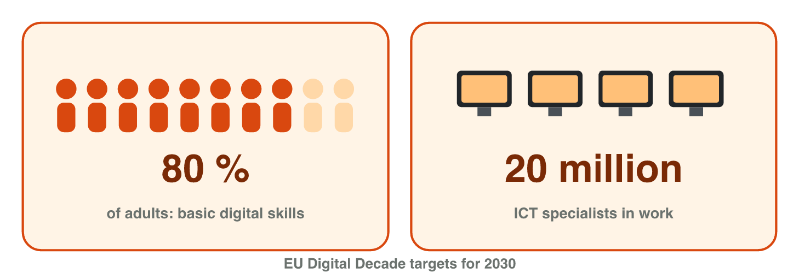

## Keywords



## Think · A job without a computer?

Name one job today that needs **no digital skills at all**.

::: {.answer}
Very hard to find — almost every job now involves a screen.
:::

## 1.1 Skills, literacy, competence

:::: {.columns}
::: {.column width="38%"}
- skills: use the tools
- literacy: + judgement
- competence: + knowledge, attitudes
- basic · intermediate · advanced
:::
::: {.column width="62%"}

:::
::::

## Try it 1 · Which term, which level?

a) evaluate information critically
b) spreadsheet analysis at work
c) programming a game

::: {.answer}
a) digital literacy
b) intermediate level
c) advanced level
:::

## 1.2 DigComp 2.2: five areas

## Eight proficiency levels

:::: {.columns}
::: {.column width="38%"}
- foundation 1–2
- intermediate 3–4
- advanced 5–6
- highly specialised 7–8
:::
::: {.column width="62%"}

:::
::::

## Example · Tasks in DigComp

::: {.reveal}
1. is this forum post reliable? → **1.2** evaluating
2. polite team chat → **2.5** netiquette
3. licence of a free sound → **3.3** copyright
4. "I can't build a PivotTable yet" → **5.4** gaps
:::

## Try it 2 · Place it in DigComp

a) licence of a sound effect
b) security updates
c) band of levels 5–6?

::: {.answer}
a) 3.3 copyright and licences
b) 4.1 protecting devices
c) advanced
:::

## 1.3 The labour market

:::: {.columns}
::: {.column width="38%"}
- digitalisation of work
- automation of routine tasks
- **lifelong learning**
:::
::: {.column width="62%"}

:::
::::

## Try it 3 · Skills at work

a) EU target: basic skills?
b) learning tools all career long?
c) automation takes over…?

::: {.answer}
a) 80 %
b) lifelong learning
c) routine tasks
:::

## Game challenge · Hiring at Pixel Harbor

:::: {.columns}
::: {.column width="38%"}
- QA tester · marketing assistant
- two-factor authentication
- skills described with DigComp
:::
::: {.column width="62%"}

:::
::::

## Try it 4 · Read the candidates (harder)

a) bug reports in a tracker
b) short social-media videos
c) trains colleagues in a new tool

::: {.answer}
a) communication and collaboration
b) digital content creation
c) advanced
:::

## Live demo · Lab task: your DigComp profile



## Summary

- skills ⊂ literacy ⊂ competence
- DigComp: 5 areas · 21 competences · 8 levels
- programming = 1 of 21
- automation → lifelong learning
- start with your own gaps
