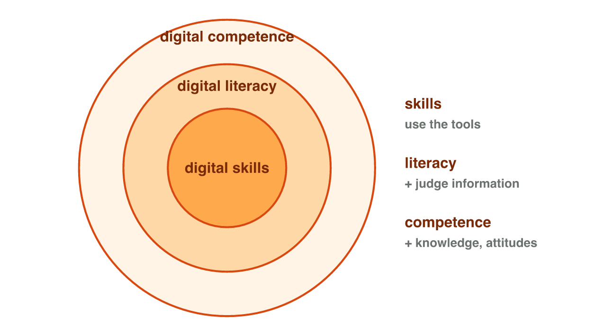
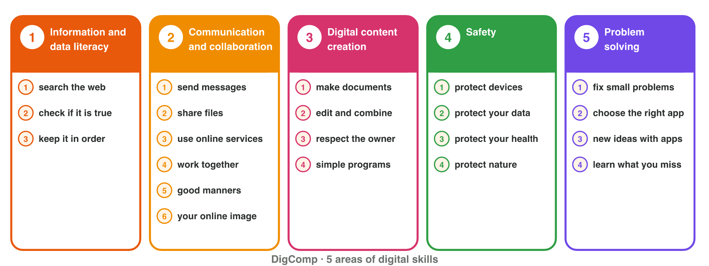
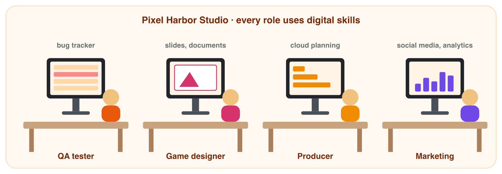

This page is the interactive version of the lesson notes (PDF). Each section
starts with a situation at work. Then it explains the idea behind it. It ends
with a **Lab task** on the lab computer and one set of questions. The full
explanations, examples and exercises are in the notes.

## Key terms



## 1.1 Digital skills, digital literacy and digital competence

- **Digital skills**: practical abilities (format a document, share a folder).
- **Digital literacy**: + understanding (find, check and share information
  safely).
- **Digital competence**: the biggest: knowledge + skills + attitudes, used
  with confidence and responsibility.
- Three levels: **basic** (everyday apps), **intermediate** (special apps at
  work), **advanced** (create and manage technology).
- Most jobs need basic and intermediate skills in many tools.

{width=66%}

::: {.callout-note title="Lab task · Your digital week"}
Write five things you did on a computer or phone this week. Next to each one,
write its level: basic, intermediate or advanced.
:::

::: {.callout-tip title="Try it 1 · Which term, which level?"}
Choose the right answer. You can use an answer more than once.

::: {.match extra="digital literacy"}
A student types fast, but shares the account password with friends. What do they have?
:   digital skills, not competence

Sending an e-mail and filling in an online form.
:   basic

Making a chart of test results in a spreadsheet.
:   intermediate

Programming a game server.
:   advanced

Knowledge + skills + attitudes, used with responsibility.
:   digital competence
:::
:::

## 1.2 The DigComp framework

- **DigComp 2.2** (European Commission, 2022): 5 **competence areas**, 21
  competences.
- The areas: 1 information and data, 2 communication and collaboration,
  3 content creation, 4 safety, 5 problem solving.
- Eight **proficiency levels** in four groups: foundation (with help),
  intermediate (alone), advanced (helps others), highly specialised (leads).
- Programming is only **one** of the 21 competences.
- Employers, universities and the European CV use DigComp.

{width=96%}



::: {.callout-note title="Lab task · Your DigComp profile"}
Do the **DigComp self-check** above honestly. Your answers stay in this
browser only. Find your strongest and your weakest area. Save your profile as
a PDF for the next lab session, and write one learning goal.
:::

::: {.callout-tip title="Try it 2 · Place it in DigComp"}
Choose the DigComp area.

::: {.match extra="programming only"}
Checking if a forum post about a new phone is reliable.
:   information and data literacy

Writing polite, clear messages in the team chat.
:   communication and collaboration

Checking the licence of a free sound effect for a trailer.
:   digital content creation

Setting a screen lock on your phone.
:   safety

Noticing that you cannot make a chart yet, and taking a course.
:   problem solving
:::
:::

## 1.3 Digital skills and the labour market

- The **labour market**: workers offer skills, employers look for skills.
- Work is digital in almost every job.
- Automation does routine tasks, so people must use and check the tools.
- EU targets for 2030: 80 % of adults with basic digital skills; 20 million ICT
  workers.
- Tools change, so employers want **lifelong learning**.
- In a game studio, every role needs digital skills, not only programmers.

{width=92%}

::: {.callout-note title="Lab task · A real job advertisement"}
On a job website, find one real advertisement for a job in games, design,
media or marketing. Copy four requirements into a document, and write the
DigComp area of each one. Which requirement is your biggest gap? Save the
document as `job-advert_digcomp.docx`.
:::

::: {.callout-tip title="Try it 3 · Skills at work"}
Choose the right answer.

::: {.match extra="fewer digital skills|one program for life"}
Software takes over routine tasks. What do workers need now?
:   to use and check the tools

The habit of learning new tools during the whole working life.
:   lifelong learning

The EU target for adults with basic digital skills by 2030.
:   80 %

A job advert asks for "weekly reports in spreadsheets". Which area?
:   information and data literacy

A job advert asks to "handle player data responsibly". Which area?
:   safety
:::
:::

## Game challenge: hiring at Pixel Harbor {.challenge}

Work alone. Use every section of today.

**Pixel Harbor** is a mobile-game studio of eight people, who work partly from
home. It is hiring a junior game tester and a junior marketing assistant. The
tester will write bug reports in a shared tracker. The marketing assistant
will make short videos for social media. Every employee must sign in with a
code on the phone. Candidates describe their skills with DigComp areas and
levels.

::: {.callout-tip title="Try it 4 · Read the candidates (harder)"}
Choose the DigComp area or the proficiency group.

::: {.match extra="problem solving|highly specialised"}
Bug reports in a shared tracker.
:   communication and collaboration

Short videos for social media.
:   digital content creation

A code on the phone for every employee.
:   safety

A candidate who can share a file only with help.
:   foundation

A candidate who trains colleagues in a new tool.
:   advanced
:::
:::

## Summary {.summary}

- Skills ⊂ literacy ⊂ competence (knowledge, skills, attitudes).
- Levels: basic, intermediate, advanced.
- DigComp 2.2: 5 areas, 21 competences, 8 levels in 4 groups.
- Programming is one competence of 21.
- Digital work, automation and targets put digital skills at the centre of the labour market.
- Lifelong learning starts with finding your own gaps.
