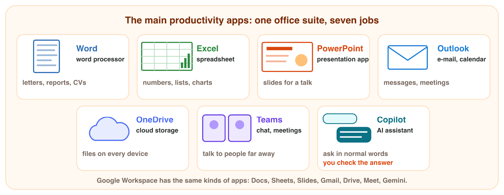
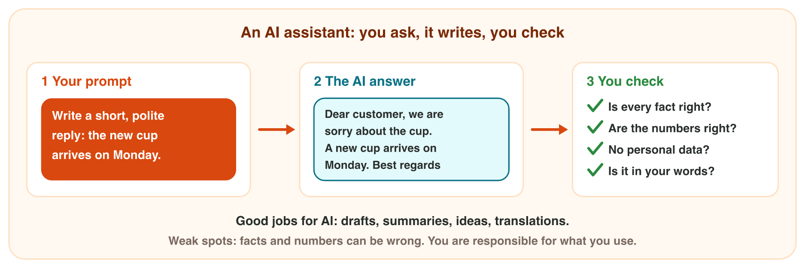

This page is the interactive version of the lesson. In class you follow the
**worksheet (PDF)**: three experiments on the computer. Each section of this
page explains one idea, then shows its experiment: do each step, write your
result in its box, then open "Check your result". Every question on this
page has its answer: try first, then check.

## Key terms



## Before you start

- **You need:** a lab computer with Excel, a browser, your university
  account, and your phone (its stopwatch).
- **Start file:** download it, then open it. Every student works with the
  same data.



- What you type in the boxes stays in this browser only.

{width=100%}

## 1.1 Why every job needs digital skills

- Job adverts ask for "Excel and e-mail", "Microsoft Office", "AI tools".
- **Digital skills:** what you can do with a computer, a phone and apps.
- **Productivity:** you finish more useful work in less time.
- The computer does the simple, repeated work. You plan and check.
- Example: 8 prices (12, 25, 8, 40, 15, 30, 5, 20 JD). By hand: about 30
  seconds. With **AutoSum** in a spreadsheet: 155 JD at once. One price
  changes from 8 to 18: the spreadsheet shows 165 JD by itself.

{width=92%}





::: {.callout-tip title="Try it 1 · Skills and time"}
Choose the right answer. You can use an answer more than once.

::: {.match extra="the manager|Word"}
What is the name for "more useful work in less time"?
:   productivity

    Why: Productivity means more useful work in less time.

Sending a file by e-mail. What is it?
:   a digital skill

    Why: It is something you do with a computer and an app.

The computer does the simple, repeated work. Who checks the result?
:   you

    Why: The computer does the work; you plan it and check it.

One of the 8 prices changes. Which tool shows the new total by itself?
:   a spreadsheet

    Why: A spreadsheet adds the numbers again when one changes.

The total of 8 prices is 155 JD. The price 8 becomes 18. What is the new total?
:   165 JD

    Why: The price grows by 10, so the total grows by 10.
:::
:::

## 1.2 The main productivity apps

- An **office suite** is a set of apps that work together.
- **Microsoft 365** is the most common one. Google Workspace has the same
  kinds of apps.
- Each app has one main job:

| App | Kind of app | Main job |
|---|---|---|
| Word | word processor | letters, reports, CVs |
| Excel | spreadsheet | numbers, lists, totals, charts |
| PowerPoint | presentation app | slides for a talk |
| Outlook | e-mail and calendar | messages, meetings |
| OneDrive | cloud storage | your files on every device |
| Teams | chat and online meetings | talk to people far away |
| Copilot | AI assistant | ask in normal words |

{width=100%}



::: {.callout-warning title="Watch out!"}
Numbers in a Word table do not add up by themselves. Use Excel for numbers.
:::



::: {.callout-tip title="Try it 2 · Which app?"}
Choose the app. You can use an answer more than once.

::: {.match extra="Teams"}
Which app do you use for a CV?
:   Word

    Why: A CV is text on a page: Word is the word processor.

Which app do you use for a chart of the sales of each month?
:   Excel

    Why: Excel is for numbers, totals and charts.

Which app do you use for slides for your talk in class?
:   PowerPoint

    Why: PowerPoint makes the slides for a talk.

Which app keeps your files safe and opens them on your phone?
:   OneDrive

    Why: OneDrive is cloud storage: your files on every device.

Which app do you use to send a file and set a meeting for Tuesday?
:   Outlook

    Why: Outlook has e-mail and a calendar.
:::
:::

## 1.3 AI assistants: a new kind of app

- An **AI assistant** is an app that you ask in normal words: Microsoft
  Copilot, ChatGPT, Gemini.
- It uses **generative AI**: it makes new text or pictures.
- Your request is a **prompt**.
- Good jobs for AI: first drafts, summaries, ideas, short translations.
- Weak spots: AI can write wrong facts and numbers, and it sounds sure.
- **The AI rule of this course:** use AI for drafts and ideas. Check every
  fact and number. Never type personal data (ID number, card number, phone
  number) into an AI tool.

{width=100%}





::: {.callout-tip title="Try it 3 · Good job for AI?"}
Choose the right answer. You can use an answer more than once.

::: {.match extra="the AI is always right"}
What do we call the request that you type to an AI assistant?
:   a prompt

    Why: A prompt is your request to the AI, in normal words.

"Sum up this long e-mail in 3 points." Is it a good job for AI?
:   yes, then read it

    Why: Summaries are a good job for AI, but you still read the answer.

"When did our small company open its first shop?" What must you do with the answer?
:   check the facts

    Why: The AI does not know a small company; it may invent a date.

"Fill in this form. My ID number is 9981234567." What should you do?
:   do not send it

    Why: An ID number is personal data: never type it into an AI tool.

The AI says that 15% of 240 is 32. What must you do?
:   check the facts

    Why: AI can write wrong numbers: 15% of 240 is 36.

Who is responsible for the text that you use from an AI?
:   you

    Why: The AI only writes a draft; you check it and you use it.
:::
:::

## Table of results



## Game challenge: Monday at Sunrise Company {.challenge}

Work alone. Use every section of today.

Mona works from 9:00 to 11:00 on six jobs. With the right apps and no AI,
the jobs take 120 minutes: she finishes at 11:00. AI can make three jobs
faster: the e-mails (20 → 10 minutes), the slides (30 → 20) and the report
(40 → 25). Then she finishes at 10:25.

The six jobs: reply to 3 customer e-mails; add up the 30 sales of the week;
make 5 slides about new products; write a one-page report; clean the
customer list (names and phone numbers); share the report with the manager.



::: {.callout-tip title="Try it 4 · Mona's Monday (harder)"}
Mona's six jobs, 9:00 to 11:00: 3 customer e-mails, the 30 sales of the
week, 5 slides, a one-page report, the customer list (names and phone
numbers), sharing the report. AI saves 10 minutes on the e-mails, 10 on the
slides and 15 on the report. Choose the right answer.

::: {.match extra="Word|9:45"}
Which app for the total of the 30 sales of the week?
:   Excel

    Why: Excel adds numbers exactly; no AI is needed.

Which app for sharing the report with the manager?
:   OneDrive

    Why: OneDrive keeps the file in the cloud and shares it.

Can Mona give the customer list to an AI tool?
:   no: it has personal data

    Why: Names and phone numbers are personal data.

How many minutes does AI save Mona in all?
:   35 minutes

    Why: 10 + 10 + 15 = 35 minutes.

Without AI she finishes at 11:00. When does she finish with AI?
:   10:25

    Why: 35 minutes before 11:00 is 10:25.

AI writes the first draft of the report. What must Mona do next?
:   check every fact and number

    Why: AI can write wrong facts; Mona is responsible for the report.
:::
:::

## Summary {.summary}

- Digital skills: what you can do with a computer, a phone and apps.
- Productivity: more useful work in less time; apps do the repeated work.
- An office suite has Word, Excel, PowerPoint, Outlook, OneDrive and Teams.
- Choose the app by the job: text, numbers, slides, mail, files, meetings.
- An AI assistant writes drafts, sums up and translates from your prompt.
- Check every AI answer, and never type personal data into an AI tool.
