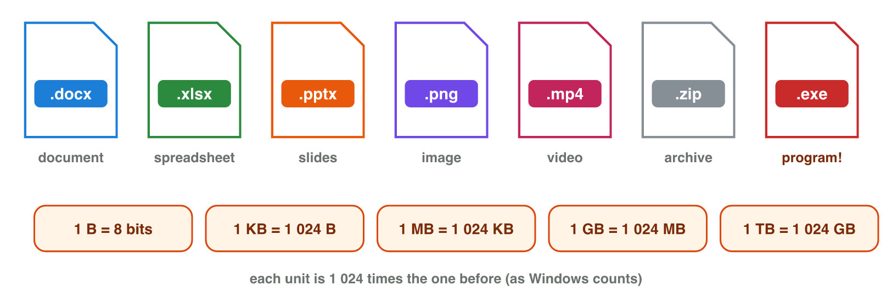

::: {.lead}
Last week Sara wrote her homework on the lab computer. Today she cannot find
it. She has three files called `homework.docx`, and she does not know which
one is the last one. Many students have this problem. In this lab session you
learn two things. First, how you sign in to the university services. Second,
where your work is saved, and how you can find it and keep it safe.
:::

## Key terms



## 2.1 Your account and single sign-on

An **account** is your place in an app or a website. It has a user name
(often an e-mail address), a password and your data.

**Authentication** means: you prove that the account is yours. There are
three kinds of proof:

- something you **know**: a password or a PIN;
- something you **have**: your phone, which gets a code;
- something you **are**: your fingerprint or your face.

The university has many services: e-mail, the e-learning platform, cloud
storage and more. You sign in only one time, and all of them open. This is
called **single sign-on (SSO)** (@fig-sso).

{#fig-sso width=84%}

Single sign-on is easy. But if someone steals your password, they can open
*every* service. So on a lab computer:

- sign out of your account at the end;
- never let the browser save your password;
- lock the screen when you leave your desk (Windows key + L).

::: {.callout-warning title="Common mistake"}
You close the browser and think you are signed out. Often you are still
signed in. Always press **Sign out** first.
:::

::: {.callout-note title="Lab task · One sign-in, many services"}
1. Sign in to your university account in the browser.
2. Open the e-mail, the e-learning platform and the cloud storage.
3. Count: how many times did you type your password?
4. At the end of the lab, sign out and lock the screen.

*Your result:* the services you opened, and the number of times you typed
your password.
:::

## 2.2 Files, folders and paths

A **file** is one saved piece of work with a name: a document, a photo, a
video. A **folder** keeps files and other folders together. Folders inside
folders make a **tree** (@fig-tree).

{#fig-tree width=86%}

::: {.callout-important title="Definition 2.1 — Path"}
The **path** of a file is its full address: all the folders from the top down
to the file. On Windows, a `\` stands between the folders. Two files can have
the same name, but never the same path.
:::

For example, this is the path of Sara's CV on the lab computer:

`C:\Users\Sara\Documents\Courses\Digital-Skills\week-01\cv.docx`

The letters after the last dot of a file name are the **file extension**. They
show the type of the file and the app that opens it (@fig-types).

{#fig-types width=92%}

| Extension | Type | App |
|---|---|---|
| `.docx`, `.pdf` | document | Word, a PDF reader |
| `.xlsx` | spreadsheet | Excel |
| `.pptx` | slides | PowerPoint |
| `.jpg`, `.png` | photo, picture | a photo app |
| `.mp3`, `.mp4` | sound, video | a media player |
| `.exe` | program | Windows itself: only from people you trust |

: Common file extensions. {#tbl-ext}

::: {.callout-warning title="Common mistake"}
Windows often hides the extension. So a dangerous program called
`invoice.pdf.exe` looks like `invoice.pdf`. Turn on **File name extensions**,
and you can see it.
:::

The size of a file is counted in **bytes**. Each unit is 1024 times the one
before: 1 KB = 1024 bytes, 1 MB = 1024 KB, 1 GB = 1024 MB. A short document
is a few KB. A photo is a few MB. A video is often hundreds of MB.

::: {.callout-note title="Example 2.1 — Can I upload my video?"}
Sara has a video of 2 GB. The e-learning platform takes files of 500 MB at
most.

1. Change GB to MB: 2 GB = 2 × 1024 MB = 2048 MB.
2. Compare: 2048 MB is more than 500 MB. The upload does not work.
3. What can Sara do? She puts the video in her cloud storage and sends a
   link.
:::



::: {.callout-note title="Lab task · Extensions, sizes and paths"}
1. Open **File Explorer**. Turn on file extensions: View → Show → File name
   extensions.
2. Open the Documents folder. Write the extension and the size of three
   files.
3. Right-click one file and choose **Copy as path**. Paste the path into a
   document.
4. Play stage 1 of **Path Finder** (above).

*Your result:* three files with extension and size, and one path.
:::

## 2.3 Good file names and folders

A file that you cannot find is lost. Use four rules for **file names**:

1. **Say what it is**: `cv`, not `New Document`.
2. **No spaces**: use `-` or `_` between the words.
3. **Write the date as year-month-day**: 2026-10-21. Then the files sort by
   date.
4. **Number the versions**: `v01`, `v02`, not `final`, `final2`.

::: {.callout-note title="Example 2.2 — Better file names"}
| Poor name | Better name |
|---|---|
| `New Document (3).docx` | `2026-10-21_cv_v01.docx` |
| `final final.pptx` | `2026-11-12_english-talk_v03.pptx` |
| `IMG_4821.jpg` | `2026-10-21_family-dinner.jpg` |

Each better name says the date, what the file is, and the version.
:::

Folders need rules, too. Make one folder for each course, and one folder for
each week in it (@fig-tree). Keep the tree short: four levels or fewer.

::: {.callout-note title="Lab task · Make your course folders"}
In your university cloud storage:

1. Make a folder `Courses`. In it, make one folder for each of your courses.
2. In `Digital-Skills`, make a folder `week-01`.
3. Put your DigComp profile from lesson 1 in `week-01`. Give it a good name,
   for example `2026-10-21_digcomp-profile_v01.pdf`.

*Your result:* the folders and the file with a good name.
:::

## 2.4 Cloud storage, sync and backup

**Cloud storage** keeps your files on the Internet, for example in OneDrive
or Google Drive. You can open them on any device after you sign in. If your
phone breaks, your files are still there.

**Synchronization (sync)** keeps the same files on all your devices. You
change a file on the lab computer, and the change appears on your phone a
moment later. But sync also copies your *mistakes* (@fig-sync-backup).

{#fig-sync-backup width=90%}

::: {.callout-important title="Definition 2.2 — Sync and backup"}
**Sync** makes all copies the same: if you delete a file in one place, it is
deleted everywhere. A **backup** is an extra copy in a *separate* place. A
mistake does not reach it.
:::

Cloud storage has a **recycle bin** and a **version history**. They keep
deleted files and old versions for some days. They help, but they are not a
real backup. A simple rule is the **3-2-1 rule**: keep **3** copies of
important work, on **2** different kinds of storage, with **1** copy in
another place.

::: {.callout-note title="Example 2.3 — A deleted folder"}
Sara keeps her class report in a synced folder. On the lab computer, she
deletes the folder by mistake.

1. Sync deletes the folder on her laptop and her phone, too.
2. The cloud recycle bin still has it for some days. She can get it back
   from there.
3. She also keeps a copy on a USB stick at home. That copy is her backup.
:::

::: {.callout-note title="Lab task · Delete and get it back"}
1. Open the file of the last task. Change one word, and rename it `v02`.
2. Delete the file.
3. Open the **recycle bin** of the cloud storage and restore the file. Is it
   back in `week-01`?

*Your result:* one sentence: how many days does your recycle bin keep files?
:::

## Further reading

Evans, Martin and Poatsy, *Technology in Action*, 18th ed., the chapters on
the Internet, cloud services and file management.

## Exercises

1. Write the three kinds of proof for an account, with one example each.
2. What is single sign-on? Write one risk.
3. Write three good habits for a lab computer.
4. Write the path of `notes.docx` in the folder `week-02` of `Digital-Skills`,
   in `Courses`, in `Documents` of the user `Ali`, on Windows.
5. Which app opens each file: `budget.xlsx`, `talk.pptx`, `song.mp3`?
6. Why is `photo.jpg.exe` dangerous?
7. A video is 3 GB. How many MB is it?
8. Give a better name to `My CV FINAL (2).docx`, made on 3 November 2026.
9. Why is sync not a backup?

## Answers to the exercises

::: {.answers}
1. Know (a password), have (a phone with a code), are (a fingerprint).
2. You sign in one time and many services open. Risk: a stolen password opens everything.
3. Sign out; do not save the password; lock the screen.
4. `C:\Users\Ali\Documents\Courses\Digital-Skills\week-02\notes.docx`.
5. Excel; PowerPoint; a media player.
6. It is a program, but it looks like a photo.
7. 3 × 1024 = 3072 MB.
8. For example `2026-11-03_cv_v01.docx`.
9. Sync copies a deletion to every device; a backup is a separate copy.
:::
